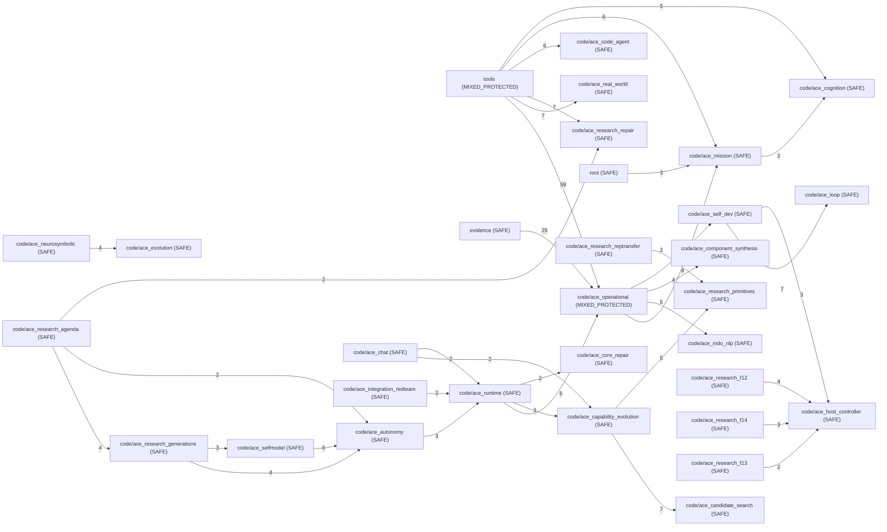

# Kartografi Repositori ACE — ACE

> Peta AST statis deterministik oleh `tools/repo_cartography.py` (`ace.repo-cartography.v1`; zero import/eksekusi `code/`).

## 1. Ringkasan Makro

- Schema: `ace.repo-cartography.v1`
- Total subsistem: **68** (termasuk `4` subsistem zona terlindung/beku)
- Total berkas terpetakan: **2174**
- Modul Python produksi: **578** | Modul tes: **389**
- Tepi dependensi lintas subsistem (produksi): **117**
- Siklus SCC lintas subsistem: **1**

## 2. Diagram Dependensi Lintas Subsistem (Top Bobot Impor)

## 3. Inventaris Subsistem & Klasifikasi Zona

| Subsistem | Zona | Berkas | Modul Prod | Modul Tes | Masuk | Keluar | Catatan |
| --- | --- | ---: | ---: | ---: | ---: | ---: | --- |
| `.ace_evolution` | `SAFE_WORKSPACE` | 44 | 14 | 0 | 0 | 0 | Wilayah kerja aman (read-only AST / build tooling) |
| `.github` | `SAFE_WORKSPACE` | 18 | 0 | 0 | 0 | 0 | Wilayah kerja aman (read-only AST / build tooling) |
| `chat_tasks` | `SAFE_WORKSPACE` | 1 | 0 | 0 | 0 | 0 | Wilayah kerja aman (read-only AST / build tooling) |
| `checkpoints` | `SAFE_WORKSPACE` | 13 | 0 | 0 | 0 | 0 | Wilayah kerja aman (read-only AST / build tooling) |
| `code/ace_abstract_interp` | `SAFE_WORKSPACE` | 5 | 3 | 2 | 0 | 0 | Wilayah kerja aman (read-only AST / build tooling) |
| `code/ace_abstraction` | `SAFE_WORKSPACE` | 3 | 2 | 1 | 0 | 1 | Wilayah kerja aman (read-only AST / build tooling) |
| `code/ace_automata` | `SAFE_WORKSPACE` | 3 | 2 | 1 | 3 | 0 | Wilayah kerja aman (read-only AST / build tooling) |
| `code/ace_autonomy` | `SAFE_WORKSPACE` | 16 | 12 | 4 | 6 | 1 | Wilayah kerja aman (read-only AST / build tooling) |
| `code/ace_candidate_search` | `SAFE_WORKSPACE` | 8 | 6 | 2 | 2 | 0 | Wilayah kerja aman (read-only AST / build tooling) |
| `code/ace_capability_evolution` | `SAFE_WORKSPACE` | 11 | 6 | 3 | 6 | 2 | Wilayah kerja aman (read-only AST / build tooling) |
| `code/ace_causal` | `SAFE_WORKSPACE` | 3 | 2 | 1 | 1 | 0 | Wilayah kerja aman (read-only AST / build tooling) |
| `code/ace_chat` | `SAFE_WORKSPACE` | 3 | 2 | 1 | 0 | 2 | Wilayah kerja aman (read-only AST / build tooling) |
| `code/ace_code_agent` | `SAFE_WORKSPACE` | 23 | 14 | 9 | 4 | 3 | Wilayah kerja aman (read-only AST / build tooling) |
| `code/ace_cognition` | `SAFE_WORKSPACE` | 9 | 6 | 3 | 3 | 3 | Wilayah kerja aman (read-only AST / build tooling) |
| `code/ace_component_synthesis` | `SAFE_WORKSPACE` | 3 | 2 | 1 | 3 | 1 | Wilayah kerja aman (read-only AST / build tooling) |
| `code/ace_conformal` | `SAFE_WORKSPACE` | 3 | 2 | 1 | 1 | 0 | Wilayah kerja aman (read-only AST / build tooling) |
| `code/ace_core_repair` | `SAFE_WORKSPACE` | 8 | 5 | 3 | 2 | 2 | Wilayah kerja aman (read-only AST / build tooling) |
| `code/ace_dsl_growth` | `SAFE_WORKSPACE` | 5 | 4 | 1 | 2 | 1 | Wilayah kerja aman (read-only AST / build tooling) |
| `code/ace_egraph` | `SAFE_WORKSPACE` | 4 | 2 | 2 | 1 | 1 | Wilayah kerja aman (read-only AST / build tooling) |
| `code/ace_epistemic` | `SAFE_WORKSPACE` | 3 | 2 | 1 | 0 | 0 | Wilayah kerja aman (read-only AST / build tooling) |
| `code/ace_evaluator` | `PROTECTED_INSTRUMENT` | 5 | 4 | 1 | 3 | 0 | Wilayah evaluator / judge (Engineer Utama saja) |
| `code/ace_evolution` | `SAFE_WORKSPACE` | 6 | 4 | 2 | 10 | 1 | Wilayah kerja aman (read-only AST / build tooling) |
| `code/ace_game_theory` | `SAFE_WORKSPACE` | 3 | 2 | 1 | 1 | 0 | Wilayah kerja aman (read-only AST / build tooling) |
| `code/ace_gnn` | `SAFE_WORKSPACE` | 3 | 2 | 1 | 0 | 1 | Wilayah kerja aman (read-only AST / build tooling) |
| `code/ace_host_controller` | `SAFE_WORKSPACE` | 18 | 14 | 4 | 5 | 0 | Wilayah kerja aman (read-only AST / build tooling) |
| `code/ace_host_exchange` | `SAFE_WORKSPACE` | 5 | 3 | 2 | 2 | 1 | Wilayah kerja aman (read-only AST / build tooling) |
| `code/ace_ilp` | `SAFE_WORKSPACE` | 3 | 2 | 1 | 0 | 0 | Wilayah kerja aman (read-only AST / build tooling) |
| `code/ace_indo_nlp` | `SAFE_WORKSPACE` | 9 | 5 | 4 | 2 | 0 | Wilayah kerja aman (read-only AST / build tooling) |
| `code/ace_integration_redteam` | `SAFE_WORKSPACE` | 3 | 2 | 1 | 1 | 6 | Wilayah kerja aman (read-only AST / build tooling) |
| `code/ace_interpolation` | `SAFE_WORKSPACE` | 3 | 2 | 1 | 1 | 0 | Wilayah kerja aman (read-only AST / build tooling) |
| `code/ace_inversion` | `SAFE_WORKSPACE` | 3 | 2 | 1 | 0 | 0 | Wilayah kerja aman (read-only AST / build tooling) |
| `code/ace_loop` | `SAFE_WORKSPACE` | 3 | 2 | 1 | 1 | 0 | Wilayah kerja aman (read-only AST / build tooling) |
| `code/ace_mcp` | `SAFE_WORKSPACE` | 7 | 4 | 3 | 0 | 4 | Wilayah kerja aman (read-only AST / build tooling) |
| `code/ace_mcts` | `SAFE_WORKSPACE` | 3 | 2 | 1 | 0 | 1 | Wilayah kerja aman (read-only AST / build tooling) |
| `code/ace_mission` | `SAFE_WORKSPACE` | 9 | 6 | 3 | 5 | 3 | Wilayah kerja aman (read-only AST / build tooling) |
| `code/ace_neurosymbolic` | `SAFE_WORKSPACE` | 9 | 5 | 4 | 0 | 2 | Wilayah kerja aman (read-only AST / build tooling) |
| `code/ace_operational` | `MIXED_PROTECTED` | 211 | 98 | 109 | 5 | 14 | Memuat instrumen/scorer/memory-write terlindung + modul lain |
| `code/ace_pac_bayes` | `SAFE_WORKSPACE` | 3 | 2 | 1 | 1 | 0 | Wilayah kerja aman (read-only AST / build tooling) |
| `code/ace_real_world` | `SAFE_WORKSPACE` | 12 | 8 | 4 | 1 | 1 | Wilayah kerja aman (read-only AST / build tooling) |
| `code/ace_red_team` | `SAFE_WORKSPACE` | 3 | 2 | 1 | 1 | 0 | Wilayah kerja aman (read-only AST / build tooling) |
| `code/ace_report` | `SAFE_WORKSPACE` | 3 | 2 | 1 | 0 | 0 | Wilayah kerja aman (read-only AST / build tooling) |
| `code/ace_research_agenda` | `SAFE_WORKSPACE` | 6 | 4 | 2 | 2 | 5 | Wilayah kerja aman (read-only AST / build tooling) |
| `code/ace_research_discovery` | `SAFE_WORKSPACE` | 10 | 9 | 1 | 1 | 2 | Wilayah kerja aman (read-only AST / build tooling) |
| `code/ace_research_f12` | `SAFE_WORKSPACE` | 7 | 6 | 1 | 1 | 2 | Wilayah kerja aman (read-only AST / build tooling) |
| `code/ace_research_f13` | `SAFE_WORKSPACE` | 7 | 6 | 1 | 1 | 1 | Wilayah kerja aman (read-only AST / build tooling) |
| `code/ace_research_f14` | `SAFE_WORKSPACE` | 10 | 9 | 1 | 1 | 1 | Wilayah kerja aman (read-only AST / build tooling) |
| `code/ace_research_generations` | `SAFE_WORKSPACE` | 12 | 10 | 2 | 3 | 4 | Wilayah kerja aman (read-only AST / build tooling) |
| `code/ace_research_hypgen` | `SAFE_WORKSPACE` | 7 | 6 | 1 | 1 | 1 | Wilayah kerja aman (read-only AST / build tooling) |
| `code/ace_research_primitives` | `SAFE_WORKSPACE` | 3 | 2 | 1 | 6 | 0 | Wilayah kerja aman (read-only AST / build tooling) |
| `code/ace_research_repair` | `SAFE_WORKSPACE` | 13 | 10 | 3 | 3 | 2 | Wilayah kerja aman (read-only AST / build tooling) |
| `code/ace_research_reptransfer` | `SAFE_WORKSPACE` | 12 | 10 | 2 | 1 | 1 | Wilayah kerja aman (read-only AST / build tooling) |
| `code/ace_runtime` | `SAFE_WORKSPACE` | 5 | 3 | 2 | 12 | 6 | Wilayah kerja aman (read-only AST / build tooling) |
| `code/ace_self_dev` | `SAFE_WORKSPACE` | 36 | 26 | 10 | 3 | 2 | Wilayah kerja aman (read-only AST / build tooling) |
| `code/ace_selfmodel` | `SAFE_WORKSPACE` | 7 | 6 | 1 | 5 | 2 | Wilayah kerja aman (read-only AST / build tooling) |
| `code/ace_smt` | `SAFE_WORKSPACE` | 3 | 2 | 1 | 1 | 0 | Wilayah kerja aman (read-only AST / build tooling) |
| `code/ace_synthesis` | `SAFE_WORKSPACE` | 3 | 2 | 1 | 1 | 1 | Wilayah kerja aman (read-only AST / build tooling) |
| `code/ace_visual_bridge` | `SAFE_WORKSPACE` | 4 | 3 | 1 | 1 | 0 | Wilayah kerja aman (read-only AST / build tooling) |
| `code/checkpoints` | `SAFE_WORKSPACE` | 3 | 0 | 0 | 0 | 0 | Wilayah kerja aman (read-only AST / build tooling) |
| `data` | `SAFE_WORKSPACE` | 1 | 0 | 0 | 0 | 0 | Wilayah kerja aman (read-only AST / build tooling) |
| `docs` | `SAFE_WORKSPACE` | 273 | 0 | 0 | 0 | 0 | Wilayah kerja aman (read-only AST / build tooling) |
| `evidence` | `SAFE_WORKSPACE` | 722 | 29 | 1 | 0 | 1 | Wilayah kerja aman (read-only AST / build tooling) |
| `examples` | `SAFE_WORKSPACE` | 5 | 0 | 0 | 0 | 0 | Wilayah kerja aman (read-only AST / build tooling) |
| `handover` | `FROZEN_CORPUS_SPEC` | 159 | 23 | 0 | 0 | 1 | Corpus beku, preregistrasi, & custody spec (read-only) |
| `projects` | `SAFE_WORKSPACE` | 12 | 3 | 2 | 0 | 1 | Wilayah kerja aman (read-only AST / build tooling) |
| `root` | `SAFE_WORKSPACE` | 20 | 4 | 0 | 0 | 5 | Wilayah kerja aman (read-only AST / build tooling) |
| `secrets` | `SAFE_WORKSPACE` | 3 | 0 | 0 | 0 | 0 | Wilayah kerja aman (read-only AST / build tooling) |
| `tests` | `SAFE_WORKSPACE` | 19 | 0 | 19 | 0 | 0 | Wilayah kerja aman (read-only AST / build tooling) |
| `tools` | `MIXED_PROTECTED` | 302 | 146 | 153 | 1 | 28 | Memuat instrumen/scorer/memory-write terlindung + modul lain |

## 4. Tepi Ketergantungan Lintas Subsistem (Semua)

| Asal | Tujuan | Bobot Impor | Contoh Target Modul |
| --- | --- | ---: | --- |
| `tools` | `code/ace_operational` | 59 | `ace_operational.abc_v3_scorer`, `ace_operational.grid_adapter`, `ace_operational.grid_generalization` |
| `evidence` | `code/ace_operational` | 25 | `ace_operational.experiment_kernel`, `ace_operational.grid_adapter`, `ace_operational.grid_generalization` |
| `code/ace_operational` | `code/ace_mission` | 8 | `ace_mission.bus`, `ace_mission.schema` |
| `code/ace_capability_evolution` | `code/ace_candidate_search` | 7 | `ace_candidate_search.model`, `ace_candidate_search.search` |
| `code/ace_self_dev` | `code/ace_loop` | 7 | `ace_loop.source_evolution` |
| `tools` | `code/ace_real_world` | 7 | `ace_real_world.data_wrangler_synth`, `ace_real_world.git_analyzer_synth`, `ace_real_world.log_parser_synth` |
| `tools` | `code/ace_research_repair` | 7 | `ace_research_repair.corpus`, `ace_research_repair.runner`, `ace_research_repair.verify` |
| `code/ace_runtime` | `code/ace_operational` | 6 | `ace_operational.autonomous_engine`, `ace_operational.autonomy_loop`, `ace_operational.language` |
| `code/ace_selfmodel` | `code/ace_autonomy` | 6 | `ace_autonomy`, `ace_autonomy.planner`, `ace_autonomy.policy` |
| `tools` | `code/ace_code_agent` | 6 | `ace_code_agent.controller`, `ace_code_agent.repo_retrieval`, `ace_code_agent.static_probe` |
| `tools` | `code/ace_mission` | 6 | `ace_mission.admission`, `ace_mission.bus`, `ace_mission.generator` |
| `code/ace_capability_evolution` | `code/ace_research_primitives` | 5 | `ace_research_primitives.primitive_discovery` |
| `code/ace_operational` | `code/ace_indo_nlp` | 5 | `ace_indo_nlp.discourse`, `ace_indo_nlp.lexicon_kb`, `ace_indo_nlp.morphology` |
| `tools` | `code/ace_cognition` | 5 | `ace_cognition.reasoning`, `ace_cognition.substrate_guardian` |
| `code/ace_neurosymbolic` | `code/ace_evolution` | 4 | `ace_evolution.island_search` |
| `code/ace_operational` | `code/ace_component_synthesis` | 4 | `ace_component_synthesis.component_synthesizer` |
| `code/ace_research_agenda` | `code/ace_research_generations` | 4 | `ace_research_generations`, `ace_research_generations.evaluator`, `ace_research_generations.mechanisms` |
| `code/ace_research_f12` | `code/ace_host_controller` | 4 | `ace_host_controller`, `ace_host_controller.verify` |
| `code/ace_research_generations` | `code/ace_autonomy` | 4 | `ace_autonomy` |
| `code/ace_autonomy` | `code/ace_runtime` | 3 | `ace_runtime.cli`, `ace_runtime.engine` |
| `code/ace_research_f14` | `code/ace_host_controller` | 3 | `ace_host_controller` |
| `code/ace_research_generations` | `code/ace_selfmodel` | 3 | `ace_selfmodel` |
| `code/ace_runtime` | `code/ace_capability_evolution` | 3 | `ace_capability_evolution.compositional`, `ace_capability_evolution.structural` |
| `code/ace_self_dev` | `code/ace_host_controller` | 3 | `ace_host_controller` |
| `root` | `code/ace_mission` | 3 | `ace_mission.admission`, `ace_mission.bus`, `ace_mission.generator` |
| `code/ace_chat` | `code/ace_capability_evolution` | 2 | `ace_capability_evolution.compositional`, `ace_capability_evolution.structural` |
| `code/ace_chat` | `code/ace_runtime` | 2 | `ace_runtime.cli`, `ace_runtime.engine` |
| `code/ace_integration_redteam` | `code/ace_runtime` | 2 | `ace_runtime.cli`, `ace_runtime.engine` |
| `code/ace_mission` | `code/ace_cognition` | 2 | `ace_cognition.reasoning` |
| `code/ace_operational` | `code/ace_self_dev` | 2 | `ace_self_dev.fenced_store`, `ace_self_dev.stagnation_detector` |
| `code/ace_research_agenda` | `code/ace_autonomy` | 2 | `ace_autonomy` |
| `code/ace_research_agenda` | `code/ace_research_repair` | 2 | `ace_research_repair`, `ace_research_repair.evaluator` |
| `code/ace_research_f13` | `code/ace_host_controller` | 2 | `ace_host_controller` |
| `code/ace_research_reptransfer` | `code/ace_research_primitives` | 2 | `ace_research_primitives.primitive_discovery` |
| `code/ace_runtime` | `code/ace_core_repair` | 2 | `ace_core_repair.admission`, `ace_core_repair.doctor` |
| `code/ace_runtime` | `code/ace_mission` | 2 | `ace_mission.bus`, `ace_mission.generator` |
| `code/ace_selfmodel` | `code/ace_runtime` | 2 | `ace_runtime.engine` |
| `handover` | `code/ace_operational` | 2 | `ace_operational.grid_adapter`, `ace_operational.grid_generalization` |
| `root` | `code/ace_runtime` | 2 | `ace_runtime.cli`, `ace_runtime.engine` |
| `tools` | `code/ace_autonomy` | 2 | `ace_autonomy.errors`, `ace_autonomy.policy` |
| `tools` | `code/ace_host_controller` | 2 | `ace_host_controller.repo_janitor`, `ace_host_controller.resilient_watchdog` |
| `tools` | `code/ace_indo_nlp` | 2 | `ace_indo_nlp.morphology`, `ace_indo_nlp.phonotactics` |
| `tools` | `code/ace_research_generations` | 2 | `ace_research_generations.verify`, `ace_research_generations.verify_growth` |
| `tools` | `code/ace_self_dev` | 2 | `ace_self_dev.coordinator`, `ace_self_dev.models` |
| `code/ace_abstraction` | `code/ace_evolution` | 1 | `ace_evolution.island_search` |
| `code/ace_code_agent` | `code/ace_automata` | 1 | `ace_automata.lstar` |
| `code/ace_code_agent` | `code/ace_evaluator` | 1 | `ace_evaluator.sealed_generator` |
| `code/ace_code_agent` | `code/ace_evolution` | 1 | `ace_evolution.island_search` |
| `code/ace_cognition` | `code/ace_component_synthesis` | 1 | `ace_component_synthesis.component_synthesizer` |
| `code/ace_cognition` | `code/ace_self_dev` | 1 | `ace_self_dev.confirmation_suite` |
| `code/ace_cognition` | `code/ace_selfmodel` | 1 | `ace_selfmodel.memory` |
| `code/ace_component_synthesis` | `code/ace_evolution` | 1 | `ace_evolution.island_search` |
| `code/ace_core_repair` | `code/ace_capability_evolution` | 1 | `ace_capability_evolution.compositional` |
| `code/ace_core_repair` | `tools` | 1 | `tools.verify_sources` |
| `code/ace_dsl_growth` | `code/ace_evaluator` | 1 | `ace_evaluator.task_families` |
| `code/ace_egraph` | `code/ace_evolution` | 1 | `ace_evolution.island_search` |
| `code/ace_evolution` | `code/ace_dsl_growth` | 1 | `ace_dsl_growth.graph_primitives` |
| `code/ace_gnn` | `code/ace_evolution` | 1 | `ace_evolution.island_search` |
| `code/ace_host_exchange` | `code/ace_code_agent` | 1 | `ace_code_agent.patch_diagnostic` |
| `code/ace_integration_redteam` | `code/ace_autonomy` | 1 | `ace_autonomy` |
| `code/ace_integration_redteam` | `code/ace_research_agenda` | 1 | `ace_research_agenda` |
| `code/ace_integration_redteam` | `code/ace_research_generations` | 1 | `ace_research_generations` |
| `code/ace_integration_redteam` | `code/ace_research_repair` | 1 | `ace_research_repair` |
| `code/ace_integration_redteam` | `code/ace_selfmodel` | 1 | `ace_selfmodel` |
| `code/ace_mcp` | `code/ace_capability_evolution` | 1 | `ace_capability_evolution.compositional` |
| `code/ace_mcp` | `code/ace_code_agent` | 1 | `ace_code_agent.patch_diagnostic` |
| `code/ace_mcp` | `code/ace_host_exchange` | 1 | `ace_host_exchange.diagnostic` |
| `code/ace_mcp` | `code/ace_runtime` | 1 | `ace_runtime.engine` |
| `code/ace_mcts` | `code/ace_evolution` | 1 | `ace_evolution.island_search` |
| `code/ace_mission` | `code/ace_automata` | 1 | `ace_automata.lstar` |
| `code/ace_mission` | `code/ace_evolution` | 1 | `ace_evolution.island_search` |
| `code/ace_neurosymbolic` | `code/ace_dsl_growth` | 1 | `ace_dsl_growth.graph_primitives` |
| `code/ace_operational` | `code/ace_causal` | 1 | `ace_causal.causal_miner` |
| `code/ace_operational` | `code/ace_code_agent` | 1 | `ace_code_agent.repo_retrieval` |
| `code/ace_operational` | `code/ace_conformal` | 1 | `ace_conformal.conformal_risk` |
| `code/ace_operational` | `code/ace_egraph` | 1 | `ace_egraph.equality_saturation` |
| `code/ace_operational` | `code/ace_game_theory` | 1 | `ace_game_theory.minimax_synthesizer` |
| `code/ace_operational` | `code/ace_interpolation` | 1 | `ace_interpolation.craig_interpolator` |
| `code/ace_operational` | `code/ace_pac_bayes` | 1 | `ace_pac_bayes.pac_bounds` |
| `code/ace_operational` | `code/ace_red_team` | 1 | `ace_red_team.adversarial_suite` |
| `code/ace_operational` | `code/ace_smt` | 1 | `ace_smt.dpllt_solver` |
| `code/ace_operational` | `code/ace_synthesis` | 1 | `ace_synthesis.cegis` |
| `code/ace_real_world` | `code/ace_mission` | 1 | `ace_mission.bus` |
| `code/ace_research_agenda` | `code/ace_runtime` | 1 | `ace_runtime.engine` |
| `code/ace_research_agenda` | `code/ace_selfmodel` | 1 | `ace_selfmodel` |
| `code/ace_research_discovery` | `code/ace_research_primitives` | 1 | `ace_research_primitives.primitive_discovery` |
| `code/ace_research_discovery` | `code/ace_runtime` | 1 | `ace_runtime.engine` |
| `code/ace_research_f12` | `code/ace_runtime` | 1 | `ace_runtime.engine` |
| `code/ace_research_generations` | `code/ace_research_primitives` | 1 | `ace_research_primitives.primitive_discovery` |
| `code/ace_research_generations` | `code/ace_runtime` | 1 | `ace_runtime.engine` |
| `code/ace_research_hypgen` | `code/ace_runtime` | 1 | `ace_runtime.engine` |
| `code/ace_research_repair` | `code/ace_research_primitives` | 1 | `ace_research_primitives.primitive_discovery` |
| `code/ace_research_repair` | `code/ace_runtime` | 1 | `ace_runtime.engine` |
| `code/ace_runtime` | `code/ace_candidate_search` | 1 | `ace_candidate_search.model` |
| `code/ace_runtime` | `code/ace_research_primitives` | 1 | `ace_research_primitives.primitive_discovery` |
| `code/ace_synthesis` | `code/ace_evolution` | 1 | `ace_evolution.island_search` |
| `projects` | `code/ace_operational` | 1 | `ace_operational.terminal_chart_visualizer` |
| `root` | `code/ace_autonomy` | 1 | `ace_autonomy.cli` |
| `root` | `code/ace_capability_evolution` | 1 | `ace_capability_evolution.compositional` |
| `root` | `code/ace_cognition` | 1 | `ace_cognition.reasoning` |
| `tools` | `code/ace_automata` | 1 | `ace_automata.lstar` |
| `tools` | `code/ace_capability_evolution` | 1 | `ace_capability_evolution.compositional` |
| `tools` | `code/ace_component_synthesis` | 1 | `ace_component_synthesis.component_synthesizer` |
| `tools` | `code/ace_core_repair` | 1 | `ace_core_repair.admission` |
| `tools` | `code/ace_evaluator` | 1 | `ace_evaluator.cheat_detection` |
| `tools` | `code/ace_evolution` | 1 | `ace_evolution.island_search` |
| `tools` | `code/ace_host_exchange` | 1 | `ace_host_exchange.contracts` |
| `tools` | `code/ace_integration_redteam` | 1 | `ace_integration_redteam.redteam_suite` |
| `tools` | `code/ace_research_agenda` | 1 | `ace_research_agenda.verify` |
| `tools` | `code/ace_research_discovery` | 1 | `ace_research_discovery.verify` |
| `tools` | `code/ace_research_f12` | 1 | `ace_research_f12.verify` |
| `tools` | `code/ace_research_f13` | 1 | `ace_research_f13.verify` |
| `tools` | `code/ace_research_f14` | 1 | `ace_research_f14.verify` |
| `tools` | `code/ace_research_hypgen` | 1 | `ace_research_hypgen.verify` |
| `tools` | `code/ace_research_reptransfer` | 1 | `ace_research_reptransfer.verify` |
| `tools` | `code/ace_selfmodel` | 1 | `ace_selfmodel.verify` |
| `tools` | `code/ace_visual_bridge` | 1 | `ace_visual_bridge.cli` |

## 5. Deteksi Siklus SCC Lintas Subsistem

1. `code/ace_autonomy` <-> `code/ace_cognition` <-> `code/ace_core_repair` <-> `code/ace_integration_redteam` <-> `code/ace_mission` <-> `code/ace_operational` <-> `code/ace_real_world` <-> `code/ace_research_agenda` <-> `code/ace_research_discovery` <-> `code/ace_research_f12` <-> `code/ace_research_generations` <-> `code/ace_research_hypgen` <-> `code/ace_research_repair` <-> `code/ace_runtime` <-> `code/ace_selfmodel` <-> `tools`
