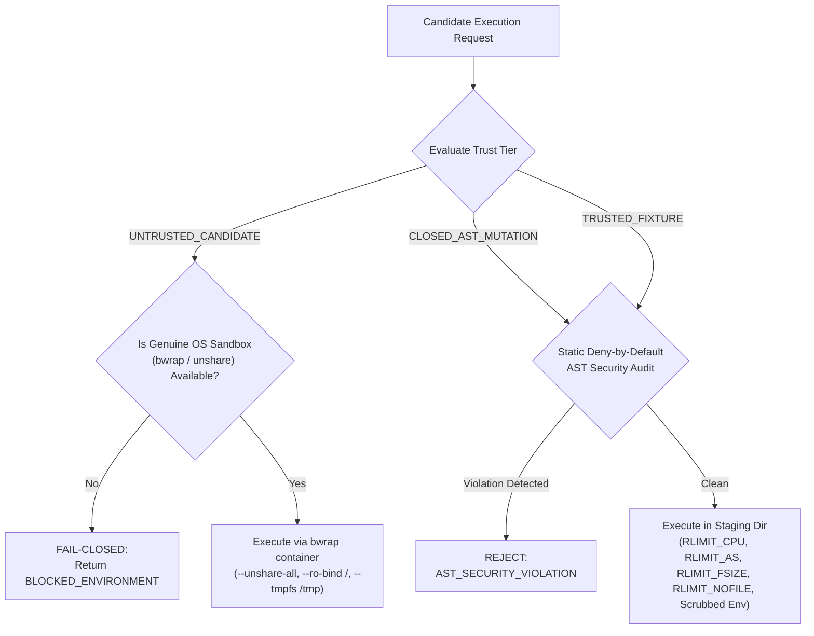

# ACE Software Repair Sandbox Security Hardening & Isolation Specification (2026-11-07)

**Execution Lane:** `security/ace-candidate-isolation-20261107` (Issue #70 Priority B / P1)  
**Target Base:** `integration/ace-master-verified-20261107` (`a8efd9bfc9a9633bcd1a8b815bc7d7f725cffeb7`)  
**Status:** Implemented & Verified (9/9 Security Tests PASS)  
**Scientific Status:** `SCIENTIFIC_NOT_ASSESSED` | **Release Gate:** `BLOCK_RELEASE`  

---

## 1. Problem Statement & Threat Model

In earlier prototypes, `code/ace_research_repair/sandbox.py` executed candidate Python code in a standard subprocess using Python `-I -B` and environment scrubbing. While this isolated standard environment variables, **subprocess execution alone is not genuine OS-level containment**. An untrusted candidate script could potentially attempt:
1. Network access (e.g. via `socket`, `urllib`, `requests`).
2. Local filesystem reads/writes outside the staging directory (e.g. `/etc/passwd`, repository sources).
3. Privilege or namespace escape via `ctypes` or `os.system`.
4. Introspection escape via `().__class__.__bases__[0].__subclasses__()` or `__globals__`.
5. Resource exhaustion (CPU infinite loops, fork bombs, RAM exhaustion).

---

## 2. Hardened Architecture & Trust Boundaries

The sandbox establishes three formal trust tiers:

### 2.1 Trust Boundaries
- **`TrustBoundary.TRUSTED_FIXTURE`**: Fixed corpus diagnostic units and regression suites. Permitted to execute diagnostics under strict rlimits and AST safety.
- **`TrustBoundary.CLOSED_AST_MUTATION`**: Internal candidate patches produced by verified AST operators (`OffByOneOperator`, `GuardOperator`, etc.). Permitted under AST deny-by-default audit and rlimits.
- **`TrustBoundary.UNTRUSTED_CANDIDATE`**: Arbitrary candidate code from external inputs, synthesis engines, or unverified origin. **Disabled and rejected with `BLOCKED_ENVIRONMENT`** unless genuine OS-level containment (`bwrap` or unshare namespaces) is active.

### 2.2 Deny-by-Default Static AST Audit (`audit_candidate_ast`)
Candidate code is statically parsed and walked before spawning any subprocess:
- **Forbidden Modules**: `os`, `subprocess`, `socket`, `urllib`, `requests`, `http`, `shutil`, `ctypes`, `posix`, `nt`, `importlib`, `multiprocessing`, `threading`, `signal`, `pty`, `commands`, `builtins`, `asyncio`, `aiohttp`, `ftplib`, `poplib`, `imaplib`, `smtplib`, `ssl`, `xmlrpc`, `webbrowser`, `pickle`, `shelve`, `tempfile`.
- **Forbidden Builtins / Calls**: `eval`, `exec`, `compile`, `open`, `input`, `globals`, `locals`, `vars`, `breakpoint`, `__import__`.
- **Forbidden Attributes / Introspection**: `__subclasses__`, `__bases__`, `__globals__`, `__builtins__`, `__code__`, `__closure__`, `__func__`, `__self__`.

### 2.3 Resource Ceilings (`_make_preexec`)
- `RLIMIT_CPU`: Enforced soft and hard CPU limit (default 2s).
- `RLIMIT_CORE`: 0 (disables all core dumps).
- `RLIMIT_AS`: Virtual address space limit (512 MB) preventing memory exhaustion.
- `RLIMIT_FSIZE`: File size write limit (512 KB) preventing disk exhaustion.
- `RLIMIT_NOFILE`: File descriptor ceiling (32) preventing descriptor leaks.

---

## 3. Test Verification & Adversarial Results

Verification test suite: `code/ace_research_repair/test_repair_sandbox.py` (9 tests, all PASS):
1. `test_untrusted_candidate_blocked_without_os_sandbox`: Verified `BLOCKED_ENVIRONMENT` returned for untrusted candidate when OS sandbox is absent.
2. `test_trusted_fixture_allowed_and_executed`: Verified diagnostic fixtures run cleanly under containment.
3. `test_closed_ast_mutation_allowed`: Verified internal closed AST mutations pass tests.
4. `test_ast_deny_by_default_blocks_socket_and_network`: Blocked `socket` and `urllib` before execution.
5. `test_ast_deny_by_default_blocks_subprocess_and_os`: Blocked `os`, `subprocess`, `ctypes`, `shutil`.
6. `test_ast_deny_by_default_blocks_dynamic_execution_and_file_io`: Blocked `eval`, `exec`, `open`, `globals`.
7. `test_ast_deny_by_default_blocks_dunder_introspection_escape`: Blocked `__subclasses__` introspection escape.
8. `test_cpu_and_wall_timeout_terminates_infinite_loop`: Infinite loops terminated cleanly by CPU/timeout.
9. `test_child_crash_isolated`: Hard `sys.exit` in child isolated from parent process.

Full backwards compatibility verified: `ace_research_repair.test_repair` 6/6 tests PASS.
Upstream pins: 25/25 verified intact.
