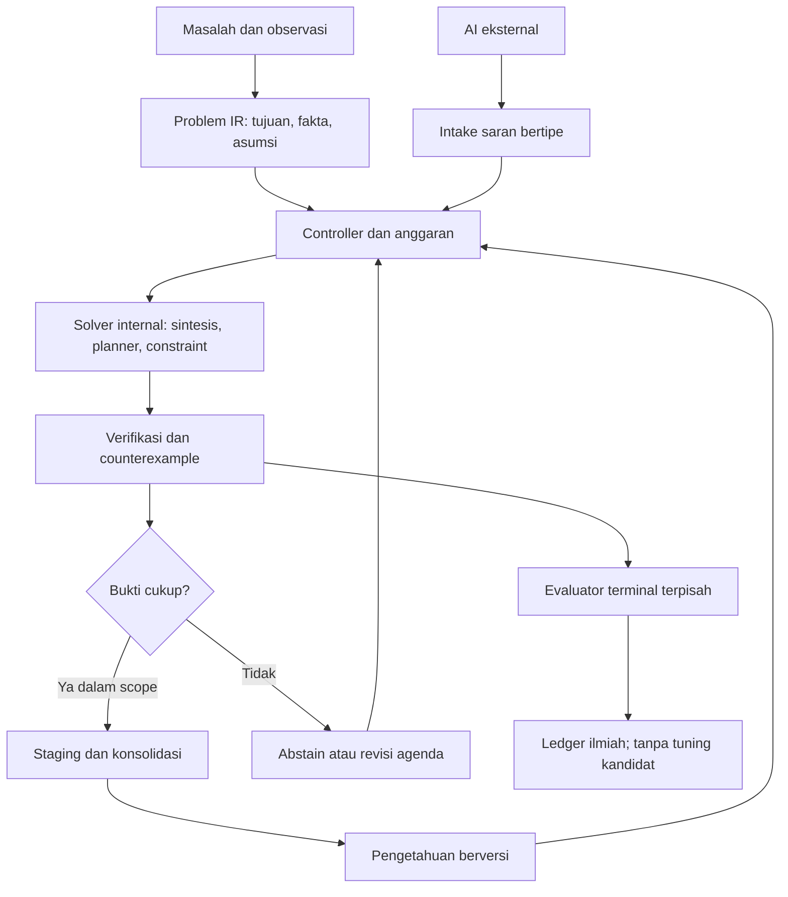

# ACE menuju OAIE — audit, rancangan, dan implementasi teruji

Tanggal: **10 November 2026, Asia/Jakarta**. Repository: [dianzherdiana25-hash/ACE](https://github.com/dianzherdiana25-hash/ACE). Pekerjaan: [draft PR #95](https://github.com/dianzherdiana25-hash/ACE/pull/95), ditumpuk di atas [draft PR #94](https://github.com/dianzherdiana25-hash/ACE/pull/94).

**Keputusan:** ACE layak dilanjutkan sebagai sistem riset hibrida yang menguji kemampuan terbatas. Sudah ada reasoning algoritmik internal; belum ada bukti kecerdasan umum, penemuan kelas representasi secara terbuka, atau peningkatan kemampuan tanpa batas. Tambahan paling bernilai sekarang adalah menghubungkan solver lama ke kontrak masalah, verifikasi, dan pengetahuan yang benar-benar dapat dipakai kembali. Irisan tersebut sudah diimplementasikan dan diuji dalam pekerjaan ini.

Status ilmiah keseluruhan: **NOT_ASSESSED**. Status rilis: **BLOCK_RELEASE**. OAIE: **NOT_ESTABLISHED**. Tidak ada klaim kesadaran atau pengalaman subjektif.

## 1. ACE Saat Ini

### Snapshot sumber yang benar-benar diperiksa

| Sumber | SHA saat pemeriksaan | Keadaan yang teramati |
|---|---|---|
| `main` | `b5edf411ba5eb386efec945671aefed7091ba892` | Workflow research gagal pada tes kontrak runtime; workflow scheduler terpisah berhasil. |
| `ace-termux-20261110` | `d710ca00d68d6f96b753615ae28261ba4137d988` | Basis PR #94; keadaan Git tidak membuktikan proses HP sedang memakai SHA ini. |
| `fix/ace-ai-evidence-gate-20261110` | `52394dcf6f203197ffa66b2dc7f802c475690a63` | PR #94 terbuka, draft, belum merged; enam workflow pada SHA ini berhasil. |
| Branch pekerjaan ini | `research/ace-internal-reasoning-20261110` | Terisolasi dari daemon; basis persis SHA PR #94 di atas. |
| Protokol sebelum implementasi/scoring | `183a9fbfe67c26964db630da89f0743ccf435093` | Sudah tersimpan di GitHub sebelum kode eksperimen dibuat. |
| Commit implementasi | `7e6f6a78ab10e774c6cdf9784e91f6e9a900ba84` | Kode, tes, bukti mentah, profil sumber daya, dan workflow reasoning. Commit penerbitan laporan dapat berada setelahnya; lihat HEAD PR #95. |

[CI PR #94, full system](https://github.com/dianzherdiana25-hash/ACE/actions/runs/42745002150) berhasil di Python 3.12/3.13. Workflow lain yang berhasil: research, R9, autonomous software researcher, runtime v2, repair v2. Ini bukti rekayasa pada SHA tertentu. [Research CI main](https://github.com/dianzherdiana25-hash/ACE/actions/runs/42679261105) menjalankan 203 tes dan gagal satu: `LEARNED_STAGED` aktual versus `NO_VALIDATED_MODEL` yang diasumsikan tes lama. PR #94 memperbarui kontrak nonbeku dan receipt v2, sambil mempertahankan receipt v1.

Audit mencatat **329 berkas Python, 72.934 baris, 48 direktori paket `ace_*`** sebelum penambahan. Semua berkas Python pada tree basis diparse; seluruh file tes paket yang ada dijalankan melalui harness utama dan suite tambahan. Penelusuran manual memusatkan jalur runtime, solver, daemon, evaluator, memori, promosi, dan entri di luar nama ACE. [Peta seluruh paket dan impor](ACE_SOURCE_MAP_20261110.md) serta [inventory berhash](../../evidence/audit_20261110/source-inventory.json.gz) tersedia. Ini bukan bukti bahwa setiap cabang kontrol telah tercakup atau semua snapshot historis sudah dieksekusi ulang.

### Kemampuan yang memiliki implementasi dan bukti

| Kemampuan | Source yang dapat diperiksa | Bukti dan batasnya |
|---|---|---|
| Akuisisi dan prediksi tugas simbolik | `code/ace_runtime/engine.py`, `cli.py` | SQLite WAL, antrean, library program, validasi train/validation, replay dan recovery. Domain a/b dan grammar counter/DFA/product; tidak memahami persoalan umum secara otomatis. |
| Sintesis internal | `ace_candidate_search`, `ace_component_synthesis`, `ace_synthesis`, `ace_evolution` | Mencari AST/komponen dari contoh dengan operator yang disediakan. Bekerja tanpa LLM. Sintesis bukan bukti penciptaan bahasa komputasi terbuka. |
| Perencanaan dan konsekuensi terbatas | `ace_neurosymbolic/neural_guided_search.py`, `ace_mcts/program_mcts.py`, arsip R6 | A*, UCT, dan planning pada domain terbatas. Nama “neural” pada kode tidak menjamin ada model terlatih; estimator A* yang diperiksa menggunakan sinyal statistik. |
| Pemeriksaan formal kecil | `ace_smt`, `ace_abstract_interp`, `ace_interpolation`, `ace_neurosymbolic/cegar_refinement.py` | Implementasi kendala, invariant, interpolasi, counterexample. Tes contoh lolos; soundness umum seluruh verifier belum dibuktikan. |
| Transfer representasi | `ace_research_reptransfer` / R9 | Pada bank publik B=32, fitur terpelajar 0,9805 versus extended hand-library 0,9656, dengan pembacaan simbol target sekitar 31 kali lebih sedikit. Sumber sudah dikurasi; drift tersembunyi gagal 9/10. |
| Self-model dan metakognisi | `ace_selfmodel`, `ace_self_dev/metacognitive_predictor.py` | Introspeksi runtime, Brier/ECE dan abstention dalam eksperimen terbatas. Bukan kesadaran, bukan kalibrasi terjamin pada tugas baru. |
| Perbaikan bug | `ace_research_repair` | Pada benchmark publik, R_ace memperbaiki 12 target nominal, sama dengan R_fixed dan R_fresh. H1 keunggulan ketat gagal; sebagian efisiensi dan kontrol anti-overfit berhasil. |
| Pengetahuan dan recovery | `ace_runtime`, `ace_selfmodel/memory.py`, `ace_research_repair/memory.py`, `ace_self_dev/state_manager.py` | Penyimpanan, silsilah, checksum/HMAC, checkpoint, pengalaman. Banyak jenis memori belum menjadi satu knowledge layer yang memuat konteks berlaku dan cara penerapan. |
| Siklus penelitian otomatis | `ace_research_agenda`, `ace_self_dev/coordinator.py`, daemon | Pemilihan gap, mutasi, evaluator dan checkpoint tersedia. Sebagian agenda/kandidat berasal dari katalog dan aturan yang ditulis peneliti. Nomor siklus bukan ukuran belajar. |
| Konsultasi AI | `ace_code_agent/ai_advisor.py` | `ask-ai` dipanggil sebagai proses eksternal jika tersedia. Identitas upstream dan biaya tidak terverifikasi. Dalam checkout ini executable tersebut tidak tersedia; tidak ada konsultasi model baru yang dijalankan. |

### Temuan audit yang membatasi klaim

1. **Gate penerimaan belum konsisten di seluruh entrypoint.** PR #94 memperbaiki `WorktreeHarness`: kode AI tidak dieksekusi, hasil valid tetap `INCONCLUSIVE`. Namun `tools/ace_mission_worker.py:solve_mission` masih menetapkan `ACCEPTED` beserta alasan keberhasilan sebelum evaluasi perilaku. Reproduksi dalam direktori sementara menghasilkan klaim “label budget reduced by 4x” tanpa pengukuran pengurangan label. `MissionBus.submit_mission` menyimpan keputusan yang diberikan pemanggil; checksum artefak tidak memvalidasi keputusan itu.
2. **Angka W4 dapat direproduksi, interpretasi discovery tidak didukung.** Replay menghasilkan graf A=0,9245, B=0,8578, C=1,0 dan rasio A=0,7742, B=0,8902, C=1,0. Tetapi A/B adalah lambda tetap; C memanggil BFS graf dan aturan `na > 4*nb` yang ditulis langsung. Tidak ada pembelajaran 16 label dalam runner itu. “Fixed 35 library”, “adaptive search”, dan penemuan solver bukan penjelasan yang cocok dengan implementasi runner. Hasilnya menguji solver yang dipasok, bukan ACE menemukan BFS.
3. **Isolasi tidak boleh disimpulkan dari nama.** `detect_os_sealing()` memeriksa keberadaan container/binary; itu belum membuktikan kandidat benar-benar berjalan di namespace terpisah. `ImmutablePromotionRules.require_os_containment` default `False`. Repair sandbox juga mempunyai environment override. Canary pembatasan file, jaringan, proses, dan waktu pada jalur eksekusi aktual masih diperlukan sebelum source eksternal boleh berjalan. Irisan baru memakai interpreter tertutup, bukan jalur source ini.
4. **Status otomatis bukan sertifikasi.** `get_evaluation_seed_and_status()` dapat memberi `CONFIRMED_SEALED` hanya karena environment seed diisi. Kerahasiaan seed tidak membuktikan pemisahan generator/evaluator, baseline setara, atau keunggulan ilmiah. Registry `research_pipeline` juga dapat merekam receipt yang disediakan pemanggil tanpa membuktikan receipt tersebut benar.
5. **Metadata historis sudah tertinggal.** Dokumen alignment 7 November masih menyebut beberapa modul belum ada, padahal source sekarang sudah memuatnya. Piagam, PRD dan laporan historis dipakai sebagai konteks; inventaris source dan eksperimen aktual mengendalikan kesimpulan audit ini.

Bukti reproduksi negatif: [negative-controls.json](../../evidence/audit_20261110/negative-controls.json). Bukti lama tidak diubah. Isu historis [#53](https://github.com/dianzherdiana25-hash/ACE/issues/53), [#17](https://github.com/dianzherdiana25-hash/ACE/issues/17) dan pekerjaan pemilik lain tidak otomatis ditutup oleh CI hijau ini.

### Posisi R1–R9 dan S1–S5

| Jalur | Bagian yang dapat digunakan lagi | Kesimpulan yang harus dipertahankan |
|---|---|---|
| R1 | Induksi DFA/RPNI; source terpilih sudah diimpor | Belajar automaton dalam kelasnya; bukan penciptaan primitive universal. |
| R2 | Riset retensi dan metrik forgetting pada branch tersendiri | Klaim retensi harus menyertakan keluarga yang paling dirugikan, bukan rata-rata saja. |
| R3 | Operator evolusi graf arsitektur | Eksperimen baseline negatif tetap berlaku; perubahan arsitektur bukan otomatis perbaikan. |
| R4 | Pemilihan/adaptasi kebijakan belajar | Diagnostik OOD belum membuktikan keunggulan meta-learning yang luas. |
| R5 | Intervensi, EVPI dan pembukuan query | Kontrol kausal serta biaya query lebih penting daripada jumlah pertanyaan. |
| R6 | Planner, recovery dan studi metareasoning v6 | Branch `401cde69aad7` memuat hasil negatif: learned VOI kalah dari fixed-never pada transfer yang dilaporkan. Planner lama perlu dipakai sebelum membuat planner baru. |
| R7 | Ketidakpastian, selective prediction dan stress test | Kontra-contoh shifted/correlated null melarang klaim jaminan distribusi bebas tanpa asumsi. |
| R8 | Pengukuran per keluarga dan false-progress probes | Gunakan untuk memisahkan efek grammar, seleksi, compute dan transfer. |
| R9 | Fitur DFA yang dapat ditransfer | Bukti positif terbatas dengan sumber terpilih; belum menyelesaikan hidden drift. |
| S1 | Generasi hipotesis komposisional | Kontrol matched tidak dikalahkan pada studi negatif yang dicatat. |
| S2 | Typed arithmetic search dan arsip ekuivalensi | Reuse sebagai backend; arsip netral PR #92 tidak boleh dipromosikan menjadi novelty terbuka. |
| S3 | Pemisahan keluarga dan non-oracle transfer controls | Hasil negatif mengingatkan terhadap leakage dan keunggulan yang hilang dengan budget setara. |
| S4 | Percobaan perubahan kebijakan lintas generasi | Belum membuktikan learning-to-learn atau recursive improvement yang bertahan. |
| S5 | Arsip diversity/open-endedness | Kebaruan perilaku terbatas bukan bukti pertumbuhan kecerdasan tanpa batas. |

R2–R8/S1–S5 ditelusuri melalui ref, source/docs dan PR historis yang tersedia; tidak semuanya berada di tree runtime yang diuji dan tidak semuanya dinilai ulang hari ini. Tidak ada gabungan branch atau pemindahan ownership. Lihat PR #34–#45, #57, #92 dan piagam untuk riwayat masing-masing.

## 2. Kesenjangan Arsitektur

ACE tidak kekurangan nama algoritma. Kesenjangan utamanya adalah **kontrak dan integrasi yang mempertahankan arti bukti dari satu tahap ke tahap berikutnya**.

| Area | Sudah tersedia sebagian | Gap nyata | Integrasi yang disarankan |
|---|---|---|---|
| A. Cognitive architecture | Goal autonomy, self-state, model simbolik, pengalaman | Belum ada representasi masalah lintas domain dan working state yang mengikat fakta, asumsi, aksi, constraint, serta status bukti | Satu schema Problem/State/Goal dengan adapter domain; fakta membawa sumber dan status, saran model menjadi asumsi/hipotesis. |
| B. Internal reasoning | ComponentSynthesizer, CEGIS, SMT, A*, MCTS | Solver terpisah; jalur konsultasi AI sering hanya menghasilkan source tambahan | Reasoning controller yang memilih solver dari kontrak masalah, memeriksa hasil, menyimpan program bertipe; irisan awal sudah dibuat. |
| C. Continual learning | Library runtime, R9, repair memory, generational experiments | Menyimpan model tidak sama dengan belajar mekanisme baru; retensi belum diuji luas G0–G3 | Replay kemampuan lama, routing konteks, versi kemampuan dan budget retensi; ukur backward/forward transfer dan forgetting. |
| D. Representation discovery | DFA, pohon/Dyck DSL, macro, F14 grammar | Kelas operator utama masih ditentukan peneliti; nol primitive baru pada audit F14 v3 | Belajar abstraksi/libraries dari solusi; bandingkan deskripsi terkompresi, reuse dan pencarian di domain baru dengan grammar tetap yang lebih kuat. |
| E. Algorithm/architecture evolution | Source evolution, weighted grammar, Pareto/island search | Mutasi coefficient/templat sering disebut evolusi metode; learner/evaluator belum terpisah sebagai kontrak eksperimen | Uji kandidat perubahan search bias/learner di branch/interpreter terpisah; bekukan evaluator, ukur produktivitas pada tugas baru. |
| F. Long-term memory | SQLite, episodic memory, similarity memory, causal memory | Banyak catatan tidak menyimpan precondition, counterexample dan prosedur penerapan yang tervalidasi | Knowledge record berisi IR, konteks, source/provenance, bukti dukungan/penolakan, versi, relasi dependensi dan revalidation rule. |
| G. Curiosity/active learning | BALD, F12 query, agenda, metacognitive estimates | EIG dalam kelas kecil bisa mengalahkan baseline lemah namun sama dengan random-disagreement; keterbatasan kelas belum dikenali | Pilih eksperimen berdasar expected reduction in decision loss per biaya; charge seluruh oracle call dan posterior maintenance. |
| H. Software engineering | RepairEngine, trace diagnosis, AST patch operators | Belum ada keunggulan jumlah target atas strong fixed, multi-file dan multi-edit belum terbukti | Pakai pipeline lama pada korpus terpisah dengan ruang kandidat jauh lebih besar daripada K, tanpa memperkecil budget setelah melihat hasil. |
| I. Independent evaluation | HostController, exposure ledger, receipt, reference verifier | Signature/checksum/secret seed belum menjamin custody independen; gate bypass masih ada | Satu admission contract lintas entrypoint, evaluator authority terpisah, raw predictions dan canary integritas. |
| J. Multi-AI | ask-ai advisor, data konsultasi, fallback internal | Provider sebenarnya, kuota, cost dan efek saran belum dibuktikan; saran berbentuk source | Adapter terautentikasi yang mengembalikan JSON/IR, model/endpoint/request/usage/cost; saran tidak boleh menulis fakta atau keputusan penerimaan. |

Penambahan ini penting bagi OAIE karena masing-masing menutup rantai: memperoleh bukti → menalar → menguji → mempertahankan pengetahuan → memakai pada persoalan berbeda. Menambah backend lain sebelum rantai ini konsisten justru mempersulit atribusi kemampuan.

## 3. Kelayakan OAIE

### Lima tingkat yang berbeda

| Tingkat | Kelayakan menurut bukti | Kecukupan ACE sekarang | Falsifier/eksperimen berikut | Data dan compute yang masuk akal |
|---|---|---|---|---|
| 1. Autonomous software system | Teknologi antrean, transaksi, broker dan recovery sudah mapan. Otonomi operasi bisa dibangun. | Banyak bagian sudah operasional pada domain terbatas; konsistensi semua entrypoint dan failure handling belum selesai. | Kill/restart, dua worker, corrupt checkpoint, duplicate effects, biaya habis dan jaringan putus; harus berhenti/pulih sesuai kontrak. | Pilot stdlib, CPU, storage SQLite; mulai satu worker dan batas RAM yang diukur. |
| 2. Autonomous research agent | Hipotesis/eksperimen/rangkuman otomatis sudah diperagakan, sering memakai foundation model. Kualitas sains tetap dapat gagal. | Agenda dan kampanye ada, tetapi sebagian hipotesis/keputusan bersumber katalog serta ada false acceptance. | Tugas baru dengan kontrol buta, oracle terukur, hasil negatif terpelihara; hitung penemuan yang direplikasi per unit biaya. | Eksperimen simbolik kecil bisa CPU; konsultasi model opsional dengan kuota sah. |
| 3. Adaptive learning system | Belajar DFA, program, model dan library memang memungkinkan. Continual learning masih menghadapi forgetting dan hilangnya plasticity. | Ada contoh pembaruan model/fit, R9 dan retensi lokal; belum umum lintas keluarga. | G0–G3, target disjoint, source cost ikut dihitung, bandingkan fresh/fixed/replay dan forgetting terburuk. | Ribuan label sintetis dan jutaan operasi cukup untuk pilot simbolik; neural learner lebih mahal. |
| 4. Open-ended intelligence evolution | Open-ended curricula, library learning dan pencarian kode menunjukkan bagian mekanismenya. Pertumbuhan kecerdasan umum tanpa batas belum dibuktikan. | Grammar/kelas hipotesis terbatas; F14 v3 justru menolak pertumbuhan pada bank berbeda. | Tugas baru yang tidak dipakai merancang operator; peningkatan bertahan setelah generasi berikutnya, mengalahkan fixed/fresh/extra-compute pada budget sama. | Tidak ada batas kebutuhan yang diketahui untuk OAIE. Pilot CPU dapat memfalsifikasi hipotesis sempit, tidak memverifikasi keabadian pertumbuhan. |
| 5. General autonomous intelligence | Kemampuan luas model modern tidak menyediakan bukti bahwa ACE atau arsitektur ini akan mencapai general intelligence mandiri. | Tidak memadai dan belum ada bukti. | Evaluasi luas lintas domain, adaptasi tanpa tuning tiap tugas, reliabilitas, efisiensi dan ketergantungan eksternal terukur. | Tidak dapat diestimasi ilmiah dari skor toy ACE; HP bukan dasar klaim kecukupan untuk tingkat ini. |

Kolom compute adalah rancangan anggaran pilot, bukan pengukuran HP atau janji performa. Tidak ada teorema yang membuktikan OAIE mustahil, juga tidak ada hasil yang menjamin visi tersebut dapat dicapai dengan arsitektur sekarang. Kesadaran fenomenal adalah pertanyaan terpisah yang tidak dijawab eksperimen ini.

### Penelitian yang relevan dan batas inferensinya

| Sumber primer | Hal yang dibuktikan/diperagakan | Implikasi yang sah bagi ACE |
|---|---|---|
| [DreamCoder, Ellis dkk.](https://arxiv.org/abs/2006.08381) | Sintesis program, library learning dan panduan neural saling membantu membangun abstraksi yang dapat dipakai lagi. | Mulai dari kompresi/reuse program dalam bahasa dasar. Bukan alasan mengklaim primitive universal tercipta. |
| [SHOP2, Nau dkk.](https://research.ibm.com/publications/shop2-an-htn-planning-system) | HTN memakai dekomposisi tugas dan state selama penyusunan rencana. | Goal/subgoal dan precondition dapat dipakai ulang; metode domain tetap harus tersedia/dipelajari dan diuji. |
| [MAML, Finn dkk., 2017](https://proceedings.mlr.press/v70/finn17a.html) | Parameter awal dapat dilatih agar mudah beradaptasi pada tugas baru dalam distribusi terkait. | Meta-learning harus dibandingkan dengan learner biasa; bukan sekadar menyimpan parameter atau memilih modul. |
| [DreamerV3, Hafner dkk., Nature 2025](https://doi.org/10.1038/s41586-025-08744-2) | World model yang dilatih dari pengalaman membantu kontrol pada beragam benchmark dengan konfigurasi bersama. | Model transisi berguna untuk konsekuensi aksi. Hasil RL tersebut bukan bukti bisa dicapai dengan budget simbolik HP ACE. |
| [Dohare dkk., Nature 2024](https://pmc.ncbi.nlm.nih.gov/articles/PMC11338828/) | Continual neural learning dapat kehilangan plasticity; diversitas unit membantu pada eksperimen mereka. | Ukur kemampuan belajar baru dan retensi lama secara terpisah. Memori bertambah tidak menjamin keduanya. |
| [POET, Wang dkk.](https://arxiv.org/abs/1901.01753) | Co-evolution tantangan dan solusi, serta transfer, menghasilkan kurikulum yang tidak muncul pada kontrol tertentu. | Arsip stepping stones dapat diteliti; ruang environment tetap dirancang dan eksperimen tetap berhingga. |
| [AlphaEvolve, Novikov dkk., 2025](https://arxiv.org/abs/2506.13131) | LLM, evolutionary search dan evaluator otomatis menghasilkan perbaikan algoritma yang dapat diverifikasi. | Pisahkan generator dari evaluator; ia masih bergantung pada LLM dan infrastructure, bukan reasoning internal ACE yang mandiri. |
| [Darwin Gödel Machine, Zhang dkk., versi Maret 2026](https://arxiv.org/abs/2505.22954) | Perubahan kode agen dan arsip evolutionary meningkatkan benchmark coding; foundation model tetap digunakan. | Belajar dari arsip/ablasi dan pengujian fungsi agen. Self-modification bukan bukti evolusi intelligence tanpa batas. |
| [The AI Scientist, Lu dkk., Nature Maret 2026](https://pmc.ncbi.nlm.nih.gov/articles/PMC13017497/) | Pipeline riset otomatis menghasilkan manuskrip; satu dari tiga submission diterima di workshop yang dilaporkan. | Tingkat 2 memungkinkan dengan keterbatasan metodologi dan implementasi; peer review otomatis tidak menggantikan validasi eksperimen. |

Sumber ditelusuri pada tanggal audit, termasuk versi penelitian 2026 yang dapat diverifikasi. Tidak satu pun paper tersebut sendirian membuktikan OAIE atau kecerdasan umum ACE. Sintesis hubungan dengan roadmap ACE adalah penilaian arsitektural dalam laporan ini.

## 4. Desain Reasoning Engine ACE

### Aliran arsitektur



Ini rancangan sasaran. Irisan baru mengimplementasikan Problem IR x/y → recall/advice → ComponentSynthesizer → verifikasi development → SQLite knowledge. Planning aksi umum, world model terlatih, revisi representasi terbuka dan custody evaluator eksternal belum diimplementasikan oleh irisan ini.

**Problem representation.** Schema penuh perlu memuat goal/subgoal, observasi beserta sumber, asumsi, constraint, dependensi, unknowns, state awal/target, action precondition/effect, dan kondisi selesai/gagal. Fakta dari pengguna, sensor dan eksperimen harus berbeda status dari hipotesis model. Pada implementasi awal: dua integer x/y, output integer/Boolean, contoh train dan validation, nama/tujuan. Teks tujuan belum diterjemahkan menjadi semantik umum.

**Hypothesis generation.** Gunakan operator komponen lama, induksi DFA, komposisi macro, rule induction dan relational miner sesuai domain. Hipotesis mempunyai origin `INTERNAL_SYNTHESIS`, `EXTERNAL_ADVICE_UNVERIFIED`, atau `REVALIDATED_MEMORY`. Sebuah saran model hanya candidate IR. Pencarian program dapat memberi kemampuan inferensi tanpa model neural, tetapi tetap dibatasi bahasa pencarian.

**Deliberation.** Untuk masalah dengan aksi eksplisit, BFS memberi kontrol dasar; A* dipakai jika heuristic sah dan biaya langkah diketahui; HTN untuk dekomposisi yang dapat diuji. MCTS berguna jika simulasi tindakan tersedia, bukan sebagai nama umum semua reasoning. Bandingkan ekspansi/work, akurasi dan biaya; pencarian dua kali lebih panjang harus dibandingkan dengan baseline yang mendapat dua kali compute juga. Gunakan ulang R6 sebelum menulis planner baru.

**Verification.** Periksa tipe, constraint dan konsistensi; cari counterexample pada development; staging memerlukan fit exact pada train dan validation. Terminal scoring terjadi setelah keputusan dibekukan, di caller/evaluator berbeda. Data publik terpisah bukan holdout tersegel independen. Uji metamorphic/invariant dan solver referensi membantu menemukan kesalahan interpreter, tetapi tidak menghapus risiko nonidentifiability.

**Metacognition.** Status harus membedakan didukung data, belum terbukti, ditolak, budget habis dan di luar scope. Evaluasi probabilitas keberhasilan dengan Brier/ECE dan kurva risk–coverage pada bank terpisah. Abstention awal bersifat deterministik saat bukti development gagal; tidak mengklaim probabilitas terkalibrasi atau kemampuan mendeteksi semua shift. Mintalah AI ketika expected utility informasi melebihi biaya dan ada provider yang sah, bukan setiap siklus.

**Consolidation.** Simpan program IR yang dapat dijalankan kembali, versi implementasi, scope, contoh dukungan, origin, identitas masalah, counterexample dan hasil revalidation. Irisan baru memakai basis SQLite `ExperienceMemory`; pengetahuan baru mempunyai checksum lokal dan trial tersimpan atomik. Checksum bukan signature evaluator independen. Setiap recall diuji pada contoh baru; perubahan versi source membutuhkan migrasi eksplisit. Hubungan kausal lintas domain dan indeks konsep yang kaya masih gap.

### Kontrak siklus yang dapat diuji

| Langkah | Input → output | Budget/aturan berhenti yang disarankan |
|---|---|---|
| Observe | State/tool/observasi → snapshot berprovenance | Baca terbatas; unknown tetap unknown jika perangkat/provider tidak dapat diakses. |
| Represent | Snapshot/tujuan → Problem IR | Batasi ukuran dan schema; konflik label menjadi invalid/abstain. |
| Reason | IR + library + saran → kandidat bertipe | Pada irisan: depth 2 pencarian, 300.000 operasi primitive dan 5 detik per solve. |
| Plan | Kandidat + aksi → rencana dan estimasi biaya | Limit ekspansi/rollout, sisakan budget verifikasi; belum ada planner aksi umum di irisan ini. |
| Test | Kandidat → prediksi dan counterexample | Interpreter tertutup; tidak mengimpor source kandidat. |
| Evaluate | Keputusan dibekukan → skor terhadap baseline | Terminal tidak boleh masuk API solve; tidak dipakai memilih ulang kandidat. |
| Learn | Hasil development → knowledge record | Maksimum 128 record pengetahuan / 1.024 trial pada irisan; tidak menimpa bukti lama. |
| Reflect | Kegagalan/biaya → diagnosis batas informasi/metode | Bedakan duplikasi perilaku publik dari ekuivalensi universal. |
| Revise | Diagnosis → proposal hipotesis/metode berikut | Kandidat source/learner tetap terpisah dari kode operasional sampai gerbang validasi terpenuhi. |

Input bounded ke [-64,64], konstanta IR [-4,4], maksimum 31 node/depth 4, dan nilai antara <=1.000.000. Batas 5.000 kandidat backend lama adalah pemeriksaan lunak; batas operasi primitive pada wrapper adalah keras dan dilaporkan terpisah. Pada penghentian sebelum backend mengembalikan count, count kandidat ditulis `null`, bukan nol palsu. Batas wall bersifat kooperatif untuk operasi tertutup yang dibatasi, bukan klaim hard real-time.

### Eksperimen reasoning yang benar-benar dijalankan

Protokol: [dokumen terkunci](../research/ACE_INTERNAL_REASONING_PROTOCOL_20261110.md). Delapan aturan, tiga seed publik, setiap unit 12 train +12 validation +24 terminal; total 24 unit. Aturan: penjumlahan, selisih, perkalian, dua kali jumlah, kuadrat ditambah y, equality, less-than, dan jumlah sama dengan dua. Solver tidak menerima formula target atau label terminal.

| Lengan | Correctness nominal | Panggilan model | Arti hasil |
|---|---|---|---|
| A: internal reasoning | **552/576 = 95,83%**, 23/24 unit staged; 7/8 keluarga lulus semua seed | 0 | Reasoning/sintesis terbatas bisa berjalan mandiri. |
| F: solver lama fresh, grammar dan budget sama | **552/576** | 0 | Integrasi tidak menemukan solver yang lebih pintar. Selisih correctness terhadap baseline kuat = 0. |
| B-fixture: saran JSON sintetis | **576/576** | 0 | Tes intake dengan payload invalid, kandidat salah dan solusi yang dipasok peneliti; bukan hasil model hidup dan bukan perbandingan sains A/B/C. |
| B: model eksternal sebagai penasihat, nyata | NOT_RUN / NOT_ASSESSED | Tidak tersedia | `ask-ai`/provider terautentikasi tidak tersedia di host ini. |
| C: model eksternal sebagai pengendali utama, nyata | NOT_RUN / NOT_ASSESSED | Tidak tersedia | Tidak dibuat hasil simulasi yang mengaku sebagai panggilan model. |

Pada `sum_equals_two`, seed 20261112 menghasilkan fit train yang gagal validation; hasil A/F menahan 24 prediksi. Kegagalan tetap ada; benchmark tidak diubah untuk membuatnya lulus. **23/23 program yang benar-benar staged berhasil dipanggil ulang pada input development baru melalui proses terpisah, digest tetap dan tanpa sintesis baru.** Gate semua 24 unit tetap `false` dalam artefak mentah, karena satu unit tidak memperoleh program. Ini retensi dalam aturan yang sama, bukan transfer keluarga.

Kontrol aturan tersembunyi mempertahankan development yang identik tetapi menambah satu pada seluruh output terminal. A tetap staged dan mendapat **0/24**; satu false admission ditahan dalam laporan. Tanpa observasi pembeda, kedua dunia tidak dapat dibedakan. Perbaikannya memerlukan informasi/asumsi tambahan atau cakupan keputusan lebih sempit, bukan sekadar reasoning lebih panjang.

Biaya terukur run lokal: A sekitar **0,314 detik CPU / 0,314 detik wall** untuk 24 solve; F sekitar 0,286/0,286 detik. B-fixture sekitar 0,0024 detik karena solusi sudah dipasok. Peak RSS proses benchmark **20.640 KiB**, sekitar 20,2 MiB. Ini high-water mark proses Linux, bukan alokasi tambahan atau pengukuran Redmi 14C; CPU subprocess retensi tidak termasuk profil per-lengan. Provider API baru: 0 call, biaya API tambahan Rp0; listrik, data HP dan biaya layanan host tidak diukur.

Slot label nominal: train 288, validation 288, terminal 576; retensi tambahan 576 slot development; kontrol hidden-shift 24 slot terminal. Seed dapat mengulang pasangan input: label unik per split adalah 224/264/544. Field mentah bernama `*_unique` menghitung slot per-unit, bukan deduplikasi global; [accounting-v1.json](../../evidence/internal_reasoning/accounting-v1.json) memperjelas tanpa menulis ulang hasil pertama.

Jawaban wajib: **ACE telah menunjukkan reasoning algoritmik terbatas yang dapat berjalan tanpa panggilan AI. ACE belum menunjukkan reasoning umum, peningkatan atas backend lama, atau kemampuan mandiri menghasilkan kelas representasi baru. Jalur ask-ai sendiri masih konsultasi; irisan ini memberi jalur inferensi/verifikasi internal yang terukur.**

## 5. Rekomendasi Penambahan Sistem

Urutan berikut mengutamakan dampak, kekuatan bukti, biaya HP dan penggunaan ulang. Semua batas compute adalah usulan awal yang harus diprofilkan; bukan kebutuhan universal.

| Prioritas | Pekerjaan, tujuan dan dependensi | Benchmark/kriteria berhasil | Biaya/kompleksitas dan risiko |
|---|---|---|---|
| P0 | **Admission evidence bersama** untuk MissionWorker, MissionBus, CodeAgent dan pipeline; gunakan gate/receipt lama | Tidak ada entrypoint bisa memberi keberhasilan perilaku hanya dari AST/hash/alasan teks. Wrong solver, unused function, forged receipt dan constant negative control seluruhnya ditolak. | Rendah–sedang, stdlib. Risiko breaking status lama; perlu migrasi status berversi. Penting agar seleksi evolusi tidak memakai reward palsu. |
| P0 | **Reasoning integration**: Problem IR → backend lama → verification → executable memory | A tanpa model, baseline setara, budget berhenti, restart/revalidation dan kesalahan tetap tercatat. Irisan awal sudah diuji. | Rendah, CPU kecil. Risiko grammar tertutup/ambiguity; jangan mengubah staging menjadi scientific GO. |
| P1 | **State/goal/domain adapters** sebagai working memory dan world representation simbolik | Dua domain berbeda dengan constraint/aksi eksplisit; parser input ambigu meminta bukti, bukan menciptakan fakta. | Sedang, tidak perlu GPU. Risiko adapter sebenarnya menyisipkan solusi. Penting untuk menyeberangkan masalah ke mekanisme internal. |
| P1 | **Knowledge consolidation dan continual learning** memakai memory/registry/R9 lama | G0→G3: retensi semua kemampuan lama, transfer terukur terhadap fresh dan fixed; source learning cost termasuk. | Sedang; ribuan label, batas library/DB. Risiko negative transfer, log disalahartikan sebagai pengetahuan. |
| P1 | **Evaluator custody dan containment aktual** memakai host controller/repair harness | Canary file/network/process, terminal tak terjangkau generator, pembukuan exposure, dan tidak ada override yang bisa dianggap bukti sealing. | Sedang–tinggi; interpreter tertutup cocok HP. Risiko environment berbeda dari test. Penting untuk melindungi integritas penelitian. |
| P1 | **Metacognitive controller dan active learning** memakai selfmodel, R6, F12, BALD | Risk–coverage/Brier pada keluarga terpisah; utilitas bersih mengalahkan never/always/random-disagreement, seluruh query dibayar. | Sedang; belief class kecil dahulu. Risiko kalibrasi rusak saat shift dan biaya query melampaui manfaat. |
| P1 | **Multi-AI adapter berprovenance** menggantikan asumsi identitas ask-ai | Saran salah ditolak, provider outage tidak menghentikan A, real B/C memakai input/budget sama; identitas/usage/cost disimpan atau UNKNOWN. | Rendah–sedang, 0–beberapa call berbatas. Risiko kuota/biaya berubah; hanya provider sah yang telah tersedia. |
| P2 | **Autonomous bug repair pada korpus baru** dengan RepairEngine lama | Multi-file, pool kandidat >100, K dikunci, negative controls, regresi, baseline fixed/fresh sama budget; margin terdaftar sebelum scoring. | Sedang–tinggi, subprocess/test cost dominan. Risiko ruang patch tidak mencakup bug atau evaluator bocor. |
| P2 | **Representation/library discovery** memakai macro, egraph, synthesis, R9 dan discovery DSL | Abstraksi dari source berguna pada target baru, lebih hemat label/work dari grammar tetap kuat; instance novelty dibedakan dari kelas/metode baru. | Tinggi, CPU dibatasi per-run. Risiko hanya kompresi kosmetik atau keunggulan dari kurasi source. |
| P3 | **Algorithm/architecture evolution** memakai source-evolution dan eksperimen generasi | Kandidat learner/search policy meningkatkan tugas baru G2/G3 atas G0/fixed/random/extra-compute, dengan evaluator dan policy tetap. | Tinggi; jangan mulai neural NAS besar. Risiko benchmark overfitting, regresi dan search-space bias. Penting bagi penelitian peningkatan cara belajar. |

Tidak direkomendasikan menambah solver SMT, MCTS, GNN atau daemon baru sebelum fungsi yang sudah ada benar-benar digunakan dan diukur.

## 6. Roadmap Prioritas

| Waktu | Tahap dan keluaran | Milestone terukur | Kriteria penghentian/perubahan arah |
|---|---|---|---|
| 7 hari | **A Stabilize + awal B**: satukan kontrak penerimaan, versi receipt, audit entrypoint; pertahankan opt-in reasoning | Seluruh bypass false acceptance yang diketahui mempunyai kontrol negatif; replay exact SHA; recovery restart; dua jenis input masalah terstruktur. | Berhenti promosi bila receipt/containment tidak dapat dibuktikan; jangan menyatakan stagnasi sebagai keberhasilan. |
| 30 hari | **B Reasoning + C Learning**: adapter kedua, pengetahuan executable, planner lama dan G0–G3 | Dua keluarga tugas di luar bank pengembangan, fixed/fresh/extra-compute, biaya source+target; retensi tanpa refit dan metrik forgetting. Real B/C jika provider sah tersedia. | Jika keunggulan hilang melawan strong baseline, klasifikasikan sebagai integrasi, bukan discovery; ganti hipotesis. |
| 90 hari | **D Discovery + E Loop + F Validation**: belajar abstraction/search bias, pemilihan agenda yang memberi utilitas | Protokol dikunci, evaluator custody terpisah, cross-family bank baru, minimal tiga seed/generasi; laporkan interval ketidakpastian dan kontrol drift. | Jika gains hanya berasal dari source yang dikurasi atau compute lebih besar, tolak klaim transfer; bila evaluator terekspos, batalkan klaim konfirmatori. |
| Jangka panjang | **F lanjutan + G Deployment**: replikasi keluarga baru dan pengalaman HP sederhana | UI menampilkan pekerjaan, kandidat, evidence status, koneksi AI, sumber daya, alasan gagal, stop/resume dan versi aman. | Jangan menjanjikan OAIE. Perlu persetujuan tersendiri sebelum main, daemon aktif, deployment atau biaya berubah. |

Tahap G sebaiknya tumbuh dari CLI/dashboard lama, bukan aplikasi terpisah baru. Tombol aman harus membedakan “baca status”, “jalankan trial tertutup”, “usulkan perubahan” dan “gunakan versi baru”. Profil RAM/CPU/baterai/suhu Android dan kill/restart oleh OS belum dilakukan dari host ini.

## 7. Implementasi yang Benar-Benar Dikerjakan

Branch: `research/ace-internal-reasoning-20261110`. PR: **#95, draft, tanpa merge**. Basis: PR #94 SHA `52394dcf`. Protokol commit `183a9fb`; implementasi commit `7e6f6a78`.

| File/artefak baru | Perubahan nyata |
|---|---|
| `code/ace_cognition/reasoning.py` | Problem schema, IR decoder tertutup, batas operasi/waktu, penggunaan ComponentSynthesizer, counterexample, exact development gate dan executable knowledge di ExperienceMemory. |
| `code/ace_cognition/reasoning_test.py` | 12 tes integrasi/security/retensi: tanpa eval/exec/model, advice salah, source payload, validation gagal, hard budget, tipe/depth, terminal exclusion, corruption dan restart. |
| `tools/ace_reasoning.py` | CLI opt-in dengan workspace sendiri; JSON input bounded. |
| `tools/ace_reasoning_benchmark.py` | A, strong fresh F, synthetic B-fixture, retensi antarproses, hidden shift; profiling terpisah dari sel deterministik. |
| `tools/ace_reasoning_audit.py` | Reference interpreter terpisah yang memeriksa label dan 72 sel skor. Auditor masih dalam tim/proses penelitian ini; bukan pihak independen eksternal. |
| `examples/reasoning-add.json` | Contoh tugas yang dapat dijalankan pengguna. |
| `.github/workflows/ace-internal-reasoning.yml` | Exact-head checkout, pin protokol, Python 3.12/3.13, tests, replay dua kali, compare evidence dan upload artefak. |
| `evidence/internal_reasoning/` | Public raw result, profil dan koreksi penjelasan accounting tanpa mengganti hasil pertama. |
| `evidence/audit_20261110/` | Inventory seluruh source, hasil tes basis/tambahan dan reproduksi false acceptance/W4. |
| Dokumen protokol, source map dan laporan ini | Desain, scope, kegagalan, keputusan serta reproduksi. |

Validasi lokal: **463** tes harness lama + **135** tes paket tambahan = **598** tes kode basis; **12** tes reasoning baru; **8** tes tools receipt. Total **618 kasus berbeda** lulus. Sepuluh tes solver yang dijalankan lagi bersama tes baru tidak dijumlahkan dua kali. **25/25 source pin** cocok, 13 pemeriksaan evidence harness lulus, dua run publik byte-identik. SHA256 public result: `7cb0dd0e45498d028ae1b2c320b21621774b7309e4ac4d600b05f09c210f281f`.

Run basis penuh mencatat commit lokal doc-only `84d293cf...`, yang mempunyai source basis sama dengan SHA `52394dcf`; commit tersebut kemudian disejajarkan dengan preregistrasi GitHub `183a9fb`. Ini dijelaskan agar SHA log lokal tidak disalahartikan sebagai CI commit implementasi. Inventory hash dan tree implementasi lokal cocok dengan tree GitHub `baa6be34b224b75d9a9f61b498c4ac9c805f1e70`.

[Workflow reasoning pada implementasi exact SHA](https://github.com/dianzherdiana25-hash/ACE/actions/runs/42748757786) **SUCCESS** pada Python 3.12/3.13, termasuk replay yang cocok dengan raw result. [Full-system implementation run](https://github.com/dianzherdiana25-hash/ACE/actions/runs/42748757859), [research verification](https://github.com/dianzherdiana25-hash/ACE/actions/runs/42748757776), dan R9 pada SHA implementasi tersebut juga telah dibaca kembali dan **SUCCESS**. Penerbitan laporan dapat membuat HEAD baru. Status exact HEAD penerbitan tersedia di [checks PR #95](https://github.com/dianzherdiana25-hash/ACE/pull/95/checks), bukan diasumsikan dari run sebelumnya.

Reproduksi pada checkout branch terisolasi, dari direktori repository:

```sh
PYTHONPATH=code python3 -m unittest ace_cognition.reasoning_test ace_component_synthesis.test_component_synthesizer -v
python3 tools/ace_reasoning_benchmark.py --output /tmp/ace-reasoning.json --profile /tmp/ace-profile.json
python3 tools/ace_reasoning_audit.py /tmp/ace-reasoning.json
cmp /tmp/ace-reasoning.json evidence/internal_reasoning/public-v1.json
python3 tools/ace_reasoning.py --problem examples/reasoning-add.json --workspace /tmp/ace-reasoning-demo
python3 tools/ace_reasoning.py --problem examples/reasoning-add.json --workspace /tmp/ace-reasoning-demo
```

Perintah kedua pada workspace yang sama memperlihatkan `REVALIDATED_MEMORY`. Di Termux, jalankan pada worktree terpisah setelah branch tersedia:

```sh
git fetch origin research/ace-internal-reasoning-20261110
git worktree add ../ACE-reasoning-check --detach origin/research/ace-internal-reasoning-20261110
cd ../ACE-reasoning-check
python3 tools/ace_reasoning.py --problem examples/reasoning-add.json --workspace "$TMPDIR/ace-reasoning-demo"
```

Perintah ini mengasumsikan pengguna berada dalam clone ACE dan Python 3.12+ tersedia. Itu tidak menyalakan daemon. Tidak ada akses langsung ke Termux pengguna dalam audit ini; hasil hardware/ask-ai HP tidak dinyatakan sudah teruji. Tidak ada perubahan pada main, daemon aktif, konfigurasi eksternal, sumber E1.4 beku, atau bukti historis.

## 8. Evaluasi Kemajuan

| Kategori | Hasil saat ini | Status yang tepat |
|---|---|---|
| Engineering success | Source map, 618 tes lokal berbeda, workflow reasoning/replay, gate tipe, budget, counterexample dan restart | PASS dalam scope teruji; bukan jaminan seluruh sistem aman. |
| Internal AI reasoning | Sintesis program dari label dengan nol model call; 552/576 dan sama dengan fresh solver | BOUNDED_INTERNAL_REASONING_DEMONSTRATED; bukan reasoning umum atau keunggulan baru. |
| Capability transfer | 23 program retained pada aturan sama; R9 mempunyai transfer fitur komposit yang terbatas | Within-rule reuse teruji; transfer luas/cross-family baru NOT_ASSESSED. |
| Novel representation discovery | Irisan menggunakan lima operator lama; F14 v3 tidak menemukan primitive baru dan G2 turun | Tidak dibuktikan. Jangan mengganti istilah komposisi menjadi primitive invention. |
| Scientific validation | Bank publik, peneliti/evaluator dalam pekerjaan yang sama; real B/C belum ada; hidden shift gagal | NOT_ASSESSED; BLOCK_RELEASE. |

F14 v3 merupakan falsifier penting: G0 0,6250, G1 0,6333, G2 0,5604; G2 kalah dari random sekitar 0,0677. F13 juga gagal tiga dari empat kriteria penuh. F12 dan beberapa pilot memberi hasil positif lokal, tetapi tidak menghapus temuan negatif ini. Reproduksi receipt berarti laporan dapat diperiksa, bukan hipotesis keunggulan otomatis benar.

## 9. Masalah Terbesar yang Belum Terselesaikan

1. **Reward/bukti penerimaan yang salah.** Evolusi yang menerima klaim tanpa menguji fungsi aktual dapat memilih kandidat tak berguna selamanya. Bypass MissionWorker harus ditutup sebelum promosi lintas sistem.
2. **Representasi masalah dan batas kelas hipotesis.** Banyak backend pintar hanya menerima domain kecil yang disiapkan peneliti. Tanpa adapter yang jujur dan konstruksi representasi dari bukti, kemampuan tidak meluas.
3. **Transfer dan learning-to-learn terhadap baseline kuat.** R9 terbatas, repair seri dengan fixed, irisan baru seri dengan fresh, F14 v3 negatif. Belum ada bukti pertumbuhan metode belajar yang bertahan pada keluarga berbeda.
4. **Independent evaluation dan containment nyata.** Custody, eksposur bank, canary eksekusi dan status receipt perlu menjadi kontrak bersama. Tes keberadaan binary tidak memadai untuk source eksternal.
5. **Keterbatasan informasi.** Aturan tersembunyi dengan observasi identik tidak bisa dideteksi dari data yang tidak membedakannya. Active query membantu hanya jika pertanyaan pembeda dapat diakses dan biaya dibayar.
6. **Konsolidasi pengetahuan dan agenda yang bernilai.** N-gram similarity, log, hash baru dan nomor siklus tidak membuktikan kemampuan baru; retrieval harus membawa prosedur yang berhasil pada penggunaan berikutnya.
7. **Runtime HP dan provider yang dapat diverifikasi.** Android dapat mematikan proses; kuota, identitas model, latensi dan biaya berubah. Semua harus diukur pada perangkat sebenarnya dan tidak diisi dengan asumsi optimistis.

## 10. Keputusan Strategis

### Perbandingan jalur

| Jalur | Kemampuan baru dan kecocokan ACE | Data/compute, HP/Actions, validasi | Ketergantungan dan hambatan OAIE |
|---|---|---|---|
| A. Agent lebih besar dengan AI eksternal | Cepat menambah cakupan tugas; cocok dengan ask-ai | Kode lokal ringan tetapi model/quota di luar kendali; correctness perlu evaluator terpisah | Tinggi; peningkatan model provider dapat terlihat sebagai peningkatan ACE. |
| B. Cognitive architecture neuro-symbolic | Cocok dengan IR, solver dan selfmodel yang sudah ada; membuat keputusan internal dapat diperiksa | Pilot simbolik murah, validasi domain jelas; jangan mulai dari GNN besar tanpa manfaat terbukti | Generalisasi tergantung representasi/grammar; aturan yang dipasok bukan penemuan mandiri. |
| C. Synthesis/evolution/algorithm discovery | Paling dekat dengan sebagian besar source ACE; peluang kemampuan executable baru | CPU bounded memungkinkan; scaling search dan verifikasi mahal; baseline kuat mudah dirumuskan | Search-space design dan evaluator menentukan apa yang bisa ditemukan; source novel belum tentu algoritma novel. |
| D. Meta-learning/continual transfer | Penting agar generasi berikutnya memperoleh manfaat, bukan sekadar arsip | Perlu urutan tugas yang terpisah, sumber dan target dihitung; simbolik layak, neural besar tidak jadi prioritas | Forgetting, negative transfer, kurasi source dan perbaikan semu dari ekstra compute. |
| E. Hibrida komponen terbukti | **Pilihan utama:** B sebagai kontrak/controller, C sebagai mesin kandidat, D sebagai konsolidasi, A penasihat opsional | Bisa diuji bertahap pada CPU/Actions dan HP; atribusi melalui ablasi per komponen | Risiko integrasi dan reward palsu; mitigasi dengan satu gate, provenance, baseline dan evaluator terpisah. |

Pembagian konkret: LLM mengusulkan terjemahan/hipotesis dalam IR; controller internal memeriksa evidence/anggaran dan memilih langkah; synthesis/planner mencari kandidat dan konsekuensi; verifier mencari counterexample; evaluator terminal menilai secara terpisah; memory menyimpan program beserta konteks dan kegagalannya. Tanpa model eksternal, backend internal tetap dapat dijalankan dan dievaluasi. Ini membedakan integrasi yang memiliki mekanisme sendiri dari sekadar meneruskan jawaban model.

**Apakah ACE layak dilanjutkan?** Ya, sebagai program penelitian dengan hipotesis terbatas dan hasil negatif yang diterima. Tidak ada dasar menjanjikan OAIE atau AGI.

**Apa yang dipertahankan?** Typed DSL, backend synthesis, SQLite runtime/memory, source pin, immutable evidence, repair pipeline, R9, metakognisi, recovery, dan kontrol negatif yang benar-benar bekerja.

**Apa yang diperbaiki/didesain ulang?** Seluruh jalur penerimaan berbasis teks/hash/AST saja; pemisahan data dari klaim provider; working problem representation; integrasi pengetahuan; pengukuran biaya; adapter/evaluator yang tertanam pada generasi kandidat. Hindari menghapus modul hanya karena suatu hipotesis gagal.

**Perlu model AI dari nol?** Tidak untuk tujuan sekarang. DFA, program sintetis, belief state dan small learned search policy sudah merupakan model internal komputasional. Melatih foundation model dari nol tidak sesuai budget HP dan tidak menyelesaikan persoalan verifikasi. Model kecil yang dipelajari dapat diteliti nanti apabila mengalahkan pembanding simbolik pada biaya sama.

**Bagaimana memakai AI eksternal tanpa menjadi wrapper?** AI hanya sumber kandidat/terjemahan; tidak memutuskan kebenaran, scientific GO, atau promosi. Catat origin dan actual provider bila terverifikasi; ukur A tanpa AI, B penasihat dan C controller secara nyata pada informasi/anggaran sama. Fallback harus memiliki fungsi internal yang dapat diuji.

**Eksperimen paling mungkin menunjukkan kemampuan baru?** Pelajari abstraksi atau search bias dari tugas sumber, lalu bekukan dan gunakan pada keluarga target yang tidak digunakan merancang sumber. Bandingkan dengan fresh solver, fixed library kuat, random abstraction dan extra-compute; bebankan biaya source; lanjutkan G0→G3 dan uji retensi. Keunggulan efisiensi yang tetap ada setelah kontrol ini lebih bermakna daripada penambahan primitive bernama baru.

**Langkah implementasi tunggal berikutnya?** Satukan admission evidence untuk seluruh entrypoint, dimulai `MissionWorker → MissionBus`: kandidat hanya boleh mendapat keputusan keberhasilan perilaku dari evaluator yang menguji fungsi kandidat aktual, membandingkan baseline/negative control, dan menyimpan receipt terikat versi/source. Sebelum bukti itu ada, status tetap staging/inconclusive. Ini menjaga agar reasoning dan eksperimen generasi selanjutnya belajar dari hasil nyata.

Keputusan riset: **CONTINUE_RESEARCH_WITH_SCOPE_LIMITS**. Hipotesis yang tidak mengalahkan baseline tidak dipromosikan; kegagalannya menjadi dasar memilih eksperimen berikut.
