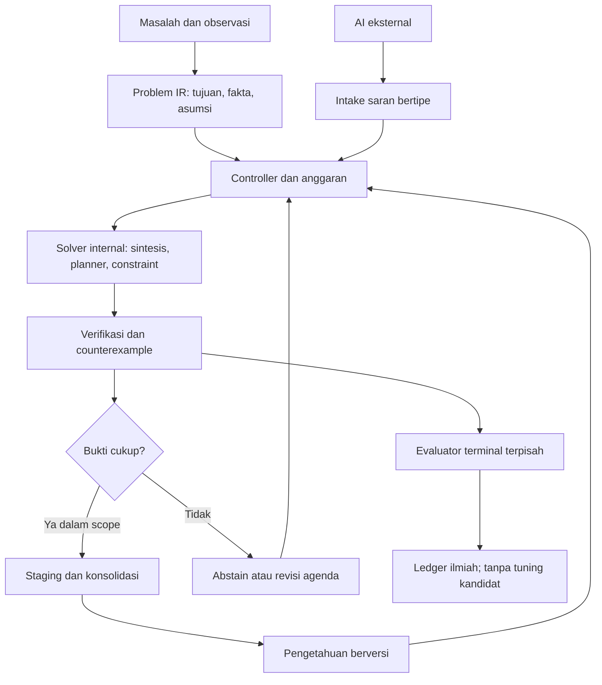
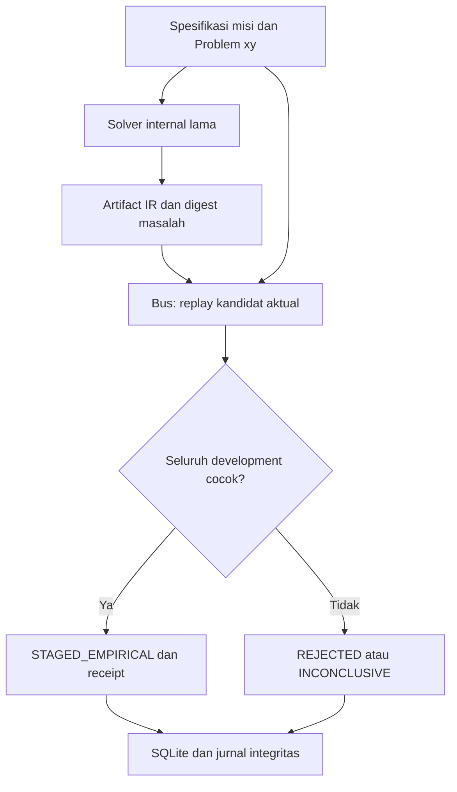

# ACE menuju OAIE — laporan audit dan implementasi 10 November 2026

**Keputusan: lanjutkan ACE sebagai sistem riset hibrida dengan reasoning internal yang terbatas dan dapat diperiksa. OAIE, kecerdasan umum, dan penemuan metode belajar baru yang bertahan belum terbukti.**

Laporan berbahasa Indonesia ini memenuhi sepuluh bagian permintaan audit. Sumber utama adalah repository [dianzherdiana25-hash/ACE](https://github.com/dianzherdiana25-hash/ACE), source yang benar-benar tersedia, replay lokal, metadata GitHub, dan penelitian primer yang diverifikasi hingga **10 November 2026, Asia/Jakarta**. Penelitian baru tidak diasumsikan terjadi hanya karena daemon berputar atau CI lulus.

Pekerjaan reasoning dan audit **sudah tersedia** pada [PR #95](https://github.com/dianzherdiana25-hash/ACE/pull/95); saya memakainya ulang dan mereproduksi hasilnya. Pekerjaan baru sesi ini adalah [draft PR #96](https://github.com/dianzherdiana25-hash/ACE/pull/96): menghubungkan kandidat reasoning internal ke admission Mission Bus yang memutar ulang perilaku aktual, serta menutup klaim penerimaan tanpa pengujian. Tidak ada solver pengganti atau model fondasi baru yang dibuat.

**Status ilmiah: NOT_ASSESSED. Rilis: BLOCK_RELEASE. OAIE: NOT_ESTABLISHED.** Keberhasilan pengujian rekayasa di bawah tidak mengubah ketiga status tersebut. Tidak ada klaim kesadaran atau pengalaman subjektif.

## 1. ACE Saat Ini

### HEAD dan keadaan GitHub yang dibaca langsung

| Objek | SHA yang diperiksa | Kesimpulan yang sah |
|---|---|---|
| `main`, awal audit | `b5edf411ba5eb386efec945671aefed7091ba892` | Research CI gagal; scheduler dan software-researcher mempunyai run terpisah yang berhasil. |
| `main`, pembacaan berikutnya | `c55e2b8f83ae4aa37236af2a1a685911e6ad8599` | Workflow yang sudah ada menambahkan satu commit `[skip ci]`, hanya `checkpoints/self_dev/v03_researcher_state.json`. Audit ini tidak menulis ke main. Jangan menempelkan status CI SHA lama pada SHA baru. |
| `ace-termux-20261110` | `d710ca00d68d6f96b753615ae28261ba4137d988` | Basis PR #94; tidak ditemukan workflow pada exact SHA dalam lookup. Ini tidak membuktikan HP memakai versi tersebut atau daemon HP hidup. |
| PR #94 / `fix/ace-ai-evidence-gate-20261110` | `52394dcf6f203197ffa66b2dc7f802c475690a63` | Terbuka, draft, belum merged; enam workflow pada SHA ini berhasil. Gate source AI tetap menahan promosi. |
| PR #95 / `research/ace-internal-reasoning-20261110` | `01916ad375aebd81aaa6d027a4f4d682a0e2cde8` | Terbuka, draft; full-system/research/reasoning berhasil pada HEAD ini, R9 berhasil sebagai workflow PR (checkout merge). Implementasi lama dipakai ulang. |
| PR #96 / branch sesi ini | `audit/ace-reasoning-admission-20261110` | Target PR adalah branch PR #95. Tidak ada merge ke basis/main. |
| Preregistrasi baru | `7f87cefde9ad495acfdf721c9ea864646d1df747` | Hipotesis dan kriteria dikomit sebelum implementasi lokal; diterbitkan sebelum eksperimen baru dinilai. |
| Implementasi baru | `e431d7efe224b437e92e71f7bd21877c1b20d7c1` | Source admission, integrasi bus/worker, tests, workflow dan hasil publik. Commit laporan berada sesudahnya dan tidak mengubah source tersebut. |

Snapshot awal mencakup 89 ref branch. Daftar PR terbuka yang dibaca sesudah pembuatan #96 memuat 63 PR; sembilan issue terbuka juga diperiksa. Banyak PR adalah stack/arsip riset, bukan kemampuan terintegrasi yang berbeda. Metadata ringkas tersedia di [github-snapshot.json](../../evidence/mission_admission/github-snapshot.json). Issue #13/#17/#53/#63/#64 dan pemilik jalur riset lain tidak ditutup oleh pekerjaan ini.

[Research CI main pada b5edf411](https://github.com/dianzherdiana25-hash/ACE/actions/runs/42679261105) gagal pada kontrak `LEARNED_STAGED` versus `NO_VALIDATED_MODEL`; PR #94 memperbarui tes nonbeku serta receipt versi baru tanpa menimpa v1. [CI PR #94](https://github.com/dianzherdiana25-hash/ACE/actions/runs/42745002150) dan [CI PR #95](https://github.com/dianzherdiana25-hash/ACE/actions/runs/42750091721) dibaca pada SHA masing-masing. Bukti lama dan source E1.4 tidak diubah.

### Peta implementasi dan kemampuan

Semua **337 berkas Python / 74.362 baris / 48 paket** pada tree implementasi diparse dan diinventarisasi. Penelusuran manual difokuskan pada aliran solver, runtime, daemon, evaluator, memori dan promosi; ini bukan klaim setiap baris sudah diverifikasi formal atau semua cabang kontrol tercakup. [Inventory source baru](../../evidence/mission_admission/source-inventory.json.gz) memuat path, hash, simbol dan impor. [Peta seluruh 48 paket sebelumnya](ACE_SOURCE_MAP_20261110.md) tetap menjadi lampiran dengan basis SHA-nya sendiri; perubahan dependensi baru adalah `ace_mission → ace_cognition.reasoning → ace_component_synthesis / ace_selfmodel.memory`.

| Kelompok / source | Fungsi yang benar-benar ada | Bukti dan batas |
|---|---|---|
| `ace_runtime/engine.py`, CLI dan `ace.py` | Antrean SQLite, akuisisi counter/DFA/product, validasi, prediksi, replay/restart | Bekerja pada domain a/b yang dideklarasikan; bukan pemahaman masalah umum. |
| `ace_component_synthesis`, `ace_candidate_search`, `ace_synthesis`, `ace_evolution` | Enumerasi AST bertipe, observational equivalence, CEGIS/evolution | Program dapat dicari tanpa LLM; grammar dan banyak operator ditentukan programmer. |
| `ace_neurosymbolic`, `ace_mcts`, arsip R6 | A*, UCT, sketsa dan refinement | Planner tersedia; label “neural” tidak membuktikan ada model yang dilatih. Belum planner dunia umum terintegrasi. |
| `ace_smt`, `ace_abstract_interp`, `ace_interpolation`, `ace_ilp`, `ace_egraph` | Kendala, invariant, aturan relasional dan rewrite kecil | Contoh/test berhasil tidak sama dengan bukti soundness universal. |
| `ace_cognition/reasoning.py` dari #95 | Problem xy, saran IR tertutup, sintesis lama, verifikasi, abstention, memori executable | Replay 552/576; sama dengan strong fresh solver. Program hasil inferensi bisa dieksekusi ulang tanpa model. |
| `ace_selfmodel`, `ace_cognition/evolutionary_memory.py`, repair memory, R9 | Pengalaman, introspeksi, similarity, fitur dan pembelajaran domain terbatas | Retensi local dan transfer fitur ada; long-term knowledge terpadu serta transfer luas belum terbukti. |
| `ace_research_repair` | Diagnosis, operator patch, pengujian, registry dan cold restart | R_ace menyelesaikan 12 target nominal, seri dengan R_fixed/R_fresh. Hipotesis keunggulan ketat gagal. |
| `ace_research_agenda`, `ace_self_dev`, `ace_loop`, generasi/F10–F14 | Diagnosis gap, kampanye, mutasi, eksperimen dan checkpoint | Banyak tugas/hipotesis masih katalog; F14 mempunyai hasil negatif lintas generasi. |
| `ace_host_controller`, `ace_evaluator` | Lineage, holdout, exposure, receipt dan mekanisme sandbox | HMAC/checksum/secret seed bukan bukti independensi atau containment actual. Jalur lain masih perlu audit. |
| `ace_code_agent/ai_advisor.py` | Konsultasi `ask-ai`, pencatatan dan pemeriksaan sintaks | Executable `ask-ai` tidak tersedia pada host audit; provider sebenarnya tidak terverifikasi. Tidak ada live B/C baru. |
| `ace_mission` dan `tools/ace_mission_worker.py` | Misi, antrean, proposal dan admission baru | Source tidak mendapat ACCEPTED; IR diputar ulang oleh bus sebelum STAGED_EMPIRICAL. Lihat bagian 7. |
| `tools/ace_autonomous_daemon.py`, `ace_self_evolver.py`, dashboard, installer | Loop, telemetry, watchdog, status dan operasi Git | Ada jalur commit/push, termasuk skrip evolver yang menarget main. Source ditelusuri; daemon/installer tidak dijalankan pada instalasi pengguna. |

### Jalur penelitian yang digunakan kembali

| Riset | Komponen yang relevan | Batas bukti yang dipertahankan |
|---|---|---|
| R1 | RPNI/DFA induction | Belajar dalam kelas automata, bukan primitive fundamental baru. |
| R2 | Retensi, forgetting, negative transfer | Periksa keluarga terburuk dan biaya source, bukan rata-rata saja. |
| R3 | Mutasi graf arsitektur | Eksperimen negatif terhadap baseline tetap negatif. |
| R4 | Adaptasi kebijakan belajar | OOD negatif belum membuktikan learning-to-learn umum. |
| R5 | Intervensi kausal dan EVPI | Query dan asumsi identifikasi harus dibayar/dinyatakan. |
| R6 | Planning dan recovery | Studi transfer learned-VOI yang kalah fixed-never bukan keberhasilan metareasoning. |
| R7 | Selective prediction/uncertainty | Kegagalan shifted OOD membatasi klaim coverage. |
| R8 | Metrik per keluarga dan false-progress probes | Pisahkan efek grammar, seleksi dan tambahan compute. |
| R9 | Transfer fitur okupansi DFA | Hasil lokal positif dengan source terkurasi; hidden drift tidak selesai. |
| S1 | Hipotesis komposisional | Matched control tidak dikalahkan pada studi negatifnya. |
| S2 | Typed arithmetic search dan equivalence archive | Backend bisa dipakai; keragaman ejaan bukan novelty global. |
| S3 | Cross-family/non-oracle/leakage tests | Keunggulan dapat hilang saat budget serta informasi disamakan. |
| S4 | Recursive policy transfer | Perubahan kebijakan belum memberi bukti peningkatan bertahan. |
| S5 | Diversity/open-ended archive | Arsip perilaku berhingga bukan bukti open-ended intelligence. |

R1–R8/S1–S5 sebagian masih berada di branch riset terpisah; tidak dicampur atau dihitung sebagai kode yang semuanya sudah terintegrasi. Seluruh eksperimen historis tidak dijalankan ulang dari nol. Source, PR dan artefak dipakai dengan batas tersebut.

Lookup tugas ChatGPT yang terlihat pada sesi ini mengembalikan **0 automation**. Ini terpisah dari GitHub: repository mempunyai scheduler harian `00:00 UTC = 07:00 WIB` dan software-researcher `03:00 UTC = 10:00 WIB`. Menurut isi workflow, scheduler membuat/mengklaim misi; researcher dapat menyimpan state dan membuat proposal Git. Keberadaan jadwal tidak membuktikan S1–S5 semuanya sedang berjalan atau menghasilkan penelitian baru. Tidak ada jadwal yang diubah.

## 2. Kesenjangan Arsitektur

ACE tidak kekurangan nama algoritma. Kesenjangan utamanya adalah **kontrak dan integrasi yang mempertahankan arti bukti dari satu tahap ke tahap berikutnya**.

| Area | Sudah tersedia sebagian | Gap nyata | Integrasi yang disarankan |
|---|---|---|---|
| A. Cognitive architecture | Goal autonomy, self-state, model simbolik, pengalaman | Belum ada representasi masalah lintas domain dan working state yang mengikat fakta, asumsi, aksi, constraint, serta status bukti | Satu schema Problem/State/Goal dengan adapter domain; fakta membawa sumber dan status, saran model menjadi asumsi/hipotesis. |
| B. Internal reasoning | ComponentSynthesizer, CEGIS, SMT, A*, MCTS | Solver terpisah; jalur konsultasi AI sering hanya menghasilkan source tambahan | Reasoning controller yang memilih solver dari kontrak masalah, memeriksa hasil, menyimpan program bertipe; irisan awal sudah dibuat. |
| C. Continual learning | Library runtime, R9, repair memory, generational experiments | Menyimpan model tidak sama dengan belajar mekanisme baru; retensi belum diuji luas G0–G3 | Replay kemampuan lama, routing konteks, versi kemampuan dan budget retensi; ukur backward/forward transfer dan forgetting. |
| D. Representation discovery | DFA, pohon/Dyck DSL, macro, F14 grammar | Kelas operator utama masih ditentukan peneliti; nol primitive baru pada audit F14 v3 | Belajar abstraksi/libraries dari solusi; bandingkan deskripsi terkompresi, reuse dan pencarian di domain baru dengan grammar tetap yang lebih kuat. |
| E. Algorithm/architecture evolution | Source evolution, weighted grammar, Pareto/island search | Mutasi coefficient/templat sering disebut evolusi metode; learner/evaluator belum terpisah sebagai kontrak eksperimen | Uji kandidat perubahan search bias/learner di branch/interpreter terpisah; bekukan evaluator, ukur produktivitas pada tugas baru. |
| F. Long-term memory | SQLite, episodic memory, similarity memory, causal memory | Banyak catatan tidak menyimpan precondition, counterexample dan prosedur penerapan yang tervalidasi | Knowledge record berisi IR, konteks, source/provenance, bukti dukungan/penolakan, versi, relasi dependensi dan revalidation rule. |
| G. Curiosity/active learning | BALD, F12 query, agenda, metacognitive estimates | EIG dalam kelas kecil bisa mengalahkan baseline lemah namun sama dengan random-disagreement; keterbatasan kelas belum dikenali | Pilih eksperimen berdasar expected reduction in decision loss per biaya; charge seluruh oracle call dan posterior maintenance. |
| H. Software engineering | RepairEngine, trace diagnosis, AST patch operators | Belum ada keunggulan jumlah target atas strong fixed, multi-file dan multi-edit belum terbukti | Pakai pipeline lama pada korpus terpisah dengan ruang kandidat jauh lebih besar daripada K, tanpa memperkecil budget setelah melihat hasil. |
| I. Independent evaluation | HostController, exposure ledger, receipt, reference verifier | Signature/checksum/secret seed belum menjamin custody independen; gate bypass masih ada | Satu admission contract lintas entrypoint, evaluator authority terpisah, raw predictions dan canary integritas. |
| J. Multi-AI | ask-ai advisor, data konsultasi, fallback internal | Provider sebenarnya, kuota, cost dan efek saran belum dibuktikan; saran berbentuk source | Adapter terautentikasi yang mengembalikan JSON/IR, model/endpoint/request/usage/cost; saran tidak boleh menulis fakta atau keputusan penerimaan. |

Penambahan ini penting bagi OAIE karena masing-masing menutup rantai: memperoleh bukti → menalar → menguji → mempertahankan pengetahuan → memakai pada persoalan berbeda. Menambah backend lain sebelum rantai ini konsisten justru mempersulit atribusi kemampuan.

**Pembaruan setelah irisan baru:** gap admission MissionWorker→MissionBus ditutup untuk dua kondisi: source tak dieksekusi tetap pending, dan IR xy dapat diputar ulang pada bukti development misi. Kontrak ini belum diterapkan pada seluruh runtime/HostController/selector di repository. Tidak ada evaluator konfirmatori baru yang dinyatakan independen.

Dua reproduksi negatif tambahan di [additional-negative-findings.json](../../evidence/mission_admission/additional-negative-findings.json): `AdmissionAwareSelector.evaluate_and_select(lambda _: True, [('a', True)], [('b', False)])` menghasilkan **ADMITTED dengan val_accuracy=0**; `StateManager.release_lock('wrong_token')` tetap melepas lock yang dipegang pemilik lain. Masing-masing menghambat kualitas reward dan kontinuitas penelitian. Keduanya belum diperbaiki oleh patch satu irisan ini.

## 3. Kelayakan OAIE

### Lima tingkat yang berbeda

| Tingkat | Kelayakan menurut bukti | Kecukupan ACE sekarang | Falsifier/eksperimen berikut | Data dan compute yang masuk akal |
|---|---|---|---|---|
| 1. Autonomous software system | Teknologi antrean, transaksi, broker dan recovery sudah mapan. Otonomi operasi bisa dibangun. | Banyak bagian sudah operasional pada domain terbatas; konsistensi semua entrypoint dan failure handling belum selesai. | Kill/restart, dua worker, corrupt checkpoint, duplicate effects, biaya habis dan jaringan putus; harus berhenti/pulih sesuai kontrak. | Pilot stdlib, CPU, storage SQLite; mulai satu worker dan batas RAM yang diukur. |
| 2. Autonomous research agent | Hipotesis/eksperimen/rangkuman otomatis sudah diperagakan, sering memakai foundation model. Kualitas sains tetap dapat gagal. | Agenda dan kampanye ada, tetapi sebagian hipotesis/keputusan bersumber katalog serta ada false acceptance. | Tugas baru dengan kontrol buta, oracle terukur, hasil negatif terpelihara; hitung penemuan yang direplikasi per unit biaya. | Eksperimen simbolik kecil bisa CPU; konsultasi model opsional dengan kuota sah. |
| 3. Adaptive learning system | Belajar DFA, program, model dan library memang memungkinkan. Continual learning masih menghadapi forgetting dan hilangnya plasticity. | Ada contoh pembaruan model/fit, R9 dan retensi lokal; belum umum lintas keluarga. | G0–G3, target disjoint, source cost ikut dihitung, bandingkan fresh/fixed/replay dan forgetting terburuk. | Ribuan label sintetis dan jutaan operasi cukup untuk pilot simbolik; neural learner lebih mahal. |
| 4. Open-ended intelligence evolution | Open-ended curricula, library learning dan pencarian kode menunjukkan bagian mekanismenya. Pertumbuhan kecerdasan umum tanpa batas belum dibuktikan. | Grammar/kelas hipotesis terbatas; F14 v3 justru menolak pertumbuhan pada bank berbeda. | Tugas baru yang tidak dipakai merancang operator; peningkatan bertahan setelah generasi berikutnya, mengalahkan fixed/fresh/extra-compute pada budget sama. | Tidak ada batas kebutuhan yang diketahui untuk OAIE. Pilot CPU dapat memfalsifikasi hipotesis sempit, tidak memverifikasi keabadian pertumbuhan. |
| 5. General autonomous intelligence | Kemampuan luas model modern tidak menyediakan bukti bahwa ACE atau arsitektur ini akan mencapai general intelligence mandiri. | Tidak memadai dan belum ada bukti. | Evaluasi luas lintas domain, adaptasi tanpa tuning tiap tugas, reliabilitas, efisiensi dan ketergantungan eksternal terukur. | Tidak dapat diestimasi ilmiah dari skor toy ACE; HP bukan dasar klaim kecukupan untuk tingkat ini. |

Kolom compute adalah rancangan anggaran pilot, bukan pengukuran HP atau janji performa. Tidak ada teorema yang membuktikan OAIE mustahil, juga tidak ada hasil yang menjamin visi tersebut dapat dicapai dengan arsitektur sekarang. Kesadaran fenomenal adalah pertanyaan terpisah yang tidak dijawab eksperimen ini.

### Penelitian yang relevan dan batas inferensinya

| Sumber primer | Hal yang dibuktikan/diperagakan | Implikasi yang sah bagi ACE |
|---|---|---|
| [DreamCoder, Ellis dkk.](https://arxiv.org/abs/2006.08381) | Sintesis program, library learning dan panduan neural saling membantu membangun abstraksi yang dapat dipakai lagi. | Mulai dari kompresi/reuse program dalam bahasa dasar. Bukan alasan mengklaim primitive universal tercipta. |
| [SHOP2, Nau dkk.](https://research.ibm.com/publications/shop2-an-htn-planning-system) | HTN memakai dekomposisi tugas dan state selama penyusunan rencana. | Goal/subgoal dan precondition dapat dipakai ulang; metode domain tetap harus tersedia/dipelajari dan diuji. |
| [MAML, Finn dkk., 2017](https://proceedings.mlr.press/v70/finn17a.html) | Parameter awal dapat dilatih agar mudah beradaptasi pada tugas baru dalam distribusi terkait. | Meta-learning harus dibandingkan dengan learner biasa; bukan sekadar menyimpan parameter atau memilih modul. |
| [DreamerV3, Hafner dkk., Nature 2025](https://doi.org/10.1038/s41586-025-08744-2) | World model yang dilatih dari pengalaman membantu kontrol pada beragam benchmark dengan konfigurasi bersama. | Model transisi berguna untuk konsekuensi aksi. Hasil RL tersebut bukan bukti bisa dicapai dengan budget simbolik HP ACE. |
| [Dohare dkk., Nature 2024](https://pmc.ncbi.nlm.nih.gov/articles/PMC11338828/) | Continual neural learning dapat kehilangan plasticity; diversitas unit membantu pada eksperimen mereka. | Ukur kemampuan belajar baru dan retensi lama secara terpisah. Memori bertambah tidak menjamin keduanya. |
| [POET, Wang dkk.](https://arxiv.org/abs/1901.01753) | Co-evolution tantangan dan solusi, serta transfer, menghasilkan kurikulum yang tidak muncul pada kontrol tertentu. | Arsip stepping stones dapat diteliti; ruang environment tetap dirancang dan eksperimen tetap berhingga. |
| [AlphaEvolve, Novikov dkk., 2025](https://arxiv.org/abs/2506.13131) | LLM, evolutionary search dan evaluator otomatis menghasilkan perbaikan algoritma yang dapat diverifikasi. | Pisahkan generator dari evaluator; ia masih bergantung pada LLM dan infrastructure, bukan reasoning internal ACE yang mandiri. |
| [Darwin Gödel Machine, Zhang dkk., versi Maret 2026](https://arxiv.org/abs/2505.22954) | Perubahan kode agen dan arsip evolutionary meningkatkan benchmark coding; foundation model tetap digunakan. | Belajar dari arsip/ablasi dan pengujian fungsi agen. Self-modification bukan bukti evolusi intelligence tanpa batas. |
| [The AI Scientist, Lu dkk., Nature Maret 2026](https://pmc.ncbi.nlm.nih.gov/articles/PMC13017497/) | Pipeline riset otomatis menghasilkan manuskrip; satu dari tiga submission diterima di workshop yang dilaporkan. | Tingkat 2 memungkinkan dengan keterbatasan metodologi dan implementasi; peer review otomatis tidak menggantikan validasi eksperimen. |

Sumber ditelusuri pada tanggal audit, termasuk versi penelitian 2026 yang dapat diverifikasi. Tidak satu pun paper tersebut sendirian membuktikan OAIE atau kecerdasan umum ACE. Sintesis hubungan dengan roadmap ACE adalah penilaian arsitektural dalam laporan ini.

### Pembaruan literatur yang diverifikasi pada audit ini

| Sumber primer | Hasil yang relevan | Inferensi terbatas untuk ACE |
|---|---|---|
| [Lu dkk., Nature, 25 Maret 2026: Towards end-to-end automation of AI research](https://www.nature.com/articles/s41586-026-10265-5) | Pipeline mengotomatiskan ide, kode, eksperimen, analisis dan naskah; demonstrasi penilaian workshop dilaporkan, dengan bar workshop yang lebih rendah daripada konferensi utama. | Mendukung kelayakan level 2. Tidak membuktikan bahwa agen mempunyai reasoning/model internal yang berkembang mandiri atau OAIE. |
| [Gottweis dkk., Nature 2026; versi arXiv diperbarui 29 Juni 2026](https://arxiv.org/abs/2502.18864) | Co-Scientist berbasis Gemini merumuskan/memperbaiki hipotesis; sebagian validasi biomedis dilakukan secara eksperimental. | Hipotesis model harus berujung pengujian di luar model. Kualitas output tidak boleh ditentukan tournament model saja. |
| [Prakash dkk., ICML 2026: Spectral Collapse Drives Loss of Plasticity](https://proceedings.mlr.press/v306/prakash26b.html) | Analisis dan eksperimen menghubungkan hilangnya plastisitas dengan struktur spektral; regularisasi dipelajari pada continual supervised/RL. | Menyimpan replay tidak otomatis mempertahankan kemampuan belajar. Temuan neural ini belum otomatis berlaku pada DSL ACE. |
| [Shao dkk., IJCAI 2025: Reinforced Neuro-Symbolic Planning](https://ijcai.org/proceedings/2025/682) | Symbolic verifier memberikan feedback constraint untuk membantu perencanaan berbasis LLM. | Mendukung pemisahan generasi dan pengujian; tidak membuktikan solver internal ACE secara otomatis lebih baik. |

Ini tinjauan sumber primer yang dipilih, bukan survei sistematis seluruh literatur 2026. Metadata, abstrak dan materi sumber yang tersedia dibaca; tidak mengaku mereplikasi eksperimen makalah tersebut. Semua penilaian kecocokan bagi ACE adalah inferensi arsitektural, bukan hasil uji ACE dari makalah itu.

Kebutuhan pilot level 1–3 bisa dibatasi pada satu CPU worker, IR kecil, ratusan/ribuan observasi dan storage lokal. Irisan aktual di bagian 7 menggunakan sekitar 20,7 MiB peak RSS host dan kurang dari satu detik untuk studi publiknya. Itu **bukan estimasi kebutuhan umum level 3–5**. Untuk level 4/5 tidak diketahui batas data/memori/compute yang cukup untuk menjamin visi; membesarkan model atau waktu pencarian bukan bukti tercapainya tingkat tersebut.

## 4. Desain Reasoning Engine ACE

Desain Problem→solver→memory dan eksperimen awal di bawah berasal dari PR #95 dan direproduksi pada audit ini. Integrasi baru PR #96 dijelaskan tersendiri setelah hasil awal; tidak ada klaim bahwa semua komponen itu baru dibuat pada sesi ini.

### Aliran arsitektur



Ini rancangan sasaran. Irisan baru mengimplementasikan Problem IR x/y → recall/advice → ComponentSynthesizer → verifikasi development → SQLite knowledge. Planning aksi umum, world model terlatih, revisi representasi terbuka dan custody evaluator eksternal belum diimplementasikan oleh irisan ini.

**Problem representation.** Schema penuh perlu memuat goal/subgoal, observasi beserta sumber, asumsi, constraint, dependensi, unknowns, state awal/target, action precondition/effect, dan kondisi selesai/gagal. Fakta dari pengguna, sensor dan eksperimen harus berbeda status dari hipotesis model. Pada implementasi awal: dua integer x/y, output integer/Boolean, contoh train dan validation, nama/tujuan. Teks tujuan belum diterjemahkan menjadi semantik umum.

**Hypothesis generation.** Gunakan operator komponen lama, induksi DFA, komposisi macro, rule induction dan relational miner sesuai domain. Hipotesis mempunyai origin `INTERNAL_SYNTHESIS`, `EXTERNAL_ADVICE_UNVERIFIED`, atau `REVALIDATED_MEMORY`. Sebuah saran model hanya candidate IR. Pencarian program dapat memberi kemampuan inferensi tanpa model neural, tetapi tetap dibatasi bahasa pencarian.

**Deliberation.** Untuk masalah dengan aksi eksplisit, BFS memberi kontrol dasar; A* dipakai jika heuristic sah dan biaya langkah diketahui; HTN untuk dekomposisi yang dapat diuji. MCTS berguna jika simulasi tindakan tersedia, bukan sebagai nama umum semua reasoning. Bandingkan ekspansi/work, akurasi dan biaya; pencarian dua kali lebih panjang harus dibandingkan dengan baseline yang mendapat dua kali compute juga. Gunakan ulang R6 sebelum menulis planner baru.

**Verification.** Periksa tipe, constraint dan konsistensi; cari counterexample pada development; staging memerlukan fit exact pada train dan validation. Terminal scoring terjadi setelah keputusan dibekukan, di caller/evaluator berbeda. Data publik terpisah bukan holdout tersegel independen. Uji metamorphic/invariant dan solver referensi membantu menemukan kesalahan interpreter, tetapi tidak menghapus risiko nonidentifiability.

**Metacognition.** Status harus membedakan didukung data, belum terbukti, ditolak, budget habis dan di luar scope. Evaluasi probabilitas keberhasilan dengan Brier/ECE dan kurva risk–coverage pada bank terpisah. Abstention awal bersifat deterministik saat bukti development gagal; tidak mengklaim probabilitas terkalibrasi atau kemampuan mendeteksi semua shift. Mintalah AI ketika expected utility informasi melebihi biaya dan ada provider yang sah, bukan setiap siklus.

**Consolidation.** Simpan program IR yang dapat dijalankan kembali, versi implementasi, scope, contoh dukungan, origin, identitas masalah, counterexample dan hasil revalidation. Irisan baru memakai basis SQLite `ExperienceMemory`; pengetahuan baru mempunyai checksum lokal dan trial tersimpan atomik. Checksum bukan signature evaluator independen. Setiap recall diuji pada contoh baru; perubahan versi source membutuhkan migrasi eksplisit. Hubungan kausal lintas domain dan indeks konsep yang kaya masih gap.

### Kontrak siklus yang dapat diuji

| Langkah | Input → output | Budget/aturan berhenti yang disarankan |
|---|---|---|
| Observe | State/tool/observasi → snapshot berprovenance | Baca terbatas; unknown tetap unknown jika perangkat/provider tidak dapat diakses. |
| Represent | Snapshot/tujuan → Problem IR | Batasi ukuran dan schema; konflik label menjadi invalid/abstain. |
| Reason | IR + library + saran → kandidat bertipe | Pada irisan: depth 2 pencarian, 300.000 operasi primitive dan 5 detik per solve. |
| Plan | Kandidat + aksi → rencana dan estimasi biaya | Limit ekspansi/rollout, sisakan budget verifikasi; belum ada planner aksi umum di irisan ini. |
| Test | Kandidat → prediksi dan counterexample | Interpreter tertutup; tidak mengimpor source kandidat. |
| Evaluate | Keputusan dibekukan → skor terhadap baseline | Terminal tidak boleh masuk API solve; tidak dipakai memilih ulang kandidat. |
| Learn | Hasil development → knowledge record | Maksimum 128 record pengetahuan / 1.024 trial pada irisan; tidak menimpa bukti lama. |
| Reflect | Kegagalan/biaya → diagnosis batas informasi/metode | Bedakan duplikasi perilaku publik dari ekuivalensi universal. |
| Revise | Diagnosis → proposal hipotesis/metode berikut | Kandidat source/learner tetap terpisah dari kode operasional sampai gerbang validasi terpenuhi. |

Input bounded ke [-64,64], konstanta IR [-4,4], maksimum 31 node/depth 4, dan nilai antara <=1.000.000. Batas 5.000 kandidat backend lama adalah pemeriksaan lunak; batas operasi primitive pada wrapper adalah keras dan dilaporkan terpisah. Pada penghentian sebelum backend mengembalikan count, count kandidat ditulis `null`, bukan nol palsu. Batas wall bersifat kooperatif untuk operasi tertutup yang dibatasi, bukan klaim hard real-time.

### Eksperimen reasoning yang benar-benar dijalankan

Protokol: [dokumen terkunci](../research/ACE_INTERNAL_REASONING_PROTOCOL_20261110.md). Delapan aturan, tiga seed publik, setiap unit 12 train +12 validation +24 terminal; total 24 unit. Aturan: penjumlahan, selisih, perkalian, dua kali jumlah, kuadrat ditambah y, equality, less-than, dan jumlah sama dengan dua. Solver tidak menerima formula target atau label terminal.

| Lengan | Correctness nominal | Panggilan model | Arti hasil |
|---|---|---|---|
| A: internal reasoning | **552/576 = 95,83%**, 23/24 unit staged; 7/8 keluarga lulus semua seed | 0 | Reasoning/sintesis terbatas bisa berjalan mandiri. |
| F: solver lama fresh, grammar dan budget sama | **552/576** | 0 | Integrasi tidak menemukan solver yang lebih pintar. Selisih correctness terhadap baseline kuat = 0. |
| B-fixture: saran JSON sintetis | **576/576** | 0 | Tes intake dengan payload invalid, kandidat salah dan solusi yang dipasok peneliti; bukan hasil model hidup dan bukan perbandingan sains A/B/C. |
| B: model eksternal sebagai penasihat, nyata | NOT_RUN / NOT_ASSESSED | Tidak tersedia | `ask-ai`/provider terautentikasi tidak tersedia di host ini. |
| C: model eksternal sebagai pengendali utama, nyata | NOT_RUN / NOT_ASSESSED | Tidak tersedia | Tidak dibuat hasil simulasi yang mengaku sebagai panggilan model. |

Pada `sum_equals_two`, seed 20261112 menghasilkan fit train yang gagal validation; hasil A/F menahan 24 prediksi. Kegagalan tetap ada; benchmark tidak diubah untuk membuatnya lulus. **23/23 program yang benar-benar staged berhasil dipanggil ulang pada input development baru melalui proses terpisah, digest tetap dan tanpa sintesis baru.** Gate semua 24 unit tetap `false` dalam artefak mentah, karena satu unit tidak memperoleh program. Ini retensi dalam aturan yang sama, bukan transfer keluarga.

Kontrol aturan tersembunyi mempertahankan development yang identik tetapi menambah satu pada seluruh output terminal. A tetap staged dan mendapat **0/24**; satu false admission ditahan dalam laporan. Tanpa observasi pembeda, kedua dunia tidak dapat dibedakan. Perbaikannya memerlukan informasi/asumsi tambahan atau cakupan keputusan lebih sempit, bukan sekadar reasoning lebih panjang.

Biaya terukur run lokal: A sekitar **0,314 detik CPU / 0,314 detik wall** untuk 24 solve; F sekitar 0,286/0,286 detik. B-fixture sekitar 0,0024 detik karena solusi sudah dipasok. Peak RSS proses benchmark **20.640 KiB**, sekitar 20,2 MiB. Ini high-water mark proses Linux, bukan alokasi tambahan atau pengukuran Redmi 14C; CPU subprocess retensi tidak termasuk profil per-lengan. Provider API baru: 0 call, biaya API tambahan Rp0; listrik, data HP dan biaya layanan host tidak diukur.

Slot label nominal: train 288, validation 288, terminal 576; retensi tambahan 576 slot development; kontrol hidden-shift 24 slot terminal. Seed dapat mengulang pasangan input: label unik per split adalah 224/264/544. Field mentah bernama `*_unique` menghitung slot per-unit, bukan deduplikasi global; [accounting-v1.json](../../evidence/internal_reasoning/accounting-v1.json) memperjelas tanpa menulis ulang hasil pertama.

Jawaban wajib: **ACE telah menunjukkan reasoning algoritmik terbatas yang dapat berjalan tanpa panggilan AI. ACE belum menunjukkan reasoning umum, peningkatan atas backend lama, atau kemampuan mandiri menghasilkan kelas representasi baru. Jalur ask-ai sendiri masih konsultasi; irisan ini memberi jalur inferensi/verifikasi internal yang terukur.**

### Integrasi baru: keputusan eksperimen mempunyai arti yang sama di Mission Bus



Spesifikasi masalah ditetapkan sebelum submission. Artifact hanya `schema`, `problem_digest`, `program`; ia tidak dapat memasok label baru, receipt, Python source, tool call atau keputusan kebenaran. Bus membaca maksimal 64 KiB, menghitung hash bytes yang sama dengan yang dinilai, memakai interpreter IR lama, memeriksa nilai dan tipe pada seluruh train/validation, dan menulis receipt dalam transaksi yang sama dengan submission. Digest receipt terikat jurnal; history menolak receipt yang berubah. Bukti historis yang belum mempunyai receipt baru ditandai unevaluated dan tidak direklasifikasi.

Setiap receipt memuat identitas misi, hash spesifikasi/masalah/program/artifact/evaluator, keputusan yang diminta versus aktual, prediksi development, counterexample, operasi aktual dan scope. Hash ini mendeteksi perubahan lokal; pihak yang dapat menulis ulang seluruh DB dapat menulis ulang rantainya juga. Ini bukan signature pihak independen.

Evaluasi mempunyai cap 300.000 operasi primitive, maksimum 128 observasi, depth 4/31 node, input xy [-64,64] dan wall budget kooperatif maksimal 5 detik. Budget generasi dan replay dicatat sebagai fase berbeda; tidak ada klaim total biaya seluruh umur misi. Cap 5.000 kandidat backend bersifat lunak sebagaimana implementasi lama; cap primitive adalah penghentian keras di wrapper. Hal ini membatasi interpretasi kata “maksimum” dalam preregistrasi: tidak ada sertifikat hard real-time atau kandidat-global yang baru dibuat.

Pada **24 tugas publik yang sudah ditentukan**, bus men-stage 23 program, memutar ulang 552 observasi dengan **816 operasi primitive**, dan menghasilkan **552/576** pada terminal. Fresh solver juga **552/576** dengan jumlah operasi sintesis sama, masing-masing **376.053** secara agregat. Always-abstain mendapat coverage positif nol. Seluruh 24 program dengan output salah, 24 perubahan problem binding, serta 24 source dengan klaim sukses gagal staging. Jumlah 72 yang “akan diterima kontrak lama” adalah pembanding kontrak counterfactual, bukan 72 uji independen runtime lama atau hasil ilmiah.

Kandidat dibekukan sebelum terminal dinilai; tidak ada perubahan grammar untuk mengejar skor. Kontrol hidden shift dan kegagalan `sum_equals_two` dari PR #95 tetap utuh. Bukti baru menunjukkan perbaikan hubungan kandidat→pengujian→keputusan, **bukan tambahan kecerdasan**. Seluruh JSON/seed publik, evaluator dan peneliti masih dalam satu domain kepercayaan.

### Eksperimen A/B/C berikutnya yang masih diperlukan

A sudah benar-benar dijalankan tanpa model; B-fixture bukan provider. Saat provider sah tersedia, kunci problem/development/terminal, lalu beri A, B penasihat, dan C controller akses observasi yang sama. Model B hanya dapat mengirim maksimal empat IR bertipe; salah/invalid harus ditolak dan kegagalan provider tetap mengizinkan A berjalan. C diberi keluaran akhir untuk dinilai oleh evaluator yang sama, tanpa akses terminal. Ukur correctness seluruh kasus dan conditional accuracy, coverage/abstention, recovery, retensi, transfer, panggilan, token/usage, latency, peak RAM dan biaya yang benar-benar dilaporkan provider.

Samakan label, batas waktu dan budget layanan yang teramati; internal FLOPs model vendor tidak tersedia, sehingga jangan menyebut total compute identik. Uji abstention terkalibrasi dengan Brier/risk–coverage pada bank berbeda. Sampai A/B/C nyata tersedia, pernyataan “ACE mengalahkan model eksternal” tetap NOT_ASSESSED.

## 5. Rekomendasi Penambahan Sistem

Urutan berikut mengutamakan dampak, kekuatan bukti, biaya HP dan penggunaan ulang. Semua batas compute adalah usulan awal yang harus diprofilkan; bukan kebutuhan universal.

| Prioritas | Pekerjaan, tujuan dan dependensi | Benchmark/kriteria berhasil | Biaya/kompleksitas dan risiko |
|---|---|---|---|
| P0 | **Admission evidence bersama** untuk MissionWorker, MissionBus, CodeAgent dan pipeline; gunakan gate/receipt lama | Tidak ada entrypoint bisa memberi keberhasilan perilaku hanya dari AST/hash/alasan teks. Wrong solver, unused function, forged receipt dan constant negative control seluruhnya ditolak. | Rendah–sedang, stdlib. Risiko breaking status lama; perlu migrasi status berversi. Penting agar seleksi evolusi tidak memakai reward palsu. |
| P0 | **Reasoning integration**: Problem IR → backend lama → verification → executable memory | A tanpa model, baseline setara, budget berhenti, restart/revalidation dan kesalahan tetap tercatat. Irisan awal sudah diuji. | Rendah, CPU kecil. Risiko grammar tertutup/ambiguity; jangan mengubah staging menjadi scientific GO. |
| P1 | **State/goal/domain adapters** sebagai working memory dan world representation simbolik | Dua domain berbeda dengan constraint/aksi eksplisit; parser input ambigu meminta bukti, bukan menciptakan fakta. | Sedang, tidak perlu GPU. Risiko adapter sebenarnya menyisipkan solusi. Penting untuk menyeberangkan masalah ke mekanisme internal. |
| P1 | **Knowledge consolidation dan continual learning** memakai memory/registry/R9 lama | G0→G3: retensi semua kemampuan lama, transfer terukur terhadap fresh dan fixed; source learning cost termasuk. | Sedang; ribuan label, batas library/DB. Risiko negative transfer, log disalahartikan sebagai pengetahuan. |
| P1 | **Evaluator custody dan containment aktual** memakai host controller/repair harness | Canary file/network/process, terminal tak terjangkau generator, pembukuan exposure, dan tidak ada override yang bisa dianggap bukti sealing. | Sedang–tinggi; interpreter tertutup cocok HP. Risiko environment berbeda dari test. Penting untuk melindungi integritas penelitian. |
| P1 | **Metacognitive controller dan active learning** memakai selfmodel, R6, F12, BALD | Risk–coverage/Brier pada keluarga terpisah; utilitas bersih mengalahkan never/always/random-disagreement, seluruh query dibayar. | Sedang; belief class kecil dahulu. Risiko kalibrasi rusak saat shift dan biaya query melampaui manfaat. |
| P1 | **Multi-AI adapter berprovenance** menggantikan asumsi identitas ask-ai | Saran salah ditolak, provider outage tidak menghentikan A, real B/C memakai input/budget sama; identitas/usage/cost disimpan atau UNKNOWN. | Rendah–sedang, 0–beberapa call berbatas. Risiko kuota/biaya berubah; hanya provider sah yang telah tersedia. |
| P2 | **Autonomous bug repair pada korpus baru** dengan RepairEngine lama | Multi-file, pool kandidat >100, K dikunci, negative controls, regresi, baseline fixed/fresh sama budget; margin terdaftar sebelum scoring. | Sedang–tinggi, subprocess/test cost dominan. Risiko ruang patch tidak mencakup bug atau evaluator bocor. |
| P2 | **Representation/library discovery** memakai macro, egraph, synthesis, R9 dan discovery DSL | Abstraksi dari source berguna pada target baru, lebih hemat label/work dari grammar tetap kuat; instance novelty dibedakan dari kelas/metode baru. | Tinggi, CPU dibatasi per-run. Risiko hanya kompresi kosmetik atau keunggulan dari kurasi source. |
| P3 | **Algorithm/architecture evolution** memakai source-evolution dan eksperimen generasi | Kandidat learner/search policy meningkatkan tugas baru G2/G3 atas G0/fixed/random/extra-compute, dengan evaluator dan policy tetap. | Tinggi; jangan mulai neural NAS besar. Risiko benchmark overfitting, regresi dan search-space bias. Penting bagi penelitian peningkatan cara belajar. |

Tidak direkomendasikan menambah solver SMT, MCTS, GNN atau daemon baru sebelum fungsi yang sudah ada benar-benar digunakan dan diukur.

Urutan disesuaikan oleh temuan sesi ini: admission Mission Bus sudah dikerjakan, sehingga perbaikan paling dekat adalah selector lama yang mengabaikan validation serta kontrak lock/recovery. Setelah itu, bangun adapter domain kedua dan konsolidasi pengetahuan, bukan menambah mesin solver baru. Area A–J, dukungan modul lama, gap dan desain dipetakan di bagian 2; tabel di atas memberikan prioritas, dependensi, benchmark, biaya dan risiko tiap pekerjaan. Alasan OAIE yang mengikat semuanya ialah mencegah seleksi berdasarkan reward palsu, mempertahankan prosedur yang berguna, lalu menguji apakah prosedur itu benar-benar membantu tugas baru.

## 6. Roadmap Prioritas

| Waktu | Tahap dan keluaran | Milestone terukur | Kriteria penghentian/perubahan arah |
|---|---|---|---|
| 7 hari | **A Stabilize + awal B**: satukan kontrak penerimaan, versi receipt, audit entrypoint; pertahankan opt-in reasoning | Seluruh bypass false acceptance yang diketahui mempunyai kontrol negatif; replay exact SHA; recovery restart; dua jenis input masalah terstruktur. | Berhenti promosi bila receipt/containment tidak dapat dibuktikan; jangan menyatakan stagnasi sebagai keberhasilan. |
| 30 hari | **B Reasoning + C Learning**: adapter kedua, pengetahuan executable, planner lama dan G0–G3 | Dua keluarga tugas di luar bank pengembangan, fixed/fresh/extra-compute, biaya source+target; retensi tanpa refit dan metrik forgetting. Real B/C jika provider sah tersedia. | Jika keunggulan hilang melawan strong baseline, klasifikasikan sebagai integrasi, bukan discovery; ganti hipotesis. |
| 90 hari | **D Discovery + E Loop + F Validation**: belajar abstraction/search bias, pemilihan agenda yang memberi utilitas | Protokol dikunci, evaluator custody terpisah, cross-family bank baru, minimal tiga seed/generasi; laporkan interval ketidakpastian dan kontrol drift. | Jika gains hanya berasal dari source yang dikurasi atau compute lebih besar, tolak klaim transfer; bila evaluator terekspos, batalkan klaim konfirmatori. |
| Jangka panjang | **F lanjutan + G Deployment**: replikasi keluarga baru dan pengalaman HP sederhana | UI menampilkan pekerjaan, kandidat, evidence status, koneksi AI, sumber daya, alasan gagal, stop/resume dan versi aman. | Jangan menjanjikan OAIE. Perlu persetujuan tersendiri sebelum main, daemon aktif, deployment atau biaya berubah. |

Tahap G sebaiknya tumbuh dari CLI/dashboard lama, bukan aplikasi terpisah baru. Tombol aman harus membedakan “baca status”, “jalankan trial tertutup”, “usulkan perubahan” dan “gunakan versi baru”. Profil RAM/CPU/baterai/suhu Android dan kill/restart oleh OS belum dilakukan dari host ini.

Target kalender dari 10 November 2026: **7 hari = 17 November 2026**, **30 hari = 10 Desember 2026**, **90 hari = 8 Februari 2027**. Ini milestone pengembangan, bukan automation yang sudah dibuat atau janji waktu penemuan.

Kriteria tambahan yang harus dikunci sebelum studi lanjutan: (1) tidak ada admission saat validation mengandung counterexample; (2) token yang salah tidak mengubah lock, lalu uji dua proses dan restart; (3) minimal dua adapter domain dengan label/konteks berbeda; (4) G0→G3 mempertahankan semua kemampuan yang dipromosikan dan melaporkan backward/forward transfer serta keluarga terburuk; (5) keuntungan terhadap fresh/fixed/random/extra-compute harus positif setelah biaya source diperhitungkan. Margin, unit analisis, jumlah keluarga/seed dan interval ketidakpastian ditetapkan sebelum terminal dibuka. Bila tidak unggul, hasil tetap engineering integration atau negatif.

## 7. Implementasi yang Benar-Benar Dikerjakan

**Baru dalam sesi ini:** draft [PR #96](https://github.com/dianzherdiana25-hash/ACE/pull/96), branch `audit/ace-reasoning-admission-20261110`, protocol `7f87cefde9ad495acfdf721c9ea864646d1df747`, implementasi `e431d7efe224b437e92e71f7bd21877c1b20d7c1`. **Dipakai ulang:** seluruh solver, Problem/Meter, reasoning memory dan benchmark PR #95. Tidak mengklaim implementasi PR #95 dibuat ulang pada sesi ini.

| File yang berubah/ditambahkan | Perilaku nyata |
|---|---|
| `code/ace_mission/admission.py` | Receipt baru dari replay bytes IR aktual, tipe ketat, problem binding, budget dan larangan promosi ilmiah. |
| `code/ace_mission/bus.py` | Mengganti keputusan sukses pemanggil dengan hasil replay; tabel receipt tambahan, hash binding, validasi history, transparansi row historis unevaluated. |
| `code/ace_mission/schema.py` | Problem opsional menggunakan validator lama; budget waktu/candidate/primitive harus sah. |
| `tools/ace_mission_worker.py` | Menghapus klaim ACCEPTED/angka yang tidak diuji dari template; identitas internal tidak mengaku provider; `--problem` satu kali menghubungkan solver→artifact→bus. |
| `code/ace_mission/test_admission.py` | 25 tes: source tidak dieksekusi, kandidat salah, strict type, forged receipt, binding, duplicate JSON, budgets, restart, korupsi receipt dan CLI end-to-end. |
| `tools/ace_mission_admission_benchmark.py` | Studi publik 24 tugas, fresh/always-abstain controls, negative proposals, raw receipts dan profil terpisah. |
| `tools/verify_full_system.py` | Memasukkan suite admission ke harness lama, tanpa menonaktifkan pengujian. |
| `.github/workflows/ace-mission-admission.yml` | Python 3.12/3.13, pin preregistrasi/exact SHA, tes dan dua replay byte-identik; replay bukti reasoning lama. |
| `evidence/mission_admission/` | Hasil deterministik, raw receipts, profil, failure iteration pertama, inventory, snapshot GitHub, temuan negatif dan hasil tes. |
| Dokumen protokol dan laporan ini | Hipotesis, batas, source map, desain, hasil negatif, roadmap dan keputusan. |

Validasi source implementasi persis `e431d7ef`: **488 tes harness penuh + 155 tes tambahan = 643 kasus berbeda**, seluruhnya lulus; tidak ada error/failure/skip pada suite tambahan. Inventaris ID testcase memastikan tidak ada penghitungan dua kali. Suite terfokus 43 tes merupakan subset dari angka tersebut. **25/25 source pin** cocok dan **13 pemeriksaan evidence** lulus. Hasil lengkap: [full-system-tests.json](../../evidence/mission_admission/full-system-tests.json), [additional-tests.json](../../evidence/mission_admission/additional-tests.json), log dan ID testcase terkompresi dalam direktori yang sama.

CI pada source implementasi `e431d7efe224b437e92e71f7bd21877c1b20d7c1` sudah dibaca kembali: [mission admission](https://github.com/dianzherdiana25-hash/ACE/actions/runs/42752021484), [full-system](https://github.com/dianzherdiana25-hash/ACE/actions/runs/42752021476), [research verification](https://github.com/dianzherdiana25-hash/ACE/actions/runs/42752021830), dan [R9](https://github.com/dianzherdiana25-hash/ACE/actions/runs/42752021612) semuanya SUCCESS. Workflow admission/full-system/research memeriksa exact head. Workflow R9 pada event PR perlu dibaca dengan konteks checkout-nya; metadata head saja tidak membuktikan semua job memakai head tanpa merge. Commit penerbitan laporan sesudah implementasi tidak dianggap otomatis lulus dari hasil ini: status publikasi terbaru tersedia pada [checks PR #96](https://github.com/dianzherdiana25-hash/ACE/pull/96/checks).

Hasil publik baru: **23/24 staged**, **552/576 benar**, **552/576 fresh**, **24/24 salah ditolak**, **24/24 binding tamper ditolak**, **24/24 klaim source gagal staging**. Replay deterministik cocok byte demi byte. Bukti reasoning sebelumnya juga cocok byte demi byte dan auditor referensi memeriksa **72 sel**, mereproduksi A/F=552, fixture=576. Auditor tersebut masih satu proyek, bukan penilaian ilmiah independen eksternal.

Profil satu run Linux Python 3.12.14: **0,714 detik CPU / 0,714 detik wall**, **21.152 KiB peak RSS** (~20,7 MiB) untuk keseluruhan studi admission/fresh/controls. High-water RSS proses tidak berarti incremental memory. Biaya provider baru **0 call / USD0**; observasi sintetis digunakan ulang dan tidak ada oracle baru yang dibeli. Compute source, baselines dan replay dihitung terpisah pada artifact. Baterai, data seluler, listrik, billing host/Actions dan resource Redmi 14C belum diukur; jangan mengartikan angka API sebagai seluruh biaya sistem.

Empat error pada percobaan tes pertama disimpan: tiga salah path fixture dan satu penanganan budget invalid. Setelah diperbaiki, pengujian terkait lulus. Bukti iterasi pertama tetap tersedia dalam `first-development-iteration.json.gz`. Kegagalan hipotesis ilmiah lama tidak diubah menjadi PASS.

Reproduksi pada checkout branch/commit di atas:

```sh
PYTHONPATH=code python3 -m unittest ace_mission.test_admission ace_mission.test_mission_bus ace_cognition.reasoning_test -v
python3 tools/ace_mission_admission_benchmark.py --output /tmp/mission.json --profile /tmp/mission-profile.json --raw-receipts /tmp/mission-raw.json.gz
cmp /tmp/mission.json evidence/mission_admission/public-v1.json
python3 tools/ace_reasoning_benchmark.py --output /tmp/reasoning.json --profile /tmp/reasoning-profile.json
cmp /tmp/reasoning.json evidence/internal_reasoning/public-v1.json
python3 tools/ace_reasoning_audit.py /tmp/reasoning.json
python3 tools/verify_full_system.py --group all --json
```

Untuk mencoba dari Termux, mulai di direktori clone ACE yang sudah dimiliki dan gunakan worktree terpisah:

```sh
git fetch origin audit/ace-reasoning-admission-20261110
git worktree add --detach ../ACE-mission-check e431d7efe224b437e92e71f7bd21877c1b20d7c1
cd ../ACE-mission-check
python3 tools/ace_mission_worker.py --workspace "$TMPDIR/ace-mission-check" --problem examples/reasoning-add.json
python3 ace.py mission --workspace "$TMPDIR/ace-mission-check" status
```

Dengan Python yang sesuai, contoh menghasilkan `Bus decision: STAGED_EMPIRICAL`. Perintah satu kali berhenti sendiri; tidak menyalakan daemon. Workspace ini menampilkan antrean, keputusan dan status integritas. CLI reasoning lama tetap dapat menunjukkan revalidation memori pada pemanggilan kedua. Tidak ada akses langsung ke perangkat Termux pengguna; perintah/komponen diuji di Linux/GitHub, bukan diklaim sudah diuji pada ARM64/Android.

Tidak ada merge, deployment, perubahan daemon aktif/konfigurasi eksternal, penghapusan data penting, perubahan source E1.4 beku, evaluator independen atau bukti historis. Main bergerak dari workflow yang sudah ada, bukan tindakan audit ini. Approval merge/deployment tidak diminta karena belum diperlukan untuk meninjau dan memakai hasil terisolasi.

## 8. Evaluasi Kemajuan

| Dimensi | Bukti aktual | Status |
|---|---|---|
| Engineering success | Closed IR replay, tipe/budget, receipt, restart dan negative controls; CI dipisahkan per SHA | PASS dalam cakupan pengujian, bukan jaminan semua entrypoint aman. |
| Internal AI reasoning | Program disintesis dan diterapkan tanpa model, 552/576; program tersimpan dipanggil ulang | **BOUNDED_INTERNAL_REASONING_DEMONSTRATED**; bukan reasoning umum atau keunggulan atas solver lama. |
| Capability transfer | 23/23 program staged direvalidasi sesudah proses restart pada aturan sama; R9 mempunyai hasil transfer fitur terbatas | Within-rule reuse teruji; cross-family baru dan G0→G3 luas **NOT_ASSESSED**. |
| Novel representation discovery | Operator IR tetap add/sub/mul/eq/lt; F14 mempunyai hasil negatif | Belum dibuktikan; komposisi/macro bukan otomatis kelas primitive baru. |
| Scientific validation | Semua bank baru publik/reuse, pihak generator/evaluator dalam proyek sama, B/C hidup tidak dijalankan | **NOT_ASSESSED**, **BLOCK_RELEASE**, **OAIE_NOT_ESTABLISHED**. |

Perbaikan baru mencegah reward yang jelas tidak berdasar pada jalur Mission Bus. Ketepatan terminal tidak meningkat: selisih terhadap fresh = 0. Studi F14 v3 yang tercatat sebelumnya menunjukkan G0 0,6250 → G1 0,6333 → G2 0,5604 dan kalah random pada G2; hasil itu tidak dibatalkan oleh perbaikan receipt atau jumlah tes yang bertambah.

Jawaban pertanyaan utama: **ACE bukan hanya penerus jawaban model pada semua jalurnya: ia memiliki mekanisme inferensi program yang dapat berjalan tanpa model eksternal. Namun cakupan mekanisme itu sempit, dan belum ada bukti bahwa ACE memperoleh reasoning umum atau mampu memperluas kelas representasi/metode belajarnya secara terbuka.** Mengganti model penasihat atau menambah siklus tidak cukup membuktikannya.

## 9. Masalah Terbesar yang Belum Terselesaikan

1. **Admission belum seragam.** Mission path diperbaiki; selector lama dapat ADMITTED dengan validation nol. Evaluasi source/host/pipeline lain belum mendapat kontrak yang sama. Reward palsu akan merusak seleksi evolusi.
2. **Lock dan recovery multiproses belum andal.** Wrong-token unlock tereproduksi; operasi read→write lock juga perlu uji atomisitas. Penelitian dapat berbagi state/receipt secara salah bila dua proses berpapasan. Jangan mengklaim dua-worker safety dari tes satu proses.
3. **Batas representasi dan identifiability.** IR xy dan grammar a/b tidak mencakup masalah umum. Data finite yang sama dapat sesuai dengan dua aturan yang berbeda di luar data. Tanpa observasi/konteks pembeda, tidak ada pencarian yang dapat memastikan aturan mana benar. Hidden shift 0/24 adalah bukti batas ini, bukan alasan menghapus kontrol.
4. **Keunggulan transfer/learning-to-learn belum kuat.** Fresh sama baiknya dengan reasoning baru, repair sama jumlah targetnya dengan fixed/fresh, R9 memakai source terkurasi, F14 v3 negatif. OAIE memerlukan perbaikan yang tetap ada setelah kontrol tersebut.
5. **Evaluator custody dan containment aktual.** Checksum/HMAC/seed rahasia serta binary tersedia tidak membuktikan isolasi. Jalur baru tidak menjalankan Python kandidat; jalur source lain perlu canary aktual dan pemisahan authority.
6. **Pengetahuan lintas domain belum terkonsolidasi.** Banyak memori menyimpan pengalaman/similarity, tetapi belum ada prosedur penerapan dengan konteks, dependensi, counterexample dan revalidasi yang seragam. Log baru bukan kemampuan baru.
7. **Provider dan HP belum terukur.** `ask-ai` pada HP belum diakses dari host ini; nama fleet pada docstring bukan bukti model upstream, biaya atau legitimasi kuota. Baterai/suhu/OS-kill/storage serta resume Termux perlu pengukuran lokal terpisah.
8. **Status historis dapat menyesatkan.** `STATUS.md` 8 November masih menyebut main lama dan CONFIRMED_SEALED dengan dasar otorisasi; W4 memberi 100% untuk solver yang memang dipasok. Audit mereproduksi angka W4, tetapi tidak menemukan proses belajar yang mendukung klaim discovery BFS. Baca klaim terhadap source/evidence, bukan status teks saja.

## 10. Keputusan Strategis

### Perbandingan jalur

| Jalur | Kemampuan baru dan kecocokan ACE | Data/compute, HP/Actions, validasi | Ketergantungan dan hambatan OAIE |
|---|---|---|---|
| A. Agent lebih besar dengan AI eksternal | Cepat menambah cakupan tugas; cocok dengan ask-ai | Kode lokal ringan tetapi model/quota di luar kendali; correctness perlu evaluator terpisah | Tinggi; peningkatan model provider dapat terlihat sebagai peningkatan ACE. |
| B. Cognitive architecture neuro-symbolic | Cocok dengan IR, solver dan selfmodel yang sudah ada; membuat keputusan internal dapat diperiksa | Pilot simbolik murah, validasi domain jelas; jangan mulai dari GNN besar tanpa manfaat terbukti | Generalisasi tergantung representasi/grammar; aturan yang dipasok bukan penemuan mandiri. |
| C. Synthesis/evolution/algorithm discovery | Paling dekat dengan sebagian besar source ACE; peluang kemampuan executable baru | CPU bounded memungkinkan; scaling search dan verifikasi mahal; baseline kuat mudah dirumuskan | Search-space design dan evaluator menentukan apa yang bisa ditemukan; source novel belum tentu algoritma novel. |
| D. Meta-learning/continual transfer | Penting agar generasi berikutnya memperoleh manfaat, bukan sekadar arsip | Perlu urutan tugas yang terpisah, sumber dan target dihitung; simbolik layak, neural besar tidak jadi prioritas | Forgetting, negative transfer, kurasi source dan perbaikan semu dari ekstra compute. |
| E. Hibrida komponen terbukti | **Pilihan utama:** B sebagai kontrak/controller, C sebagai mesin kandidat, D sebagai konsolidasi, A penasihat opsional | Bisa diuji bertahap pada CPU/Actions dan HP; atribusi melalui ablasi per komponen | Risiko integrasi dan reward palsu; mitigasi dengan satu gate, provenance, baseline dan evaluator terpisah. |

Pembagian konkret: LLM mengusulkan terjemahan/hipotesis dalam IR; controller internal memeriksa evidence/anggaran dan memilih langkah; synthesis/planner mencari kandidat dan konsekuensi; verifier mencari counterexample; evaluator terminal menilai secara terpisah; memory menyimpan program beserta konteks dan kegagalannya. Tanpa model eksternal, backend internal tetap dapat dijalankan dan dievaluasi. Ini membedakan integrasi yang memiliki mekanisme sendiri dari sekadar meneruskan jawaban model.

**Apakah ACE layak dilanjutkan?** Ya, sebagai program penelitian dengan hipotesis terbatas dan hasil negatif yang diterima. Tidak ada dasar menjanjikan OAIE atau AGI.

**Apa yang dipertahankan?** Typed DSL, backend synthesis, SQLite runtime/memory, source pin, immutable evidence, repair pipeline, R9, metakognisi, recovery, dan kontrol negatif yang benar-benar bekerja.

**Apa yang diperbaiki/didesain ulang?** Seluruh jalur penerimaan berbasis teks/hash/AST saja; pemisahan data dari klaim provider; working problem representation; integrasi pengetahuan; pengukuran biaya; adapter/evaluator yang tertanam pada generasi kandidat. Hindari menghapus modul hanya karena suatu hipotesis gagal.

**Perlu model AI dari nol?** Tidak untuk tujuan sekarang. DFA, program sintetis, belief state dan small learned search policy sudah merupakan model internal komputasional. Melatih foundation model dari nol tidak sesuai budget HP dan tidak menyelesaikan persoalan verifikasi. Model kecil yang dipelajari dapat diteliti nanti apabila mengalahkan pembanding simbolik pada biaya sama.

**Bagaimana memakai AI eksternal tanpa menjadi wrapper?** AI hanya sumber kandidat/terjemahan; tidak memutuskan kebenaran, scientific GO, atau promosi. Catat origin dan actual provider bila terverifikasi; ukur A tanpa AI, B penasihat dan C controller secara nyata pada informasi/anggaran sama. Fallback harus memiliki fungsi internal yang dapat diuji.

**Eksperimen paling mungkin menunjukkan kemampuan baru?** Pelajari abstraksi atau search bias dari tugas sumber, lalu bekukan dan gunakan pada keluarga target yang tidak digunakan merancang sumber. Bandingkan dengan fresh solver, fixed library kuat, random abstraction dan extra-compute; bebankan biaya source; lanjutkan G0→G3 dan uji retensi. Keunggulan efisiensi yang tetap ada setelah kontrol ini lebih bermakna daripada penambahan primitive bernama baru.

**Langkah implementasi tunggal berikutnya?** Perbaiki `AdmissionAwareSelector.evaluate_and_select` agar counterexample pada validation selalu menggagalkan admission dan alasan keputusan terikat hasil aktual. Jalur MissionWorker→MissionBus sudah ditangani oleh PR #96. Tambahkan kontrol train sempurna/validation salah, pembanding tepat dan replay receipt; jangan melemahkan evaluator atau mempromosikan source. Kontrak lock adalah P0 berikutnya sebelum eksperimen paralel atau operasi daemon baru. Setelah fondasi ini konsisten, eksperimen ilmiah paling bernilai adalah library/search-bias transfer pada keluarga baru dengan biaya source ikut dihitung.

Keputusan riset: **CONTINUE_RESEARCH_WITH_SCOPE_LIMITS**. Hipotesis yang tidak mengalahkan baseline tidak dipromosikan; kegagalannya menjadi dasar memilih eksperimen berikut.
