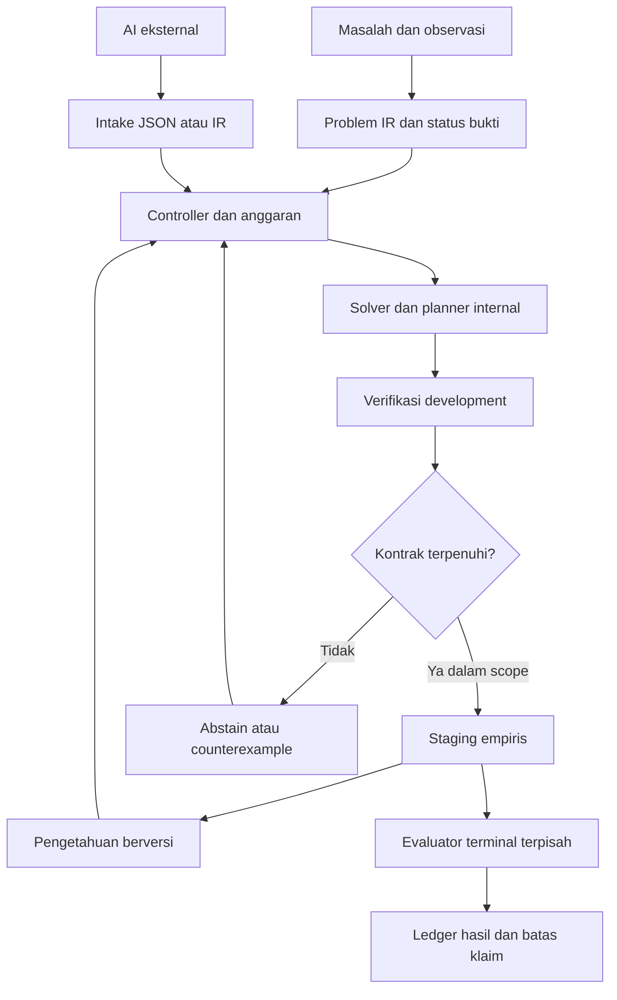

# ACE menuju OAIE: audit aktual, reasoning internal, dan perbaikan penerimaan

**Tanggal: 10 November 2026, WIB. Keputusan: lanjutkan penelitian hibrida yang terukur. ACE mempunyai pembelajaran dan penalaran simbolik terbatas yang berjalan tanpa LLM; OAIE dan kecerdasan umum belum terbukti.**

Laporan ini memperbarui audit terdahulu dengan pemeriksaan langsung repository, reproduksi reasoning yang sudah tersedia, dan satu irisan implementasi baru di [draft PR #97](https://github.com/dianzherdiana25-hash/ACE/pull/97). Perubahan memakai modul lama, bukan membuat solver atau model fondasi pengganti. Status tetap **NOT_ASSESSED / BLOCK_RELEASE / OAIE_NOT_ESTABLISHED**.

## 1. ACE Saat Ini

### Versi yang benar-benar diperiksa

| Objek | HEAD / status yang dibaca | Implikasi |
|---|---|---|
| `main` | `c55e2b8f83ae4aa37236af2a1a685911e6ad8599` | Bukan HEAD draft integrasi. CI pada commit sebelumnya tidak otomatis berlaku pada SHA ini. |
| `ace-termux-20261110` | `d710ca00d68d6f96b753615ae28261ba4137d988` | Basis PR #94; tidak membuktikan versi yang sedang dipakai HP. |
| [PR #94](https://github.com/dianzherdiana25-hash/ACE/pull/94) | `52394dcf6f203197ffa66b2dc7f802c475690a63`, terbuka/draft | Target `ace-termux-20261110`. Enam workflow pada SHA ini berhasil; status ilmiah tetap terpisah. |
| [PR #95](https://github.com/dianzherdiana25-hash/ACE/pull/95) | `01916ad375aebd81aaa6d027a4f4d682a0e2cde8`, terbuka/draft | Integrasi reasoning yang sudah ada; target branch #94. Dipakai ulang dan direproduksi. |
| [PR #96](https://github.com/dianzherdiana25-hash/ACE/pull/96) | `e1fdbf09da6aaec4b7a3e426771af81b989ebe1c`, terbuka/draft | Menutup klaim penerimaan tanpa replay pada Mission Bus; target #95. Basis pekerjaan ini. |
| [PR #97](https://github.com/dianzherdiana25-hash/ACE/pull/97) | Implementasi `23082cc4667b682d6354dec283ee466a1a5113f8` | Branch `research/ace-admission-counterexamples-20261110`, target #96. Commit laporan menyusul source ini. |

Snapshot ref, PR, sembilan issue terbuka yang ditemukan, dan run #94/#96 disimpan di [github-snapshot.json](../../evidence/w3_admission/github-snapshot.json). PR #94/#95/#96 bukan tiga sistem yang semuanya sudah aktif pada main. Urutan stack yang perlu direview adalah **#94 → #95 → #96 → #97**. Tidak ada merge pada sesi ini.

`STATUS.md` masih memuat HEAD historis dan istilah seperti `CONFIRMED_SEALED`, “15 mesin terverifikasi”, serta klaim penerimaan siklus. Isi itu tidak cukup untuk menetapkan keadaan sekarang. Seed evaluasi yang tidak dipublikasikan, tes hijau, atau izin pemilik tidak dengan sendirinya membuktikan evaluator independen ataupun penemuan ilmiah.

### Cakupan dan peta kode

Tree implementasi dibaca sebagai source, diparse, dan diinventarisasi: **339 berkas Python, 74.763 baris, 48 paket**. Penelusuran manual difokuskan pada jalur data, learner, verifier, admission, daemon, checkpoint dan efek Git. Ini bukan klaim semua baris telah diperiksa secara formal atau setiap cabang kontrol telah diuji. [Inventory lengkap](../../evidence/w3_admission/source-inventory.json.gz) berisi path, hash, simbol, docstring dan impor. [Peta 48 paket terdahulu](ACE_SOURCE_MAP_20261110.md) berguna sebagai lampiran fungsional, dengan basis dan jumlah file historisnya sendiri.

| Komponen yang tersedia | Fungsi nyata | Bukti / batas |
|---|---|---|
| [Runtime](../../code/ace_runtime/engine.py), `ace.py`, CLI | Antrean SQLite, inferensi counter/DFA/product, prediksi, pelaporan, restart | Tes runtime dan replay demo. Domain string a/b serta grammar tertentu; bukan pemahaman masalah umum. |
| `ace_candidate_search`, `ace_component_synthesis`, `ace_synthesis`, `ace_evolution` | Sintesis AST bertipe, observational equivalence, CEGIS, evolutionary search | Pencarian dapat berjalan tanpa AI eksternal. Operator dan bahasa dasarnya disediakan peneliti. |
| `ace_automata`, `ace_research_primitives` | Induksi automata L*/RPNI dan generalisasi dalam kelasnya | Pembelajaran struktur automata sungguhan, dengan asumsi oracle/data; bukan tipe komputasi fundamental baru. |
| `ace_neurosymbolic`, `ace_mcts`, `ace_autonomy/planner.py` | A*, UCT, sketch/refinement, dekomposisi tujuan bertipe | Banyak rencana/kategori tujuan masih katalog. `NeuralGuidedAStarSearch` memakai estimator sinyal statistik; nama neural tidak membuktikan model neural telah dilatih. |
| `ace_smt`, `ace_abstract_interp`, `ace_interpolation`, `ace_ilp`, `ace_egraph` | Constraint, domain abstrak, invariant, induksi aturan dan rewrite | Dapat digunakan sebagai verifier khusus domain. Unit test contoh bukan bukti soundness universal. |
| [Reasoning](../../code/ace_cognition/reasoning.py) dari #95 | Problem xy → recall/advice → sintesis internal → verifikasi → abstain/staging → memori executable | Direproduksi: 552/576 terminal benar, sama dengan fresh solver. Nol panggilan model. |
| `ace_selfmodel`, `ace_cognition/evolutionary_memory.py`, R9, repair memory | Pengalaman, fitur, reuse dan retensi | Berbagai penyimpanan belum menjadi satu knowledge system lintas domain. Checksum/HMAC lokal bukan tanda tangan evaluator independen. |
| `ace_research_repair` | Diagnosis bug, operator patch, pengujian dan retensi patch | Pada hasil v1/v2, 12 target nominal terselesaikan, seri dengan strong fixed/fresh. Hipotesis keunggulan ketat H1 gagal. |
| `ace_research_agenda`, `ace_self_dev`, `ace_loop`, F10–F14 | Pemilihan kampanye, hipotesis, mutasi, query, lineage dan checkpoint | Ada algoritma adaptif, tetapi sebagian strategi/kandidat tetap ditulis peneliti. F14 v3 mempunyai hasil negatif penting. |
| `ace_host_controller`, `ace_evaluator`, `ace_mission` | Kontrol lineage, exposure, evaluasi, antrean dan keputusan | #96 menambah replay IR sebelum staging. Belum semua jalur memakai satu kontrak penerimaan yang konsisten. |
| `ace_code_agent/ai_advisor.py`, static probe | Konsultasi `ask-ai`, intake dan interpretasi AST aritmetika terbatas | Diagnostik offline lima catatan direproduksi; provider sebenarnya tidak terverifikasi, kandidat tidak terhubung ke algoritma aktif. |
| Daemon, dashboard, `ace_self_evolver.py`, `auto_curriculum.py`, `install.sh` | Loop, telemetry, watchdog, status serta beberapa jalur commit/push | Source diperiksa. `ace_self_evolver.py` memiliki push ke main; tidak dijalankan. Instalasi/daemon aktif pengguna tidak disentuh. |

Paket lain di inventory mencakup BALD/epistemic sampling, PAC-Bayes, conformal prediction, game theory, embedding AST, transducer/lens, parser log, data wrangling, Git/network tools, laporan HP dan red team. Keberadaan fungsi adalah bukti implementasi; klaim efisiensi, generalisasi atau jaminannya harus dinilai terhadap eksperimen dan asumsi masing-masing.

### R1–R9 dan S1–S5

Ref riset diperiksa langsung; beberapa source dan hasil terbaru berada di branch terpisah, bukan tree runtime ini. Seluruh eksperimen historis tidak dieksekusi ulang.

| Jalur | Bagian yang dapat dipakai kembali | Temuan yang membatasi klaim |
|---|---|---|
| R1 | Induksi DFA dan residual feature construction | H7 membangun fitur dari observasi dalam kelas yang disediakan; memakai base predictor istimewa yang benar. |
| R2 | Retrieval, retensi, forgetting, budget memori | v6: `HOLD_NO_VALIDATED_LIFELONG_SKILL_ADMISSION`; empat head dan tugas kelima belum memberi bukti lifelong admission yang lolos. |
| R3 | Mutasi graf dan credit assignment | v4/v4b menyimpan hasil negatif terhadap kontrol struktural. |
| R4 | Adaptasi learning policy | Studi meta-learning ada; pemilihan/persistensi parameter belum membuktikan mekanisme belajar baru lintas domain. |
| R5 | Intervensi, biaya query, identifiability | Asumsi instrumen/kausal dapat gagal; ada laporan invalid-IV dan countermodel. |
| R6 | Planning, recovery, value of information | Learned-VOI tidak otomatis mengalahkan kebijakan tetap; hasil transfer dan biaya harus dibaca bersama. |
| R7 | Selective prediction dan akuisisi informasi | R7.6 comparison gate lulus, tetapi scientific HOLD; narrow control masih lebih baik pada utility agregat. |
| R8 | Measurement, lineage, false-progress falsifiers | Digunakan untuk membedakan efek grammar, budget, seleksi dan perubahan kemampuan. |
| R9 | Transfer fitur okupansi DFA | Bukti publik positif bergantung sumber terpilih; hidden semantic inversion menerima salah 9/10 unit. |
| S1 | Hipotesis dan adaptive query selection | S1-AA menolak H1: adaptive gagal mengalahkan random/diversity pada nominal dan shifted XOR. |
| S2 | Typed arithmetic search | Reuse backend; arsip ekuivalensi netral PR #92 mempunyai hasil negatif, bukan bukti open-endedness. |
| S3 | Non-oracle/dual-source transfer controls | v4: single dan dual sama-sama nol regret; peningkatan yang disyaratkan tidak tercapai. |
| S4 | Pewarisan posterior/policy | v4: 1.063/1.536 future successes, kontrol terbaik 1.078; REJECT. |
| S5 | Quality-diversity archive | Pilot anti-stagnasi negatif; keragaman descriptor tidak cukup untuk membuktikan kemampuan meningkat. |

Jadwal GitHub terpisah dari jalur S1–S5: workflow scheduler harian dan software researcher ada, tetapi keberadaan cron tidak membuktikan semua eksperimen tersebut berjalan saat ini. Tidak ada automation atau konfigurasi jadwal yang diubah.

## 2. Kesenjangan Arsitektur

Kesenjangan utama adalah hubungan **bukti → keputusan → kemampuan yang bisa dipakai ulang**. ACE sudah mempunyai banyak algoritma; menambah nama modul tidak akan menutup hubungan tersebut.

| Kebutuhan | Dukungan lama | Gap yang dapat ditunjukkan |
|---|---|---|
| A. Cognitive architecture | Goal policy, planner, self-state, episodic memory | Belum ada representasi terpadu fakta/asumsi/aksi/constraint dan working state lintas domain. Problem #95 baru xy; runtime utama baru a/b. |
| B. Internal reasoning | Component synthesis, CEGIS, A*/MCTS, SMT | Solver belum terikat konsisten ke semua entrypoint. W3 menerima berdasarkan training meskipun validasi nol; irisan ini memperbaikinya. |
| C. Continual learning | Library, R2/R9, generation/replay | Retensi model ada; kemampuan belajar baru dengan batas memori dan source cost belum tervalidasi luas G0–G3. |
| D. Representation discovery | Induksi automata, macro, DSL/F14 | Sebagian besar kelas operator disediakan programmer. F14 v3 menolak klaim primitive dan transfer baru pada keluarga berbeda. |
| E. Evolution algoritma/arsitektur | Mutasi gene, island search, Pareto, R3 | Variasi parameter/template sering belum mengubah prosedur belajar. Keuntungan belum dipisahkan dari grammar atau tambahan compute. |
| F. Long-term memory | SQLite dan beberapa memory store | Provenance, konteks berlaku, counterexample, dependencies, versi dan prosedur aplikasi belum terpadu. |
| G. Active learning/curiosity | BALD, F12, agenda, R7 | Information gain dalam kelas salah dapat menyesatkan; studi S1 menunjukkan adaptive kalah kontrol. |
| H. Autonomous software engineering | Repair corpus, patch operators, sandbox gate | Belum ada bukti keunggulan pada repositori multi-file baru dengan ruang kandidat besar dan containment aktual. |
| I. Independent evaluation | Host controller, receipts, reference interpreter | Shared process/key/seed tidak menjamin custody independen. Masih ada gate lain dan bug lock yang terbuka. |
| J. Multi-AI | `ask-ai`, consultation records, internal fallback | Provider/usage/biaya dan pengaruh saran belum dibuktikan melalui eksperimen B/C nyata. Source teks sering hanya menjadi helper tambahan. |

Ada pula celah operasi: `StateManager.release_lock` melepas lease walaupun token salah. Reproduksi di workspace sementara tersimpan di [unresolved-lock.json](../../evidence/w3_admission/unresolved-lock.json). Perbaikan W3 tidak memperbaiki lease atau menjamin keselamatan semua jalur daemon.

## 3. Kelayakan OAIE

Kelima tingkat ini bukan sinonim dan tidak merupakan tangga yang otomatis akan dilalui.

| Tingkat | Apa yang memungkinkan / sudah diperagakan | Kecukupan ACE dan hal yang belum diketahui | Hambatan, eksperimen pembantah, data/compute |
|---|---|---|---|
| 1. Autonomous software system | Queue, tool use, transaksi, restart dan bounded jobs adalah teknologi operasional yang matang. | ACE memiliki banyak komponen, belum terbukti konsisten di seluruh entrypoint dan HP aktif. | Uji dua worker, kill/restart, corrupt checkpoint, duplikasi efek eksternal dan budget habis. Pilot CPU/stdlib dan SQLite kecil memungkinkan; ukur RAM aktual. |
| 2. Autonomous research agent | Sistem berbasis model sudah menghasilkan hipotesis dan menjalankan bagian besar pipeline riset. | ACE mempunyai agenda/eksperimen, tetapi banyak hipotesis masih katalog; kualitas dan novelty belum dijamin. | Bandingkan discovery yang direplikasi per biaya terhadap agenda tetap/acak. Ribuan contoh sintetis dan CPU cukup untuk eksperimen sempit; eksperimen dunia nyata berbeda biayanya. |
| 3. Adaptive learning system | Induksi program, automata, continual learning dan meta-learning memang mengubah model dari pengalaman. | ACE belajar model dalam grammar terbatas; beberapa hasil transfer positif, beberapa negatif. Belum learner umum. | G0–G3 pada tugas baru, source cost dihitung, forgetting diuji. Ribuan–puluhan ribu label sintetis masuk akal sebagai anggaran pilot; neural training besar bukan kebutuhan awal. |
| 4. Open-ended intelligence evolution | Library learning, co-evolution curriculum dan evolusi kode memperagakan bagian mekanismenya. | Tidak ada bukti ACE dapat terus memperluas representasi/metode dan mempertahankan peningkatan lintas generasi. | Uji keluarga yang tidak dipakai merancang operator; kalahkan fixed/fresh/extra-compute setelah biaya sumber dimasukkan. Tidak ada estimasi kebutuhan compute atau jaminan konvergensi untuk visi penuh. |
| 5. General autonomous intelligence | Sistem modern memiliki kemampuan luas; hasil benchmark tertentu tidak menetapkan kecerdasan umum otonom. | Arsitektur/bukti ACE belum memadai. Tidak diketahui apakah jalur ini akan mencapai tingkat tersebut. | Uji lintas domain, adaptasi tanpa tuning per tugas, reliabilitas dan ketergantungan eksternal. Data/RAM/compute tidak dapat diperkirakan dari toy benchmark ACE; tidak ada dasar mengklaim HP mencukupi untuk visi penuh. |

Anggaran di kolom terakhir adalah rancangan eksperimen, bukan pengukuran Redmi/Termux. Kegagalan suatu grammar bukan bukti OAIE mustahil. Keberhasilan eksperimen berhingga juga bukan bukti pertumbuhan kecerdasan tanpa batas. Kesadaran dan pengalaman subjektif adalah pertanyaan terpisah yang tidak dijawab oleh audit ini.

### Penelitian primer yang diverifikasi

Sumber dibaca sampai 10 November 2026. Penerapan ke ACE merupakan penilaian arsitektural, bukan hasil yang secara langsung dibuktikan paper tersebut.

| Sumber | Bukti yang relevan | Batas inferensi untuk ACE |
|---|---|---|
| [DreamCoder, Ellis dkk.](https://arxiv.org/abs/2006.08381) | Library simbolik dan panduan neural dipelajari bersama melalui wake/sleep; abstraksi komposisional dapat dipakai ulang. | Mendukung library learning, bukan bukti operator universal baru atau OAIE. |
| [LAPS, Wong dkk., ICML 2021](https://proceedings.mlr.press/v139/wong21a.html) | Bahasa membantu pembelajaran library/search; manfaat tetap tampak tanpa petunjuk bahasa pada test. | Contoh konkret saran bahasa yang menghasilkan kemampuan executable internal, bukan sekadar menyimpan jawaban. |
| [Palmarini dkk., ICML 2024](https://proceedings.mlr.press/v235/palmarini24a.html) | Mengekstrak komponen library dari pengetahuan neural yang sudah diamortisasi memperbaiki sintesis pada domain uji. | Biaya melatih search policy tetap harus dihitung; kompresi library belum menjamin transfer luas. |
| [MAML, Finn dkk., ICML 2017](https://proceedings.mlr.press/v70/finn17a.html) | Inisialisasi dipelajari agar cepat beradaptasi dengan sedikit contoh/gradient steps pada tugas terkait. | Meta-learning perlu benar-benar mengubah bias belajar; menyimpan parameter saja tidak cukup. |
| [DreamerV3, Hafner dkk., Nature 2025](https://danijar.com/project/dreamerv3/) | World model terlatih dan imagined rollouts mendukung kontrol pada lebih dari 150 tugas dengan konfigurasi bersama. | Membuktikan model-based RL berguna dalam eksperimen mereka; tidak menyamakan budgetnya dengan ACE di HP. |
| [DRAGO, Fu dkk., ICML 2025](https://proceedings.mlr.press/v267/fu25f.html) | Synthetic rehearsal dan exploration mempertahankan world model ketika reward berubah. | State space/dynamics dalam studi tetap sama; bukan bukti continual learning tanpa asumsi. |
| [Goebel & Zips, 2025](https://arxiv.org/abs/2507.23589) | Membandingkan rencana LLM dengan Fast Downward; resource/state/constraint tetap menjadi kesulitan pada tugas lebih kompleks. | Gunakan planner dan verifier yang eksplisit; evaluasi rencana yang executable, bukan kelancaran penjelasan. Preprint, bukan jaminan semua model terbaru gagal. |
| [Enhanced POET, Wang dkk., ICML 2020](https://proceedings.mlr.press/v119/wang20l.html) | Tantangan dan solusi berevolusi bersama, dengan transfer serta pengukuran novelty. | Ruang lingkungan dan eksperimennya tetap terbatas; open-endedness umum belum dibuktikan. |
| [AlphaEvolve, Novikov dkk., 2025](https://arxiv.org/abs/2506.13131) | LLM + evolutionary search + evaluator menghasilkan perbaikan algoritma yang dapat diperiksa. | Generator tetap model eksternal; keberhasilannya tidak membuktikan reasoning mandiri ACE. |
| [Darwin Gödel Machine, Zhang dkk., revisi Maret 2026](https://arxiv.org/abs/2505.22954) | Evolusi kode/arsip agen memperbaiki benchmark coding yang dilaporkan, memakai foundation model. | Self-modification empiris bukan bukti peningkatan kecerdasan tanpa batas atau biaya kecil. |
| [Co-Scientist, Gottweis dkk., Nature Mei 2026](https://www.nature.com/articles/s41586-026-10644-y) | Sistem Gemini menghasilkan, meninjau dan mengembangkan hipotesis; sebagian mendapat verifikasi eksperimental. | Mendukung kelayakan tingkat 2 dalam cakupan tertentu; tidak membuktikan evaluator sempurna, general intelligence atau lepas dari foundation model. |

Kesimpulan ilmiah: **tingkat 1–3 dapat diteliti dan sebagian sudah diwujudkan secara terbatas; tingkat 4–5 tetap pertanyaan terbuka. Tidak ada sumber di atas yang menjamin OAIE ACE dapat dicapai.**

## 4. Desain Reasoning Engine ACE

### Arsitektur dan pembagian otoritas



Panah terminal tidak kembali ke pemilihan kandidat pada kohort yang sudah dinilai. Hasil negatif boleh melahirkan protokol baru dengan bank baru, sambil mempertahankan hasil lama. Diagram adalah desain integrasi; belum semua panah merupakan satu runtime yang sudah selesai.

**Problem representation.** Pertahankan `Problem.from_data` #95 untuk xy dan kontrak a/b lama. Tambahkan adapter, bukan solver duplikat, ketika domain baru diperlukan. Schema lintas domain yang diusulkan memuat goal/subgoal, state awal, aksi/precondition/effect, constraint, fakta beserta sumber, asumsi, informasi hilang, uncertainty, done/failure predicates dan budget. Pernyataan penasihat masuk sebagai `HYPOTHESIS/UNVERIFIED`, tidak menjadi fakta karena model mengucapkannya.

**Hypothesis generation.** Gunakan enumerasi komponen/CEGIS, induksi automata/aturan, analogi library, dan causal probes sesuai domain. Setiap kandidat memiliki `origin=INTERNAL_SYNTHESIS`, `REVALIDATED_MEMORY` atau `EXTERNAL_ADVICE_UNVERIFIED`; provenance tidak boleh menentukan kebenaran. Memiliki beberapa kandidat penting untuk mencari kontra-contoh dan mengenali ambiguitas. Memilih komposisi dari grammar tidak diklaim menciptakan kelas representasi baru.

**Deliberation/planning.** BFS cocok untuk state kecil dan cost seragam; A* bila heuristic valid tersedia; HTN untuk subgoal dengan precondition/effect; MCTS untuk konsekuensi stokastik dengan simulator yang telah divalidasi. Pakai implementasi yang sudah ada, ukur node expansion dan predictor calls, serta bandingkan dengan enumerasi yang sama kuat. Jangan memindahkan semua tugas ke MCTS atau menyamakan jumlah langkah dengan kecerdasan. Planner harus berhenti ketika budget habis dan merevisi state bila observasi membantah model transisinya.

**Verification.** Pisahkan validasi schema/type, kecocokan development, constraint/metamorphic tests, terminal evaluation, baseline comparison dan retention gate. W3 kini memerlukan nol error validasi meski training diberi toleransi. Itu tetap pengujian empiris pada data yang tersedia. Terminal/keluarga baru harus dikelola evaluator lain. Counterexample menyebut input, expected, actual, split dan versi evaluator; bukan hanya “tes gagal”.

**Metacognition.** Pakai predictor/Brier/ECE serta R7 dengan kalibrasi pada data terpisah. State epistemik minimum: diketahui dengan bukti, dugaan, terbantahkan, belum diuji. Minta penasihat jika budget pencarian internal habis atau pengetahuan/representasi memang kurang; abstain jika evaluator, integritas atau informasi tidak cukup. Jangan memberi confidence tinggi berdasarkan agreement beberapa model yang berbagi bias. Selective risk harus dilaporkan bersama coverage, per keluarga dan saat shift.

**Memory consolidation.** Reuse SQLite `ExperienceMemory`/`ReasoningMemory`; simpan IR executable, identitas/hash, scope/preconditions, dependencies, provenance, support, failure, counterexample, versi dan aturan revalidation. Memori #95 sudah menyimpan program dan bukti development, membatasi 128 knowledge records/1.024 trial records, memeriksa digest implementasi, dan memvalidasi ulang sebelum recall. Ia belum mempunyai causal knowledge graph umum atau mekanisme pemadatan/forgetting yang terbukti. Log percakapan dan similarity token hanya indeks tambahan.

**Recursive improvement.** Kandidat perubahan learner/search policy adalah artefak terpisah dari learner operasional. Hanya IR tertutup yang boleh diinterpretasi tanpa sandbox OS terverifikasi; Python dari AI tetap tidak dieksekusi. Promosi memerlukan review/evaluasi terpisah, retensi, rollback dan perubahan state yang terikat receipt. Siklus dan kontraknya:

| Langkah | Input → output | Batas dan acceptance |
|---|---|---|
| Observe | Observasi + sumber → evidence records | Validasi ukuran/type, deduplikasi; tidak menambah label tanpa budget. |
| Represent | Evidence + goal → Problem IR | Fakta/asumsi dibedakan; domain yang tidak didukung ditolak. |
| Reason | IR + library → beberapa hipotesis | Closed grammar, origin, candidate/node/operation cap. |
| Plan | State + hipotesis → aksi/eksperimen | Precondition/effect dan cost eksplisit; tidak ada aksi eksternal otomatis di irisan ini. |
| Test | Kandidat beku + development probes → prediksi | Label dipisahkan dari terminal; interpreter atau containment tervalidasi. |
| Evaluate | Prediksi + aturan beku → accept-development/reject/abstain | Gate tidak boleh mempercayai status sukses dari generator. |
| Learn | Kandidat yang lolos + evidence → knowledge record | Transaksi, provenance, applicability dan versi harus lengkap. |
| Reflect | Hasil/biaya/kontra-contoh → diagnosis | Reuse stagnation/metacognition; nomor siklus bukan progress. |
| Revise | Diagnosis → rencana/protokol baru | Tidak menimpa hasil lama atau memakai terminal lama untuk menyeleksi ulang kandidat. |

Pada irisan xy sekarang, maksimum 5 detik/300.000 primitive operations per pemecahan, <=4 advice trees, kedalaman IR <=4 dan <=31 node. Ini batas yang benar-benar diimplementasikan, bukan batas global semua modul ACE. Budget pipeline umum di atas masih rancangan.

### Eksperimen A/B/C dan jawaban mandatory

| Kondisi | Eksekusi / hasil aktual | Kesimpulan |
|---|---|---|
| A: tanpa AI eksternal | Replay #95: 8 keluarga ×3 seed, 24 tugas; **552/576** benar, 23/24 staging, 7/8 keluarga lolos; nol model calls. Sama dengan fresh solver beranggaran sama. | Ada induksi/eksekusi aturan internal yang bisa dijalankan tanpa provider. Bukan keunggulan atas solver lama. |
| B: AI sebagai penasihat | Fixture JSON/IR tertulis peneliti: **576/576**; input source yang tidak sah dan kandidat salah ditolak. | Menguji mekanisme menerima/menolak saran, **bukan** eksperimen provider nyata. Tidak dihitung sebagai reasoning otonom atau kemampuan model eksternal aktual. |
| C: AI sebagai pengendali | **NOT_RUN**; tidak ada `ask-ai` terautentikasi di executor ini. | Tidak tersedia hasil correctness/token/biaya/latensi provider yang sah; tidak dibuat angka pembanding. |
| Retensi | 23 program yang staged dipanggil kembali setelah proses restart pada input development baru; satu tugas awal abstain. | Retensi kondisional 23/23; gate semua tugas 23/24 tetap gagal. Bukan transfer lintas keluarga. |
| Hidden shift | Development sama, target terminal berubah: keputusan tetap staging, **0/24** benar. | Keterbatasan identifikasi semantik dipertahankan. |

Replay byte-identical terhadap [public-v1.json](../../evidence/internal_reasoning/public-v1.json); reference interpreter lama memeriksa 72 sel skor. Label “unique” pada summary lama mempunyai batas yang dijelaskan [accounting-v1.json](../../evidence/internal_reasoning/accounting-v1.json), bukan diam-diam diganti.

Untuk B/C nyata berikutnya: bekukan task/info yang sama, maksimal empat proposal dan cap token/usage yang disepakati, hindari memberi terminal ke model, catat provider endpoint/model/request ID, token, jumlah panggilan, biaya aktual, latensi, RAM, recovery dan correctness per keluarga. Pisahkan cost model eksternal dari operasi solver, serta laporkan frontier kualitas-versus-biaya jika unit compute tidak sebanding. A harus berjalan saat koneksi model dinonaktifkan. B harus tetap dapat menolak saran yang salah. Provider berkuota tidak dianggap tanpa batas.

**Jawabannya: ACE sudah lebih dari wrapper pada domain simbolik yang diuji. Ia memiliki inferensi/program yang berjalan tanpa model eksternal. Belum ada bukti kemampuan memahami dan menalar masalah bahasa alami umum secara mandiri, atau bahwa konsultasi `ask-ai` menghasilkan metode internal baru.**

## 5. Rekomendasi Penambahan Sistem

Prioritas mempertimbangkan dampak, kekuatan bukti, kompleksitas dan HP. Anggaran di bawah adalah batas awal usulan yang harus diukur, bukan konsumsi hardware yang sudah diketahui. Tidak perlu menambah framework/dependensi besar.

**I — P0: satu kontrak penerimaan berbasis bukti.** Tujuan: menyamakan arti proposal, staging, scientific evaluation dan deployment. Reuse admission Mission Bus #96, W3 di #97 dan HostController. Gap dibuktikan oleh penerimaan W3 dengan validasi nol dan perbedaan gate antar-entrypoint. Bind problem/program/source/evaluator/version/split/cost dalam receipt; evaluasi actual behavior. Benchmark: 100% contoh invalid ditolak dan kontrol positif tetap memperoleh coverage. CPU/stdlib, satu worker, input bounded; biaya utamanya replay. Risiko: over-abstention dan menganggap finite tests sebagai kebenaran universal. Ini fondasi OAIE karena “belajar” tidak berarti apa-apa bila hasil yang salah diterima.

**A — P1: Problem/State/Goal dan working memory terpadu.** Reuse `Problem`, goal policy dan planner. Gap: domain xy/a-b tidak membawa aksi, asumsi atau sumber fakta. Bangun adapter dengan schema dan status bukti, tanpa solver kedua. Dependency: kontrak I. Mulai <=128 fakta/32 subgoal dan satu proses; uji contradiction, missing information, precondition failure serta pemulihan. Sukses: seluruh adapter memberi hasil yang sama pada round-trip dan tidak menaikkan dugaan menjadi fakta. Risiko: schema terlalu luas atau parsing LLM salah. Penting untuk mempertahankan arti masalah saat kemampuan bertambah.

**B — P1: controller reasoning/planning yang memilih solver lama.** Reuse component synthesis, CEGIS, A*, MCTS dan constraint tools. Gap: implementasi terpisah dan replanning belum terpadu. Pilih backend menurut tipe masalah; meter state expansion/primitive work, simpan rival hypothesis/counterexample. Dependency: A/I. Mulai 300.000 operasi/5 detik untuk xy dan plafon terpisah untuk graf. Benchmark: keluarga baru dengan kontrol fresh/exhaustive; target kualitas >=95% pada coverage >=80% sebagai pilot, bukan janji umum. Risiko: heuristic bias, combinatorial explosion, memakai lebih banyak compute. Penting agar langkah selanjutnya dipilih ACE, bukan selalu ditentukan penasihat.

**F — P1: consolidation pengetahuan executable.** Reuse SQLite knowledge, repair memory dan lineage. Gap: provenance/negative evidence/applicability terfragmentasi. Tambahkan record relasional dan revalidation; jangan hanya menyalin percakapan. Dependency: A/I. Mulai <=128 kemampuan dengan cap disk terukur. Benchmark: restart, corruption/tamper, konteks berubah, versi interpreter berubah. Sukses: semua reuse memiliki bukti/versi dan gagal tertutup bila kondisi berlaku tidak cocok. Risiko: retrieval salah atau checksum disalahartikan sebagai independensi. Penting untuk akumulasi kemampuan, bukan akumulasi log.

**C — P2: continual learning dan transfer G0–G3.** Reuse R2/R9, generation library, replay. Gap: retensi dalam rule yang sama belum far transfer. Bandingkan inherited/fresh/fixed/replay dengan total source/target budgets sama. Dependency: F/B. Pilot tiga keluarga baru, >=20 seed berpasangan, batas memori sama; ukur backward/forward transfer dan family-worst forgetting. Sukses yang diusulkan: kenaikan >=10 poin atau pengurangan work >=20% pada kualitas setara, regresi kemampuan lama <=2 poin. Risiko: negative transfer, task-ID leakage dan source cost diabaikan. Inilah pengujian langsung kemampuan yang bertahan antar-generasi.

**G — P2: curiosity dengan kalibrasi dan value of information.** Reuse BALD/F12/R7/agenda, jangan membuat curiosity engine baru. Gap: adaptive policy dapat kalah diversity/random. Pilih query dengan expected error reduction per cost dan opsi tidak bertanya. Dependency: B/F. Pilot <=32 query/tugas, compute search termasuk perbandingan baseline. Benchmark: random, diversity, fixed-never, salah grammar, correlated/OOD. Sukses: penurunan label/work pada correctness/coverage setara dengan interval paired yang mendukung; hentikan bila tak mengalahkan kontrol. Risiko: confidence palsu dalam kelas hipotesis salah. Penting untuk memilih riset yang benar-benar mengurangi ketidaktahuan.

**H — P2: autonomous repair multi-file yang terbatas.** Reuse seluruh `ace_research_repair`, diagnosis dan patch operators. Gap: benchmark kecil mencapai ceiling sama dengan strong fixed. Gunakan korpus baru dengan >=100 kandidat relevan per task, multi-edit, terminal/regresi terpisah. Dependency: I dan containment yang benar-benar diuji. Pilot CPU 60 detik/tugas dan cap proses/RAM terukur; kode tidak tepercaya tidak dijalankan bila isolasi belum tersedia. Sukses: lebih banyak bug benar terselesaikan pada compute sama, tanpa lolos trap. Risiko: test overfit, forged receipts, efek file/jaringan. Penting sebagai domain pertama perbaikan mekanisme ACE yang bisa divalidasi nyata.

**J — P2: integrasi Multi-AI sebagai sumber proposal.** Reuse advisor dan parser IR. Gap: label “PowerBrain/GPT/…” dalam catatan bukan provider identity terverifikasi. Adapter mengembalikan IR, endpoint/model yang dilaporkan, request ID, usage, error/latency dan biaya/kuota yang diketahui; sisanya `UNKNOWN`. Dependency: I/B. Mulai satu provider sah dan budget panggilan kecil; model lokal hanya setelah RAM diukur. Benchmark A/B/C dengan informasi setara dan advice beracun/salah. Sukses: B dapat menolak kandidat buruk dan tetap menyelesaikan tugas saat provider mati. Risiko: bias bersama, kuota/biaya, ketergantungan pada jawaban model. Penting agar AI eksternal memperkaya hipotesis tanpa mengambil otoritas bukti.

**D — P3: discovery representasi melalui library learning.** Reuse abstraction/wake-sleep, R1 residual induction, e-graph dan R9. Gap: kelas primitive masih authored. Mulai belajar macro dari korpus solusi dan ukur penurunan description length serta transfer pencarian. Dependency: F/C dan evaluator terpisah. Pilot CPU beberapa menit/batch, corpus kecil terpisah; tidak perlu train LLM. Benchmark: no-macro, fixed richer grammar, random macro, extra-compute. Sukses: reuse di keluarga baru menghemat total biaya, termasuk membangun library. Risiko: kebaruan ejaan, compression tanpa manfaat, programmer memasukkan jawaban. Penting untuk memperluas bahasa pemecahan masalah; masih bukan bukti menciptakan primitive fundamental.

**E — P3: evolusi metode belajar/arsitektur.** Reuse R3, source evolution dan Pareto search. Gap: mengubah koefisien bukan mengubah learner. Representasikan learner/search policy sebagai objek eksperimen terpisah; uji perubahan induktif pada tugas yang belum dinilai. Dependency: C/D/I dan containment bila source umum. Batasi 20 varian/batch dan seluruh source+target cost. Benchmark: fixed learner, random mutation, stronger search, matched extra-compute, retention. Sukses: keunggulan bertahan G1→G2→G3 pada keluarga berbeda; jika tidak, REJECT. Risiko terbesar: evaluator gaming dan biaya eksponensial. Ini paling dekat dengan visi metode-belajar-baru, tetapi harus datang setelah atribusi kemajuan dapat dipercaya.

## 6. Roadmap Prioritas

| Horizon / tahap | Milestone yang dapat diperiksa | Kriteria berhenti / keputusan |
|---|---|---|
| 7 hari — A Stabilize | Review stack #94–#97; selesaikan lease/token dan audit semua entrypoint penerimaan; replay v1 custody/v2 current; satu mode diagnostik tanpa auto-push; ukur resource di HP. | Tidak mengaktifkan kandidat jika gate masih dapat dilewati, receipt tidak cocok, dua worker merusak state, atau biaya belum diketahui. |
| 30 hari — B Reasoning + G pengalaman HP | Satu Problem/State adapter tambahan; solver lama terhubung ke planner/verifier; A berjalan tanpa koneksi model; B/C nyata hanya bila provider sah tersedia. Dashboard menampilkan task, program, bukti, alasan abstain, heartbeat, provider observation dan resource. | Hentikan perluasan domain jika correctness naik hanya karena extra-compute, baseline kuat belum dikalahkan, atau thermal/storage cap sering dilampaui. |
| 90 hari — C Learning/transfer + F validasi | G0→G1→G2→G3 dengan tiga keluarga baru dan >=20 seed; frozen old-skill suite; source cost dan memory cap; evaluator berbeda pemilik; confidence intervals/per-family results. | Jika dua kampanye preregistered tak memberi manfaat bersih atas fresh/fixed, pertahankan sebagai toolkit dan ubah hipotesis; jangan menambah generasi untuk menciptakan kesan kemajuan. |
| Setelah fondasi lolos — D representasi/algoritma | Learned macros/search bias diuji pada bank baru dengan fixed-richer-grammar dan extra-compute controls. | Tidak promosi jika manfaat hilang saat biaya library/training dihitung atau keluarga berubah. |
| Berkelanjutan — E Autonomous research loop | Agenda memilih gap berdasarkan hasil/VOI, satu bounded worker, stagnation memicu perubahan hipotesis atau stop, hasil negatif dipersistenkan. | Stop pada budget, integritas gagal, evaluator unavailable atau tidak ada informasi pembeda; jangan menambah nomor siklus saja. |
| Setiap tahap — F scientific validation dan G reliable operation | Kill/restart, drift, poison/negative controls; UI HP start/stop/resume/status dalam scope yang tervalidasi; versi aman dapat diidentifikasi. | Engineering pass tidak mengubah NOT_ASSESSED tanpa evaluator/eksperimen konfirmatori yang memadai. |

Mulai dengan satu worker pada HP. Telemetry `SubstrateGuardian` dapat dipakai, tetapi baterai/thermal yang tidak terbaca harus tampil UNKNOWN. Ukur RSS, CPU time, wall, disk growth dan baterai selama sesi pendek sebelum menetapkan cap Android. Angka runtime Linux di bagian 7 tidak boleh dipromosikan menjadi hasil hardware Redmi.

Start/stop yang sederhana berarti ada proses yang jelas, workspace versi tertentu, checkpoint atomik dan alasan berhenti. Perintah daemon aktif/deployment tetap menunggu validasi serta keputusan pemilik; sesi ini hanya menyediakan diagnostik terpisah.

## 7. Implementasi yang Benar-Benar Dikerjakan

### Hipotesis dan ownership

[Protokol](../research/ACE_W3_ADMISSION_PRESCORE_20261110.md) diterbitkan **sebelum implementasi/scoring** sebagai commit `a225037c8cdfa9f98155ca3122efc8d048e72246`. Bug lama terlebih dahulu direproduksi dan disimpan di [before.json](../../evidence/w3_admission/before.json). H1: kandidat yang gagal validasi tidak boleh diterima; H2: kontrol benar tetap diterima; H3: train menggunakan arm tersedia yang memenuhi kontrak; H4: hidden semantic flip tetap merupakan keterbatasan, bukan “terselesaikan”.

Implementasi `23082cc4667b682d6354dec283ee466a1a5113f8` berada di branch sendiri, stacked pada #96. Tree dan HEAD hasil publikasi telah dibaca kembali; tidak ada konfigurasi eksternal yang diubah.

| File | Perubahan |
|---|---|
| [admission.py](../../code/ace_core_repair/admission.py) | Require training tolerance **dan nol error validasi**; validasi schema/budget; prediksi Boolean ketat; exception/non-Boolean ditolak; counterexample dan hitungan evaluasi; `fit_with_admission` memakai arm winners lama, deduplikasi identitas, tanpa program bila tak lolos. |
| [cli.py](../../code/ace_runtime/cli.py) | `ace.py train` memakai seleksi lama yang sudah tersedia melalui gate baru; bukan selalu composition. Hasil diagnostik memuat program serializable, arm/identity dan batas status. Tidak mempromosikan/persist model ke runtime aktif. |
| [test_admission_contract.py](../../code/ace_core_repair/test_admission_contract.py) | 13 tes baru: val=0, training noise, budget salah, data invalid/overlap, tipe output, exception, counterexamples, dan CLI starts/ratio4 yang nyata. |
| [benchmark](../../tools/ace_w3_admission_benchmark.py) | Kontrol positif/memorizer; 24 task memakai hasil fit yang identik untuk semua selector; freeze keputusan sebelum terminal; interpreter replay; label/work/profile accounting. |
| [Workflow](../../.github/workflows/ace-w3-admission.yml) | Python 3.12/3.13, checkout exact SHA, source pins, tests, dua replay dan perbandingan pinned receipt. |
| [verify_full_system.py](../../tools/verify_full_system.py) | Menambahkan modul tes baru ke harness lokal. Tidak menonaktifkan tes lama. |
| `evidence/w3_admission/` | Protokol/before, raw compressed result, profile, source inventory, snapshot GitHub, diagnostik AI, raw logs dan kegagalan lock yang belum diperbaiki. |

Tidak ada sumber E1.4 beku, evaluator independen, bukti historis, branch main, konfigurasi eksternal atau daemon pengguna yang diubah. Tidak ada kode Python kandidat AI yang dieksekusi. Callable pada tes W3 adalah fungsi internal terpercaya; selector itu sendiri bukan sandbox Python.

### Hasil benchmark baru

Delapan keluarga lama × tiga seed, 24 task. Semua kontrol mendapat hasil `fit` yang sama; tidak ada task ID/oracle/terminal masuk ke pemilihan program.

| Jalur | Task dengan program yang lolos /24 | Terminal benar /3.072 | Penerimaan dengan error validasi yang teramati |
|---|---:|---:|---:|
| Jalur W3 lama, composition + training-only admission | 9 | 972 | 3 |
| W3 diperbaiki, semua fitted-arm winners + gate | 18 | **2.304** | **0** |
| Strong selector lama, empat fitted-arm winners sama | 18 | **2.304** | 0 |
| Always abstain | 0 | 0 | 0 |

Always-abstain menunjukkan mengapa nol false admission saja tidak cukup. Jalur baru seri dengan baseline kuat: kenaikan dibanding CLI lama adalah **perbaikan integrasi dan penerimaan**, bukan algoritma pembelajaran baru. Ratio4 dan Dyck tetap tidak memperoleh program yang lolos pada bank ini. Terminal pada keluarga yang dicakup seluruhnya benar dalam pilot, bukan jaminan populasi.

Pada bank metamorfik lain, tiga true-rule controls diterima dan tiga training-memorizers ditolak; source/label/bank publik, bukan sealed holdout. Hidden flip mempertahankan keputusan ADMITTED tetapi menghasilkan **0/128**, sehingga klaim semantic safety tetap ditolak.

[Hasil mentah lossless](../../evidence/w3_admission/result.json.gz), [profil](../../evidence/w3_admission/profile.json), dan [validasi lokal](../../evidence/w3_admission/local-validation.json) dapat direproduksi. Dua run semantik menghasilkan byte yang identik. Waktu/profile sengaja dipisahkan dari payload deterministik.

Anggaran aktual integration bank: train **1.512 slot /504 observasi unik family-word-label**, validation **3.072 /2.769**, terminal **3.072 /3.072**. Bank kontrol adversarial tambahan: 45 train, 144 validation, 576 terminal slots per candidate; dua kandidat/family memakai label yang sama. Pemakaian ulang label oleh baseline bukan akuisisi label baru.

Gate baru melakukan **14.325 prediction calls**, strong development selector 18.336. Fit dibagi dan biayanya dicatat; operasi internal RPNI belum seluruhnya dimeter. Terminal dinilai oleh dua interpreter, masing-masing 5.760 prediction calls untuk tiga arm yang menghasilkan program. Tidak diklaim compute-matched end-to-end.

Run profil utama: **3,806 detik wall, 3,801 detik CPU, peak RSS 22.340 KiB** pada proses Linux. Artifact JSON mentah sekitar 1,20 MB, gzip sekitar 87 KB. **Nol panggilan model, nol paid label, nol biaya API tambahan**. Energi HP/baterai/thermal tidak diukur. Repository teramati publik; workflow baru memakai standard `ubuntu-latest`, yang [didokumentasikan gratis untuk public repositories](https://docs.github.com/en/actions/concepts/billing-and-usage). Tidak ada layanan atau runner berbayar yang dibuat.

### Tes dan CI

Lokal: **656 kasus berbeda lulus** = 501 harness +155 modul tambahan yang tidak dicakup harness. 13 tes baru termasuk dalam 501; 18 focused tests adalah subset dan tidak dijumlahkan ulang. **25/25 source pins, 13 pemeriksaan evidence, replay W3 byte-identical, replay reasoning byte-identical dan reference audit 72 score cells lulus.**

Harness lokal mulai saat HEAD protokol `a225037` dengan source implementasi di worktree; source tersebut kemudian dipublikasikan tanpa perubahan sebagai `23082cc`. Raw log mempertahankan HEAD awal, bukan diubah agar tampak sebagai clean exact-head run. CI W3 melakukan checkout SHA eksplisit.

CI implementasi: [W3 Python 3.12/3.13](https://github.com/dianzherdiana25-hash/ACE/actions/runs/42755002249), [full-system](https://github.com/dianzherdiana25-hash/ACE/actions/runs/42755001310), [research](https://github.com/dianzherdiana25-hash/ACE/actions/runs/42755001322), [runtime v2 replay](https://github.com/dianzherdiana25-hash/ACE/actions/runs/42755001527), dan [repair v2 replay](https://github.com/dianzherdiana25-hash/ACE/actions/runs/42755001636) **seluruhnya berhasil pada `23082cc`**. [R9](https://github.com/dianzherdiana25-hash/ACE/actions/runs/42755001584) juga berhasil sebagai workflow PR; workflow lama ini memakai checkout merge PR, sehingga tidak disebut sebagai exact-source-checkout yang sama. CI tidak mencakup setiap modul tambahan yang dijalankan lokal. Commit laporan berikutnya mempunyai run tersendiri yang diperiksa saat handoff, bukan mewarisi status SHA implementasi secara otomatis.

### Perintah untuk Termux, belum dijalankan di perangkat pengguna

Gunakan clone terpisah agar tidak mengganti instalasi/daemon aktif. Diperlukan Git dan Python yang sudah tersedia; tidak memasang provider atau dependency baru.

```sh
git clone --single-branch --branch research/ace-admission-counterexamples-20261110 https://github.com/dianzherdiana25-hash/ACE.git ~/ACE-audit-w3-20261110
cd ~/ACE-audit-w3-20261110
python tools/verify_sources.py
PYTHONPATH=code python -m unittest ace_core_repair.test_admission_contract -v
python tools/ace_w3_admission_benchmark.py --output ./w3-result.json --profile ./w3-profile.json
python tools/ace_ai_diagnostic.py --limit 5
```

Perintah benchmark satu kali selesai sendiri; `Ctrl+C` menghentikan proses. Ini bukan start daemon atau deployment. Untuk reasoning executable gunakan `tools/ace_reasoning.py` dengan Problem xy dan workspace terpisah seperti contoh protokol #95. Pemakaian RAM/CPU/baterai Android tetap perlu diukur di perangkat.

## 8. Evaluasi Kemajuan

| Dimensi | Keputusan yang didukung | Batas yang tetap berlaku |
|---|---|---|
| Engineering success | Gate W3 dan CLI diperbaiki; kontrol negatif/positif, replay dan tes lulus. | Tidak memperbaiki semua gate, lease atau deployment. |
| Internal AI reasoning | Ada induksi/komposisi aturan yang executable tanpa model; A 552/576 direproduksi. | Domain/grammar kecil; sama dengan fresh solver. Tidak ada LLM internal baru atau pemahaman bahasa umum terbukti. |
| Capability transfer | Reuse dalam rule yang sama setelah restart dan beberapa studi R9/generational ada. | Sesi ini tidak membuktikan transfer lintas keluarga atau kenaikan G0–G3. All-task retention gate lama tetap gagal. |
| Novel representation discovery | Tidak ditemukan primitive baru pada pekerjaan ini. | Perlu membedakan instance/macro baru dari kelas representasi baru; F14 v3 negatif tetap berlaku. |
| Scientific validation | Raw evidence/negative controls diperkuat; hipotesis W3 engineering mendapat dukungan dalam pilot. | Public author-visible data; **NOT_ASSESSED**, bukan scientific GO. Real B/C belum dijalankan. |

Kemampuan baru bagi pengguna adalah keputusan `train` yang memakai model yang sudah tersedia dengan benar dan tidak lagi menyatakan kandidat gagal validasi sebagai diterima. Tidak ada dasar menyatakan ACE menjadi lebih cerdas secara umum dari perubahan ini.

## 9. Masalah Terbesar yang Belum Terselesaikan

1. **Otoritas bukti belum konsisten di semua entrypoint.** #94 menahan source, #96 memverifikasi misi dan #97 memperbaiki W3; audit berikutnya harus mencari bypass lain. Satu jalur yang mempercayai klaim generator dapat menghapus arti semua skor.
2. **Lease/recovery antar-worker belum dapat dipercaya penuh.** Wrong-token unlock direproduksi; pemilihan state, backup dan exactly-once efek eksternal memerlukan kajian tersendiri. Ini menghambat operasi otonom yang lama.
3. **Keterbatasan identifikasi dan shift semantik.** Observasi identik tidak memberi informasi pembeda terhadap terminal yang diam-diam berubah. Butuh probe/informasi baru atau abstention sesuai scope, bukan confidence yang lebih tinggi.
4. **Gap generalisasi/representasi.** Banyak grammar/operator authored. Pada F14 v3, perluasan ke keluarga berbeda tidak memberi dukungan pada hipotesis primitive/transfer/growth. Menambah katalog jawaban tidak menyelesaikannya.
5. **Keuntungan belum stabil atas baseline kuat.** W3 baru seri strong selector; reasoning seri fresh solver; repair seri fixed pada jumlah target. Harus mengubah hipotesis atau korpus baru, bukan mengecilkan budget setelah melihat hasil.
6. **Evaluator independen dan biaya lengkap.** Secret seed, HMAC lokal atau reference interpreter tidak sama dengan pemisahan custody. Source acquisition, inference internals dan neural training harus dihitung agar klaim efisiensi dapat dinilai.
7. **Koneksi nyata serta hardware belum diuji di sesi ini.** Provider/usage/kuota dan Termux thermal/RAM/baterai belum diverifikasi langsung. Ini menghambat keputusan deployment, bukan alasan membuat hasil pengujian palsu.

## 10. Keputusan Strategis

### Perbandingan jalur

| Jalur | Potensi kemampuan dan kesesuaian kode | Data/compute dan HP/Actions | Validasi dan ketergantungan | Prospek serta hambatan OAIE |
|---|---|---|---|---|
| A. Memperbesar agent eksternal | Cepat menambah cakupan bahasa/coding; advisor sudah ada. | API/kuota/latensi mendominasi; HP bisa menjadi operator, bukan tempat melatih model. | Harus menguji actual behavior; ketergantungan eksternal tinggi. | Berguna sebagai generator/reviewer, tetapi penalaran tetap banyak berada pada provider. |
| B. Cognitive/neuro-symbolic | Cocok dengan solver, IR, planner dan verifier yang sudah ada; keputusan internal dapat ditelusuri. | Pilot CPU kecil memungkinkan; parser/policy neural opsional. | Ground truth dan IR dapat diperiksa; dependency model rendah saat domain tertutup. | Fondasi terbaik untuk reasoning terbukti; grounding dan generalisasi luas tetap sulit. |
| C. Synthesis/evolution/algorithm discovery | Paling dekat dengan banyak implementasi ACE sekarang; menghasilkan program executable. | Combinatorial search harus dibatasi; standard Actions cocok untuk batch kecil. | Evaluator kuat relatif jelas pada program/domain tertentu; provider opsional. | Baik untuk penemuan mekanisme sempit; ruang primitive/evaluator dapat menjadi batas. |
| D. Meta/continual/transfer | Penting agar hasil satu tugas berguna pada tugas/generasi lain; R2/R9 sudah menyediakan bahan. | Source data/training harus dibayar/dihitung; symbolic pilot lebih murah daripada model besar. | Ablasi fresh/fixed/replay dan task-disjoint wajib; dependency provider bisa rendah. | Potensi akumulasi kemampuan, dengan risiko forgetting, negative transfer dan bias keluarga. |
| E. Hibrida berbasis bukti | Menggabungkan B sebagai controller, C sebagai generator internal, D sebagai pembelajaran, A sebagai penasihat. | Bisa bertahap CPU/HP dengan model opsional dan budget jelas. | Paling mudah mengatribusikan manfaat jika tiap komponen punya kontrak serta ablasi; memerlukan integrasi disiplin. | **Direkomendasikan.** Tidak menjamin OAIE; integrasi dan evaluasi menjadi pekerjaan utama. |

Pembagian konkret: model eksternal menerjemahkan/mengusulkan IR; controller ACE menyimpan asumsi/tujuan dan memilih rencana; synthesis/planner internal menghasilkan serta menjalankan program tertutup; evaluator menentukan kecocokan bukti; memory mempertahankan program beserta applicability/negative evidence; agenda memilih eksperimen berikutnya. Model tidak memutuskan penerimaan atau menulis status ilmiah.

**Apakah ACE layak dilanjutkan?** Ya, sebagai platform penelitian bounded learning dan autonomous research yang dapat difalsifikasi. Tidak layak dipasarkan sebagai OAIE/AGI yang sudah selesai.

**Apa yang dipertahankan?** Kontrak runtime/SQLite, sumber pinned, learner R1/S2, synthesis/type system, planner yang benar-benar ada, metering, memory, negative controls, source/evidence replay serta hasil negatif R2–R9/S1–S5/F14.

**Apa yang diperbaiki/desain ulang?** Kontrak penerimaan lintas entrypoint, lease/state recovery, status dashboard dan provider, knowledge applicability, atribusi cost, serta cara menyebut novelty. Redesign control flow dan bukti sebelum menambah backend.

**Perlu model AI internal dari nol?** Tidak untuk milestone berikut. ACE sudah mempunyai model simbolik internal. Melatih foundation model baru tidak didukung kebutuhan maupun budget sekarang. Model kecil lokal untuk routing/proposal dapat diuji nanti jika memberi manfaat terukur dan muat RAM.

**Bagaimana menghindari wrapper?** Simpan kemampuan sebagai program/representasi yang executable dan tervalidasi; A tetap bekerja tanpa provider, B dapat menolak model, dan reuse menghemat biaya pada tugas baru. Percakapan atau jawaban AI saja bukan learned capability.

**Eksperimen yang paling mungkin menunjukkan kemampuan baru?** Pelajari macro/representasi dari solusi source, bekukan library, lalu uji pada keluarga target baru G1→G2→G3 dengan fresh/fixed-richer-grammar/extra-compute controls, biaya membangun library disertakan. Keberhasilan harus bertahan ketika asal saran eksternal dihilangkan. Hipotesis gagal bila hanya menyimpan solusi atau tidak memberi keuntungan bersih.

**Satu langkah implementasi berikutnya?** Tutup bug lease yang direproduksi: wrong token tidak boleh melepas lock, akuisisi harus atomik lintas proses, expiry/restart tidak boleh mengulang efek eksternal yang tidak pasti. Uji dua worker, process death dan wrong-token release pada workspace terpisah. Ini menyelesaikan penghambat operasi yang nyata sebelum menjalankan kampanye reasoning/transfer yang lebih lama. Tidak ada perubahan daemon aktif atau merge yang diperlukan untuk meneliti perbaikannya di branch berikutnya.
